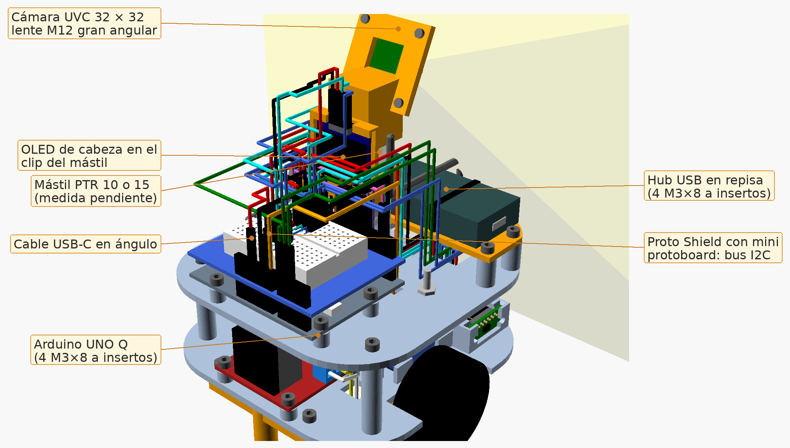
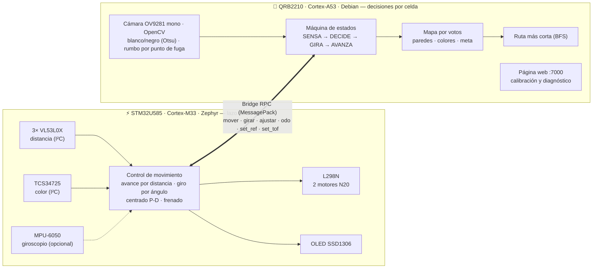
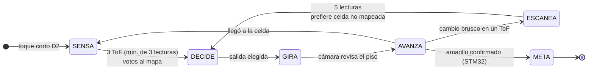
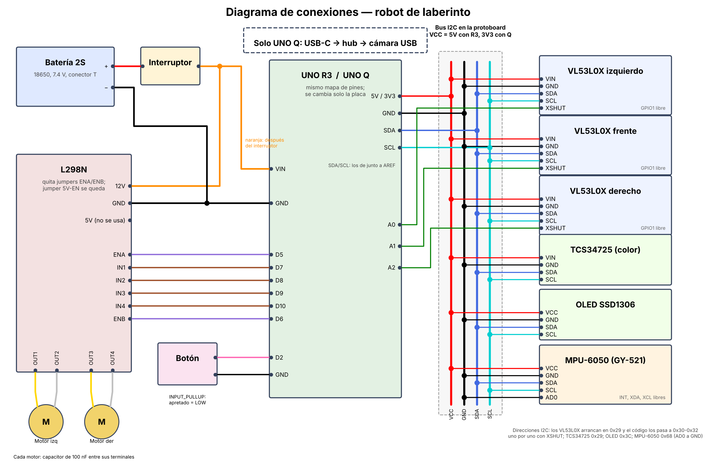

<div align="center">

# 🤖 Robot resolvedor de laberintos

### Microcontroladores 2 · Arduino UNO Q (STM32U585 + Qualcomm QRB2210)




*Robot diferencial de 120 × 120 mm que explora un laberinto desconocido, construye un mapa probabilístico de paredes y colores, se detiene en la meta amarilla y en la siguiente corrida recorre la ruta más corta conocida.*

</div>

---

## 👥 Equipo

| Integrante |
|---|
| **Manuel Harari López** |
| **Víctor Miguel Vázquez** |
| **Carlos Emiliano Escamilla Garibay** |

---

## 📚 Documentación para evaluar el proyecto

Los tres documentos finales están en [`docs/pdf/`](docs/pdf/). Se generan desde los `.md` de [`docs/`](docs/) y son la referencia vigente. Si otro archivo del repositorio no coincide con ellos, los PDF tienen prioridad.

| Documento | Para quién | Contenido |
|---|---|---|
| 📘 [**Manual técnico**](docs/pdf/manual_tecnico.pdf) ([fuente](docs/manual_tecnico.md)) | Evaluación técnica | Arquitectura de dos procesadores, sensado, control, máquina de estados, mapa, parámetros y glosario |
| 📗 [**Manual de uso**](docs/pdf/manual_uso.pdf) ([fuente](docs/manual_uso.md)) | Operación en pista | Encendido, botón, calibración desde la web, ajuste del movimiento y solución de fallas |
| 📙 [**Bitácora de diseño**](docs/pdf/historial_cambios.pdf) ([fuente](docs/historial_cambios.md)) | Proceso de ingeniería | 35 etapas desde la V1: problema, hipótesis, cambio, pruebas, decisiones y lecciones |
| 🛠️ [Manual de armado](docs/manual_ensamble.pdf) · [BOM](docs/bom.csv) · [cables](docs/cables.csv) | Construcción | Ensamble paso a paso, lista de materiales y arnés |
| 🔌 [Diagrama de conexiones](docs/diagrama_conexiones.pdf) | Construcción | Alimentación, puente H, bus I²C y líneas XSHUT |
| 🧭 [Documento técnico de la UNO Q](docs/uno_q.md) · [Guía de programación](docs/GUIA_PROGRAMACION.md) | Referencia | Justificación de la placa y cómo programar ambas iteraciones |

---

## 🎯 El problema

El robot entra a un laberinto de **celdas de 180 mm** que no conoce, con piso negro y paredes de madera pintadas de blanco. En el piso hay marcas de color (rojo, verde, azul) y una **meta amarilla**. El objetivo tiene dos partes:

1. **Exploración:** encontrar la meta sin chocar y, en el camino, registrar paredes y marcas.
2. **Explotación:** en la corrida siguiente, ir del inicio a la meta por el **camino más corto conocido**.

La dificultad no es el algoritmo de búsqueda, que es clásico, sino que todo se hace con **sensores ruidosos y actuadores sin realimentación**. Los motores N20 no tienen encoder, los ToF tienen ±15 mm de error, las paredes no están perfectamente alineadas y la batería cambia la velocidad conforme se descarga. Por eso la mayor parte del trabajo fue de **estimación robusta**: tolerar errores sin que se acumulen.

---

## 🧠 Arquitectura: dos procesadores, dos dominios de tiempo

El Arduino UNO Q integra en una misma placa un **microcontrolador de tiempo real** y un **procesador de aplicaciones con Linux**. Se dividió el trabajo según el **requisito temporal** de cada tarea, no según su complejidad:



| Dominio | Qué corre ahí | Por qué ahí |
|---|---|---|
| **Tiempo real** (STM32) | Lazo de control de 10 ms, lectura de ToF y color, frenado ante pared o amarillo | Necesita latencia determinista. Un GC de Python o una consulta web no pueden retrasar un frenado |
| **Decisión** (Linux) | Máquina de estados, mapa, BFS, visión, persistencia, servidor web | Necesita memoria, archivos, OpenCV y red. Decide **con el robot quieto**, así que su latencia no afecta la dinámica |

**Principio de diseño:** el STM32 ejecuta cada orden de forma **autónoma y segura**. Frena solo a 130 mm de una pared y al confirmar amarillo, sin esperar a Linux. Si el procesador de aplicaciones se retrasa, el robot se queda quieto en lugar de chocar.

---

## 🔁 Máquina de estados



La fase actual se ve en la OLED y en la página web. Eso permite saber **en qué estado se equivocó** el robot, no solo que se equivocó.

---

## 🔬 Decisiones de ingeniería (y por qué)

Cada decisión vino de un fallo observado en pista. La bitácora completa está en [`docs/historial_cambios.md`](docs/historial_cambios.md).

### 1. Avance por distancia en lugar de por tiempo
**Observación:** avanzando "una celda = 600 ms" el robot casi nunca quedaba centrado, y el error crecía conforme se descargaba la batería.
**Causa:** sin encoders, el tiempo es un estimador de distancia que depende del voltaje, del piso y de la carga. Es una integración en lazo abierto, así que el error se acumula.
**Solución:** el ToF frontal es un **sensor absoluto**. El STM32 toma la lectura inicial y detiene el avance cuando la lectura bajó 180 mm. El tiempo queda solo como respaldo cuando no hay pared a menos de 1 m. Así cada celda **re-ancla** la odometría y el error deja de acumularse.

### 2. Votos en el mapa en lugar de sobrescribir
**Observación:** una sola lectura falsa borraba una pared bien vista y el BFS trazaba rutas que la atravesaban.
**Solución:** cada lectura suma **+1 (pared)** o **−1 (libre)** a cada lado de la celda, saturando en ±5. Es en esencia un **filtro de mayoría con histéresis**, una forma discreta del mapa de ocupación log-odds. Una lectura mala no alcanza para revertir tres buenas, y las celdas recorridas quedan como "libre seguro" (−5).

### 3. Umbrales con margen medido
Con la pared en su propia celda el frontal lee ~130 mm, y con la pared una celda más allá, ~310 mm. El umbral original de 150 mm dejaba **20 mm de margen** contra un ruido de ±15 mm. Se movió al punto medio, **220 mm (margen de 90 mm)**. Para los laterales (pared ~50, libre > 200) el umbral de 120 mm deja 70 mm de margen.

### 4. Detección de discontinuidades ("saltos")
Si un ToF lateral cambia ≥ 120 mm **en dos lecturas consecutivas**, se abrió un pasillo. Pedir dos lecturas elimina los picos de una muestra. El robot avanza **124 mm más** (90 mm al centro de celda + 40 mm de adelanto del sensor respecto al eje − 6 mm de media pared, medidos en el CAD) para quedar centrado en la intersección. La discontinuidad también sirve como **landmark** que corrige la posición.

### 5. Calibración lineal de los ToF
Cada sensor se ajusta con **mínimos cuadrados**, `real = a·crudo + b`, a partir de 3 a 5 distancias medidas con vernier y flexómetro desde la página web. Los coeficientes viajan al STM32 y la corrección se aplica **antes** de cualquier umbral.

### 6. Giroscopio para los giros
Por tiempo, los giros de "90°" medían **~70°** en pista. Con el **MPU-6050** (opcional, se detecta solo) el giro se cierra por ángulo integrado, con bias medido al encender (200 muestras), rumbo absoluto acumulado (cada giro corrige el error del anterior) y compensación de inercia (`ADELANTO`). En recta sostiene el rumbo con un control proporcional.

### 7. La cámara como sensor auxiliar, no primario
La primera versión usaba la cámara para ver paredes y el robot **chocaba constantemente**. Desde arriba veía demasiadas paredes, zapatos y reflejos, y no había forma robusta de priorizar. Hoy la cámara **asiste y nunca decide sola**. Es una OV9281 **monocromática con obturador global**: no ve el amarillo (la meta queda en el sensor de color), pero separa muy bien el piso negro de la pared blanca y no deforma la imagen en movimiento. Antes de cada avance toma una foto y:

- **Fija la exposición** (desde la web) para que el gris del piso no cambie con la luz del lugar.
- **Umbral de Otsu:** el histograma piso/pared es bimodal, y Otsu encuentra el corte en cada foto. Si hay blanco en el camino, el robot va lento y el ToF frontal confirma.
- **Rumbo por punto de fuga:** ajusta una recta a la base de cada pared (mínimos cuadrados con rechazo de atípicos). Las dos rectas se cortan en el punto de fuga, cuya columna depende **solo del ángulo** del robot respecto al pasillo, no de su posición lateral ni de la inclinación de la cámara. Con MPU, eso corrige la **deriva del giroscopio** sin girar (fusión tipo filtro complementario). Sin MPU, endereza al robot con un giro corto. En imágenes sintéticas el error fue de ±0.1° entre −12° y 12°.

La versión **experimental** agrega distancia a la pared en 5 columnas, calibrada con el ToF frontal como regla, que funcionan como "ToF virtuales" en diagonal. También detecta aberturas laterales una celda antes de llegar.

### 8. Página web sin interferir con la corrida
Cada consulta web eran 5 a 9 llamadas RPC que competían con el robot por el Bridge y por la cámara. Durante una corrida la página **solo muestra datos en caché** (última lectura y última foto), y la OLED no se refresca en movimiento porque un refresco I²C bloquea ~25 ms.

---

## 📊 Resultados en pista

Pruebas en un laberinto de **2 × 2 m** con paredes de madera pintadas de blanco:

| Aspecto | Resultado | Acción |
|---|---|---|
| Sensor de color calibrado | ✅ Componente más confiable | Se usa como única fuente para la meta |
| Meta amarilla | ✅ La encuentra y se estaciona | Marcas grandes funcionan mejor que líneas delgadas |
| ToF | ✅ ±15 mm, sin lecturas espurias | Umbrales al punto medio + calibración lineal |
| Giros por tiempo | ⚠️ ~70° en vez de 90° | MPU-6050 o ajuste de `MS_90` |
| Avance por tiempo | ⚠️ Inconsistente con la batería | Avance por distancia |
| Cámara para paredes | ❌ Choques por exceso de información | Relegada a asistencia blanco/negro |
| Mano derecha vs. izquierda | Derecha llegó más lejos | Análisis: priorizar "de frente" rompe la garantía del seguidor de pared |
| Autonomía | ~3 h de pruebas continuas | Batería 2S 18650 |

> **Hallazgo:** un seguidor de pared garantiza recorrer todo el muro conexo solo si **siempre** prefiere el lado de su mano. Priorizar "de frente" lo convierte en una heurística que puede ciclar alrededor de islas. Eso explica que con la mano izquierda se quedara atorado y motivó el contador de visitas por celda (3 visitas → salida menos usada).

---

## 🧩 Hardware

<div align="center">

</div>

| Subsistema | Componente | Interfaz |
|---|---|---|
| Cómputo | Arduino UNO Q (STM32U585 + QRB2210) | — |
| Distancia | 3× VL53L0X (izquierda, frente, derecha) | I²C, direcciones 0x30–0x32 asignadas por XSHUT (A0–A2) |
| Color | TCS34725 | I²C 0x29 |
| Orientación | MPU-6050 (opcional) | I²C 0x68, ±500 °/s |
| Pantalla | OLED SSD1306 128×64 | I²C 0x3C |
| Visión | innomaker U20CAM-9281M: OV9281 monocromática 1 MP, obturador global, 120 fps + hub USB-C (adaptador OTG) | USB 2.0 UVC |
| Potencia | L298N + 2 motores N20 | PWM D5/D6, dirección D7–D10 |
| Energía | Batería 2S 18650 (7.4 V) | VIN |

El chasis es **paramétrico en OpenSCAD**. Pasó por entre 20 y 50 iteraciones de geometría y tolerancias, y acepta tanto la UNO Q como la UNO R3 de respaldo sin recablear.

---

## 🗂️ Estructura del repositorio

| Carpeta | Contenido |
|---|---|
| [`uno_q/`](uno_q/) | **Versión actual.** `sketch/` (STM32 con MPU-6050), `python/` (máquina de estados, mapa, cámara 1 a 3, web), `python_experimental/` (igual + distancia y aberturas por cámara) y `assets/` (página web) |
| [`atmega328p/`](atmega328p/) | Iteración A, respaldo: firmware *bare-metal* en C++ para UNO R3 / Nano con flood-fill y mapa en EEPROM |
| [`chasis/`](chasis/) | Modelo OpenSCAD, STL para imprimir, renders y planos (`chasis.pdf`) |
| [`docs/`](docs/) | Manuales, bitácora, BOM, diagramas y scripts que generan los PDF |

---

## 🚀 Inicio rápido

1. Arma el robot con el [manual de armado](docs/manual_ensamble.pdf) y el [diagrama de conexiones](docs/diagrama_conexiones.pdf).
2. En **Arduino App Lab** crea una app y copia un sketch y un Python, más `uno_q/assets/`:

   | Versión | Sketch | Python |
   |---|---|---|
   | Estable | `sketch/` | `python/` |
   | Experimental | `sketch/` | `python_experimental/` |

   Los detalles están en [`uno_q/README.md`](uno_q/README.md).
3. Abre `http://<IP-de-la-placa>:7000` y **calibra colores, sensores de distancia y cámara desde el celular**.
4. Pon el robot en la celda de inicio y da un toque corto al botón D2.

Para regenerar los documentos:

```bash
sh docs/md_pdf.sh
```

```bash
python3 docs/generar_manuales.py
```

```bash
python3 chasis/generar_pdf.py
```
