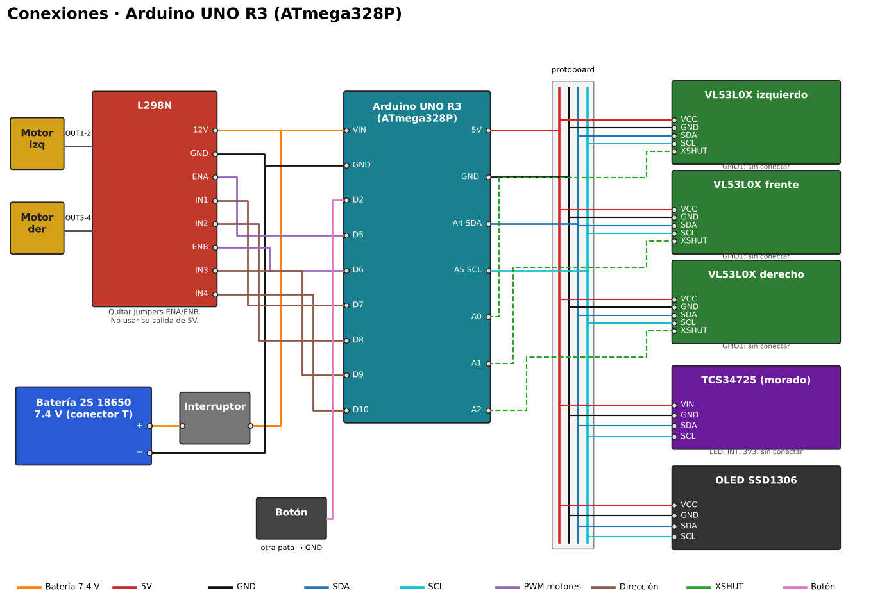

# Iteración A – ATmega328P (Arduino UNO R3)

Todo corre en el ATmega328P: motores, sensores, OLED y flood‑fill. No lleva cámara.

## Conexiones

| Componente | Pin del módulo | UNO R3 |
|---|---|---|
| L298N | ENA (quitar jumper) | D5 |
| L298N | IN1 / IN2 | D7 / D8 |
| L298N | ENB (quitar jumper) | D6 |
| L298N | IN3 / IN4 | D9 / D10 |
| L298N | 12V / GND | Batería + / GND |
| VL53L0X izq / frente / der | XSHUT | A0 / A1 / A2 |
| VL53L0X ×3, TCS34725, OLED | SDA / SCL | A4 / A5 |
| VL53L0X ×3 (VCC), TCS34725 (VIN), OLED | VCC / GND | 5V / GND |
| TCS34725 (morado) | LED / INT | sin conectar (LED siempre encendido) |
| Botón de arranque | a GND | D2 |
| Batería 2S 18650 (conector T) | + | interruptor → VIN |

5V, GND, SDA y SCL se reparten en la mini protoboard de 170 puntos del piso 3: columnas 1, 4, 7 y 10, cada una con un puente entre sus dos mitades.

El Timer1 genera la base de tiempo de 10 ms por interrupción. Por eso los motores usan el PWM de D5/D6 (Timer0) en lugar de D9/D10.

## Programación (Arduino IDE)

1. Abre `laberinto_328p/laberinto_328p.ino`.
2. En el gestor de librerías instala `VL53L0X` (de Pololu) y `SSD1306Ascii` (de Bill Greiman). El sensor de color se maneja con registros I2C directos y no necesita librería.
3. Placa: **Arduino Uno**. Selecciona el puerto y pulsa **Subir**.

Uso de memoria: 18.9 KB de flash (58%) y 1.47 KB de RAM (72%).

## Calibración

Igual que en la iteración B: enciende con el botón presionado para ver color y distancias en la OLED. Copia los valores a `refs[]`, `D_LADO` y `D_FRENTE`. Ajusta `T_CELDA`, `T_RAPIDA` y `T_90` (en ticks de 10 ms) y `AJUSTE_DER`.

## Funcionamiento

- El mapa se guarda en la EEPROM: 1 byte por celda, con paredes, visitada y color de marca. Sobrevive a apagarlo.
- Sin ruta conocida, explora hasta la meta y regresa al inicio. Con ruta conocida, va directo a velocidad alta.
- Botón corto: siguiente corrida. Sostenido más de 2 s: borra mapa y conteo.
- Las marcas se cuentan una sola vez por celda.
