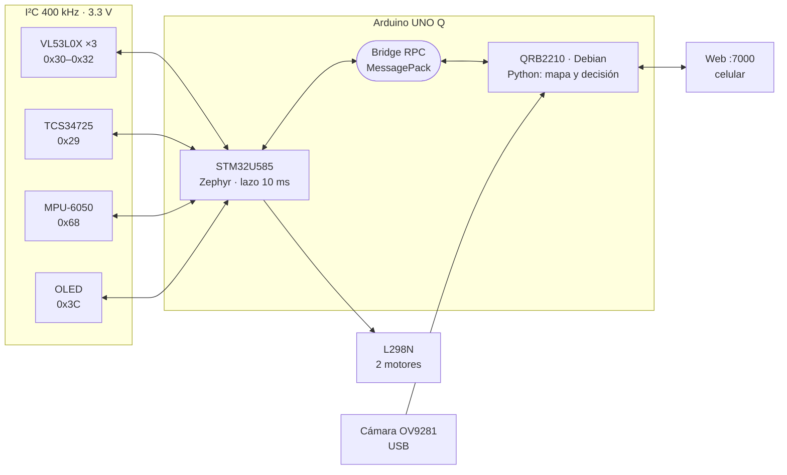
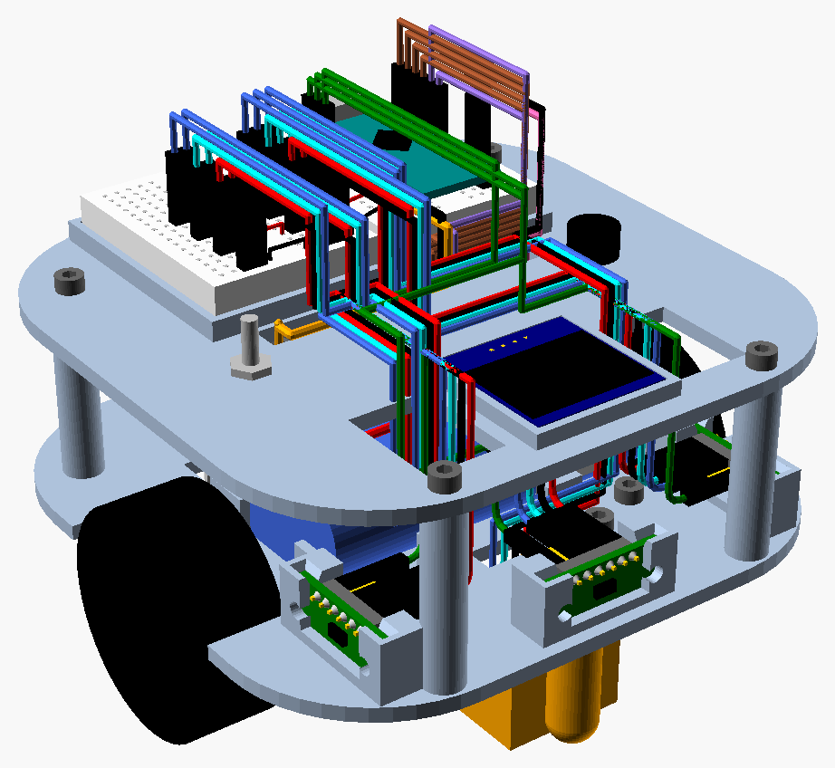
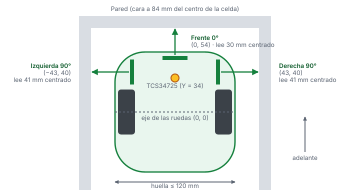
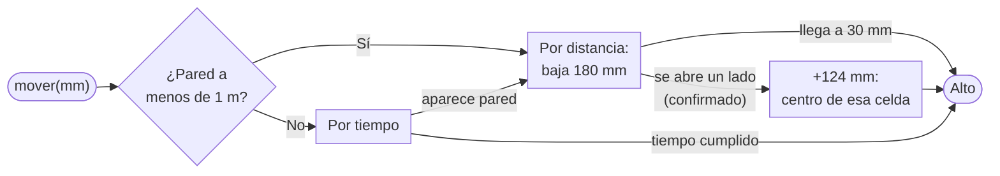
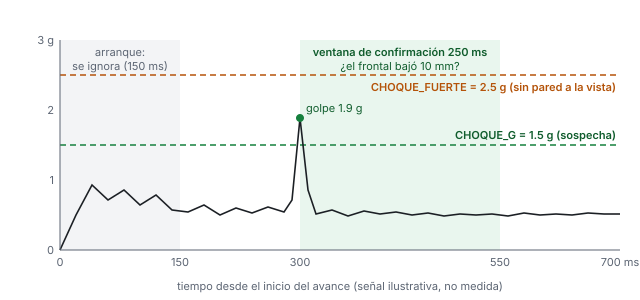
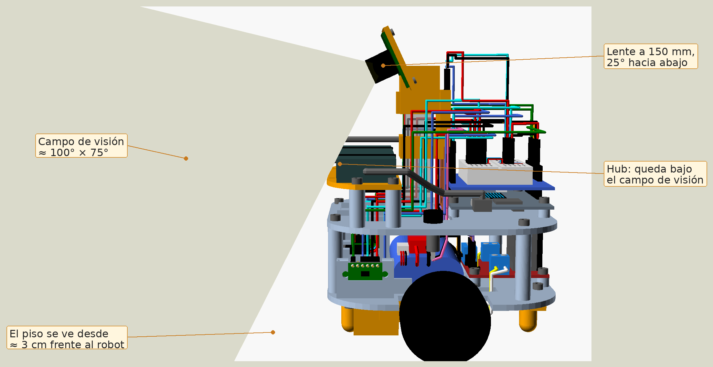
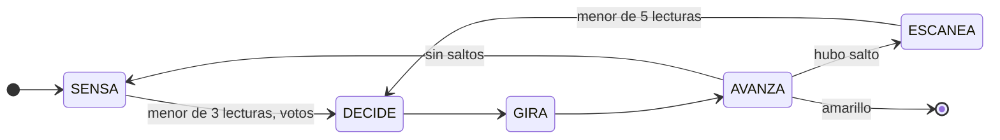
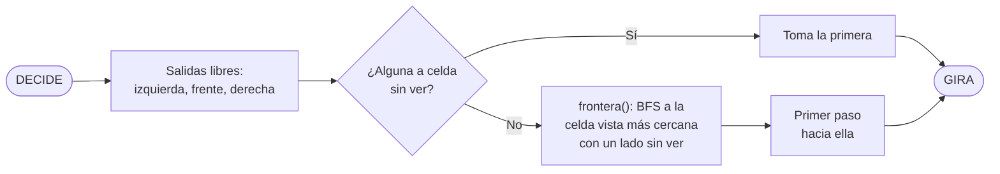
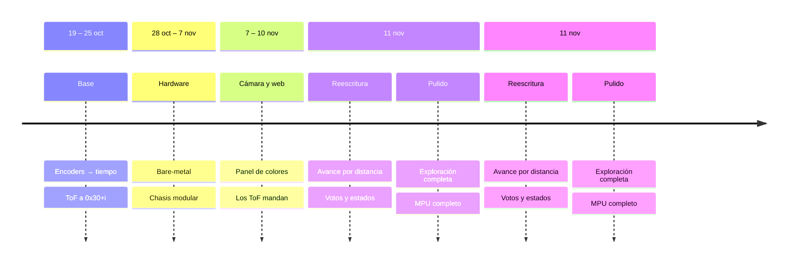

# El reto y nuestra respuesta

::: corto
El robot entra a un laberinto que no conoce, lo explora completo, cuenta las marcas de color del piso y se detiene solo en la **marca amarilla**. En la segunda corrida va directo a la meta por la ruta más corta que conoce. Lo construimos en 46 etapas, del 19 de octubre al 11 de noviembre, probando en una pista de 2 m × 2 m con paredes de madera.
:::

:::: cifras
::: cifra
**2** procesadores en una placa: tiempo real + Linux
:::
::: cifra
**10 ms** ciclo de control en el STM32
:::
::: cifra
**30 / 30** laberintos con meta en isla resueltos en simulación
:::
::: cifra
**±0.1°** error del rumbo por cámara en pruebas sintéticas
:::
::: cifra
**0** encoders: el avance se mide con láser
:::
::: cifra
**46** etapas documentadas en la bitácora
:::
::::

Este manual explica **qué hace distinto a este robot**. No es una lista de piezas: son las decisiones que más trabajamos, por qué las tomamos y cómo las comprobamos.

| Lo que pide el reto | Nuestra respuesta | Página |
|---|---|---|
| Moverse celda por celda sin perderse | Avance medido con el ToF frontal y la geometría exacta del chasis | 5 |
| Girar 90° de verdad y avanzar derecho | MPU-6050 con rumbo absoluto, giros verificados y corrección de deriva | 6 |
| No chocar ni quedarse atorado | Choque confirmado en dos pasos, detección de atorón y de robot levantado | 6 |
| Ver lo que los láser no ven | Cámara monocromática de obturador global que asiste, nunca manda | 7 |
| Encontrar una meta rodeada de paredes | Exploración completa (Trémaux / DFS) con mapa por votos | 8 |
| Ajustar en la pista, sin laptop | Calibración completa desde el celular | 9 |

::: tip
**Cómo leerlo.** Cada capítulo abre con un recuadro **En corto** de pocas líneas. Si solo tienes un minuto por página, léelo y mira la figura.
:::

# Arquitectura: dos cerebros, una placa

::: corto
El Arduino UNO Q tiene un microcontrolador STM32 y un procesador Qualcomm con Linux. Les dimos trabajos separados: el STM32 **ejecuta y protege**; Linux **piensa y mira**. Así ningún retraso de Linux deja al robot fuera de control.
:::

::: figura

**Figura 1. Arquitectura.** Qué mirar: todo lo de tiempo real cuelga del STM32; Linux solo decide, mira con la cámara y sirve la página web.
:::

| | STM32U585 (Cortex-M33) | QRB2210 (Cortex-A53) |
|---|---|---|
| **Sistema** | Zephyr (sketch Arduino) | Debian Linux, Python |
| **Hace** | Motores, 3 ToF, color, MPU-6050, OLED, botón | Máquina de estados, mapa, ruta corta, cámara (OpenCV), web |
| **Garantiza** | Para solo a 30 mm de una pared y **al confirmar el amarillo**, sin esperar a Python | Decide con el robot quieto y lecturas frescas |

**Detalles que cuidamos**

- **Movimientos que no bloquean.** Python pide `mover(mm)` o `girar(k)` por RPC y consulta `ocupado()` y `odo(i)`. El STM32 termina el movimiento por su cuenta.
- **La web no estorba al robot.** Durante una corrida la página **no llama al Bridge**: muestra la última lectura y la última foto. Antes, cada consulta eran 5 a 9 llamadas RPC cada 150 a 300 ms compitiendo con el robot.
- **La OLED no se refresca en movimiento:** tarda unos 25 ms y estorbaría al lazo de 10 ms.
- **Respaldo real:** el mismo chasis acepta un UNO R3 con firmware *bare-metal* propio (registros, sin Arduino core: 42 % de flash contra 58 % del sketch).

# Hardware y chasis a medida

::: corto
Diseñamos el chasis en OpenSCAD, con medidas reales de cada pieza, y comprobamos por computadora que nada choque antes de imprimir. Las posiciones de los sensores en el CAD son las mismas constantes que usa el código.
:::

::: figura
{width=44%}

**Figura 2. Chasis de dos pisos.** Qué mirar: huella de 120 mm, pensada para girar dentro de un pasillo de 180 mm; insertos de latón M3 en lugar de tornillos al plástico.
:::

::: figura
{width=64%}

**Figura 3. Sensores vistos desde arriba.** Qué mirar: de estas coordenadas sale que, centrado en la celda, el frontal lee 30 mm (84 − 54) y cada lateral 41 mm (84 − 43).
:::

| Subsistema | Decisión |
|---|---|
| **Bus I²C a 3.3 V** | 3 ToF, color, OLED y MPU en un solo bus. Los 3 VL53L0X y el TCS34725 traen la misma dirección (0x29): los ToF se encienden uno por uno con XSHUT y se reasignan a 0x30–0x32, sin hardware extra |
| **Medidas reales** | Rueda 45 × 17 mm, motor 12 × 11 mm, módulo ToF de 11 mm. El hueco del motor pasó por 5 valores (11.85 a 12.05 mm) hasta el ajuste a presión |
| **Dos placas, un chasis** | Mismo mapa de pines en UNO Q y UNO R3 vía Proto Shield; solo cambia un puente de VCC (3V3 ↔ 5V) |

# Movimiento sin encoders

::: corto
Los motores N20 no traen encoder y el tiempo deriva con la batería. Por eso el robot **mide la celda con el láser frontal**: anota la distancia al arrancar y para cuando bajó 180 mm. Solo si no ve pared en 1 m avanza por tiempo.
:::

::: {.figura .alta}

**Figura 4. Un avance dentro del STM32.** Qué mirar: todos los caminos terminan en `Alto` sin esperar a Python.
:::

| Técnica | Cómo funciona | Por qué |
|---|---|---|
| **Alto en el centro exacto** | Para a 30 mm reales de la pared; si queda a menos de 25 mm, retrocede. Desde 130 mm frena en proporción | 30 mm es la lectura con el eje justo al centro de la celda (del CAD) |
| **Cambios bruscos** | Si un ToF cambia 120 mm o más **y la siguiente lectura lo confirma**, se abrió un lado: avanza 124 mm más y para en el centro de esa celda para escanearla | Ninguna puerta lateral se pasa de largo; una lectura mala no dispara nada |
| **Centrado en el carril** | Control PD sobre la diferencia de los laterales (con una pared, sobre 41 mm), saturado a ±40 PWM | Antes el robot quedaba 49 mm fuera del centro con una sola pared |
| **Perfil de velocidad** | Rampa de +6 PWM por ciclo y desaceleración en el último cuarto de celda | Las ruedas patinan poco y la medición es estable |
| **Pasillos de un tirón** | Con pared a ambos lados avanza hasta 3 celdas seguidas; si se abre un lado, para ahí | ~9 % menos paradas en simulación y un movimiento más fluido |

::: cuidado
**Limitación reconocida:** en tramos largos sin pared a la vista, el avance por tiempo depende de la batería. La mejora natural son encoders en cuadratura.
:::

# MPU-6050: giros reales, choques confirmados

::: corto
El giroscopio da giros de 90° reales y rumbo recto. El acelerómetro detecta choques, atorones y si alguien levanta el robot. Cada umbral salió de logs de la pista, no de la hoja de datos.
:::

| Función | Cómo funciona |
|---|---|
| **Rumbo absoluto** | Cada giro va a un ángulo deseado acumulado (`ref` ± 90°): el error de un giro se corrige en el siguiente, no se acumula. Corta 6° antes por la inercia |
| **Aprende su montaje** | El signo del sensor se descubre en el primer giro; el sesgo del giroscopio se mide al encender (200 muestras). Funciona como sea que se atornille, siempre que vaya plano |
| **Giros verificados** | Antes de avanzar se endereza si se desvió 3° a 45°. Si un giro quedó a más de 10°, Python lo termina (2 intentos); si quedó muy fuera, acepta el rumbo real y corrige el mapa |
| **Corrige su propia deriva** | Con 2 paredes, centrado y paralelo durante 300 ms, toma el rumbo del pasillo como verdad y corrige la mitad del error del giroscopio |
| **Giro atorado** | 400 ms girando sin moverse 2° significa una esquina trabada: retrocede 200 ms y sigue (hasta 2 veces) |
| **Robot levantado** | Aceleración vertical bajo 0.8 g durante 150 ms: apaga motores y termina la corrida |

::: figura
{width=82%}

**Figura 5. Choque confirmado en dos pasos.** Qué mirar: pasar 1.5 g solo abre una ventana de 250 ms; es choque si en ese tiempo el frontal no bajó 10 mm. Sin pared a la vista solo cuenta un golpe mayor a 2.5 g (curva ilustrativa).
:::

::: tip
**Por qué en dos pasos.** En el log de la pista, la vibración de los motores y el arranque daban golpes de 0.75 a 1.52 g sin chocar. Un umbral solo confundía vibración con choque; confirmar con el ToF lo separa. Al confirmar, retrocede 450 ms y, si quedó pegado a una pared lateral, se aleja antes de seguir.
:::

# Cámara monocromática: asiste, nunca manda

::: corto
Una cámara OV9281 de 1 MP, **sin filtro de color** y con **obturador global**, mira el piso antes de cada avance con una sola foto. El piso negro y las paredes blancas son justo lo que mejor distingue. Si la cámara falla, el robot funciona igual.
:::

::: figura
{width=70%}

**Figura 6. Campo de visión de la cámara.** Qué mirar: la cámara ve el piso desde unos 3 cm frente al robot; por eso detecta paredes antes que los láser laterales.
:::

| Técnica | Cómo funciona |
|---|---|
| **Por qué monocromática** | Sin matriz de Bayer, cada píxel recibe toda la luz: más sensibilidad y menos ruido. El obturador global evita que las líneas se tuerzan al girar. El amarillo lo confirma el sensor de color |
| **Exposición fija** | Con exposición automática, una pared blanca cercana o la ropa del público cambiaban el gris del piso. Se fija desde la web |
| **Umbral automático (Otsu)** | En cada foto elige el umbral que mejor separa piso y pared, tras estirar el contraste y un filtro de mediana 5 × 5. Si ve más de 15 % de blanco en el camino, el robot va lento y el ToF hace el doble check |
| **Rumbo por punto de fuga** | Las bases de las 2 paredes se cortan en un punto cuya columna depende **solo del ángulo** del robot: *θ = atan(k · (x_f − x₀))*. Se calibra girando el robot 15° a mano: no hace falta medir la inclinación ni la lente |
| **Fusión con el MPU** | La cámara no gira el robot: mueve el rumbo deseado y el giroscopio lo sostiene. La cámara corrige la deriva lenta; el giroscopio da la respuesta rápida (filtro complementario) |

**Cómo lo comprobamos.** Con imágenes sintéticas de un pasillo (cámara a 150 mm de altura, 35° hacia abajo, ruido de ±6 niveles de gris), el ángulo medido coincidió con el real **dentro de ±0.1° entre −12° y 12°**, también con el robot descentrado 25 mm y con una pared abierta.

::: ajuste
**Versión experimental (`EXPERIMENTAL = True`).** Cinco "ToF virtuales": la cámara mide la distancia a la pared en 5 columnas, calibrada con el ToF frontal como regla, y ve las diagonales donde los láser no llegan. También detecta aberturas en la celda siguiente. En pruebas sintéticas midió 209, 306, 400 y 517 mm con paredes a 200, 300, 400 y 500 mm.
:::

# Cómo decide: exploración completa

::: corto
El robot decide siempre quieto, con una máquina de estados explícita. Prefiere celdas que no ha visto y, cuando no quedan cerca, regresa por el camino conocido a la más cercana con lados sin explorar. Así entra a una meta rodeada de paredes, donde un seguidor de pared fallaría.
:::

::: figura

**Figura 7. Máquina de estados de Python.** Qué mirar: la fase actual se ve en la OLED y en la web, así cada decisión se puede depurar.
:::

::: figura

**Figura 8. Decisión tipo Trémaux / DFS.** Qué mirar: la rama "sin ver" garantiza recorrer todo; `frontera()` evita rodear una isla para siempre.
:::

| Idea | Detalle |
|---|---|
| **El problema de la isla** | La meta está al centro, con 2 entradas: sus paredes forman una isla separada del muro exterior. Un seguidor de pared la rodea sin entrar. En simulación (30 laberintos de 9 × 9 con isla central de 3 × 3), la mano izquierda llegó **0 de 30** veces; la exploración completa, **30 de 30** |
| **Mapa por votos** | Cada lectura vota pared (+1) o libre (−1) con tope ±5. Una lectura mala no borra lo que vieron las demás; por donde pasó el robot queda libre con certeza |
| **Posición honesta** | La celda sale de los milímetros que de verdad avanzó, no de lo que pidió |
| **Segunda corrida** | Con la meta en el mapa, va por BFS por la ruta corta conocida. Si algo no cuadra, abandona la ruta y sigue explorando desde ahí |
| **Persistencia** | El mapa se guarda con escritura atómica y tolera un archivo roto: un JSON vacío tumbaba la app antes |

# Calibración desde el celular

::: corto
Todo lo que depende de la pista se calibra desde una página web que sirve el propio robot. Sin cables, sin reprogramar y sin copiar números a mano: lo calibrado se guarda en la placa y se carga solo en cada arranque. Fue de lo más útil del proyecto.
:::

| En la página | Qué hace |
|---|---|
| **Asistente de colores** | 5 pasos (piso, rojo, verde, azul, amarillo); cada uno promedia 5 lecturas y se manda al STM32 |
| **Distancia de los ToF** | Un punto a 100 mm con vernier por sensor: corrige el desfase en el STM32, antes de cualquier decisión |
| **Simulador "qué haría"** | Dibuja en vivo lo que mide cada ToF y qué decidiría el robot, sin moverlo |
| **Cámara** | Exposición, "está derecho" y escala en 3 pasos; muestra el camino en rojo (pared) o verde (piso) |
| **Corrida** | Iniciar, detener, borrar el mapa, fase, celda, meta y cronómetro |

**Clasificación de color.** El TCS34725 va dentro de una capucha impresa, con su propio LED. Normalizamos la cromaticidad (*r / (r + g + b)*), que no cambia con la intensidad de la luz, y sumamos un término logarítmico de brillo con peso pequeño, que separa colores de tono parecido como blanco y amarillo:

> *dᵢ = (r̂ − rᵢ)² + (ĝ − gᵢ)² + (b̂ − bᵢ)² + 0.01 · ln²((C + 1) / (Cᵢ + 1))*

Un color cuenta solo si se ve 3 veces seguidas y en la transición piso → color: nunca se cuenta dos veces el mismo cuadro.

::: figura

**Figura 9. Cómo llegamos aquí.** Qué mirar: casi la mitad de las 46 etapas ocurrió el último día, cuando pasamos de reglas por tiempo a medir con los ToF y el MPU.
:::

# Lo que aprendimos

::: corto
Lo más valioso no fue una pieza, sino la forma de trabajar: medir antes de suponer, darle a cada sensor un papel claro y quitar lo que no sirve.
:::

| Lección | De dónde salió |
|---|---|
| **Un número geométrico no sirve si el sensor no lo alcanza** | Un primer `D_FRENTE` de 55 mm nunca se cumplía: el VL53L0X sin calibrar "nunca llegaba a 50". Hoy los umbrales están en milímetros reales, con el sensor calibrado |
| **Los umbrales van a la mitad entre lecturas reales** | Un umbral pegado a una lectura dejaba 20 mm de margen; a la mitad, unos 90 mm por lado contra un ruido de ±15 mm |
| **Cada sensor necesita un papel y una jerarquía** | La cámara pasó de mandar a encarecer, a desempatar y a asistir. Todo se ordenó cuando los ToF quedaron como autoridad sobre las paredes |
| **Una lectura mala no debe cambiar nada sola** | Tres defensas: la menor de 3 lecturas, saltos confirmados en 2 lecturas y votos con tope |
| **Un seguidor de pared solo es completo si siempre prefiere su lado** | Mezclar "frente primero" lo dejó atorado en una zona de la pista |
| **Quitar código también es ingeniería** | Alinear con giros de 5° volvía al robot muy lento y se quitó. Una reescritura quitó unos 500 renglones de `main.py` sin perder capacidad |

::: cuidado
**Lo que mejoraríamos:** encoders en cuadratura para los tramos sin pared, y un puente H MOSFET (TB6612FNG o DRV8833) en lugar del L298N, que pierde 2–3 V y deja 4.5–5 V a los motores.
:::

| Glosario | |
|---|---|
| **ToF** | *Time of Flight*: sensor láser de distancia (VL53L0X) |
| **RPC / Bridge** | Llamada a una función del otro procesador; el Bridge las transporta |
| **DFS / Trémaux** | Exploración que avanza al fondo y prefiere caminos no visitados |
| **BFS** | Búsqueda del camino más corto entre dos celdas |
| **Otsu** | Método que elige solo el umbral que separa dos grupos de gris |
| **Obturador global** | Todos los píxeles se exponen a la vez: la imagen no se tuerce |

::: final
Gracias por su tiempo. Todo el código, el CAD, la bitácora completa y los manuales de uso y técnico están en el repositorio del proyecto.

**Manuel Harari López · Víctor Miguel Vázquez · Carlos Emiliano Escamilla Garibay**
Microcontroladores 2 · 2026
:::
