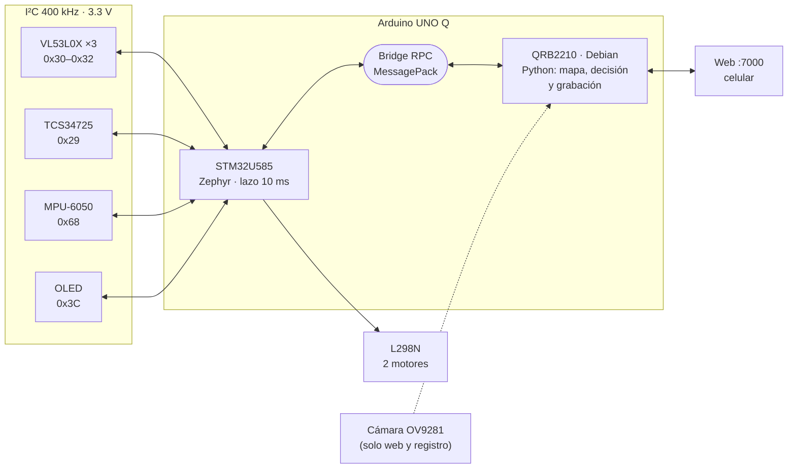
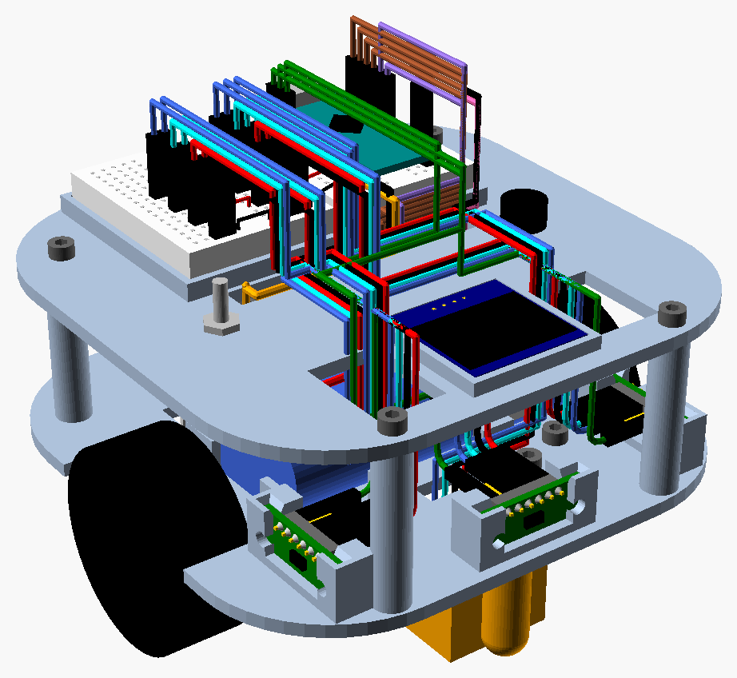
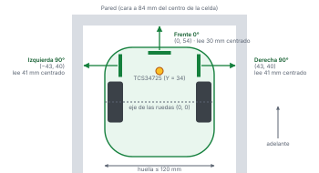
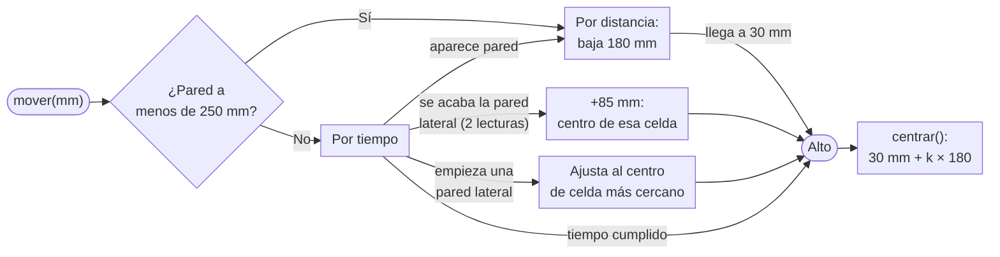
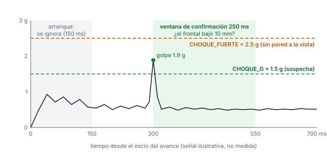
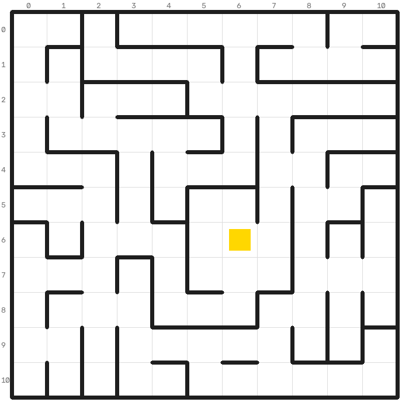
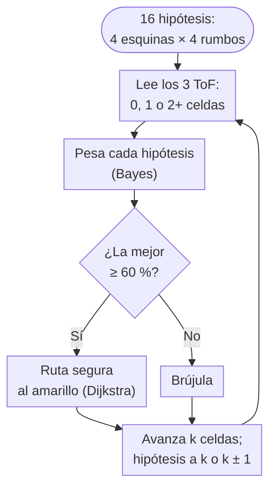

# El reto y nuestra respuesta

::: corto
El robot sale de **cualquier esquina** de un laberinto de 11 × 11 celdas y llega a la **marca amarilla** del centro, donde se detiene solo. No sabe de qué esquina sale ni hacia dónde mira: **se ubica solo** comparando lo que ven sus sensores con el mapa de la pista. La versión que compitió (v2) parte de una idea: **sin encoders, los milímetros avanzados son una suposición; las paredes no.** Quedó en **2.º lugar**; su mejor corrida llegó al amarillo en **2:06.4**.
:::

:::: cifras
::: cifra
**2.º** lugar en la competencia
:::
::: cifra
**2:06.4** mejor corrida, de la esquina al amarillo
:::
::: cifra
**98–100 %** llegadas simuladas por salida (300 corridas), contra 34–81 % de la v1
:::
::: cifra
**16** ubicaciones posibles al arrancar; el robot descubre cuál es la suya
:::
::: cifra
**0** encoders: las orillas de pared marcan las celdas
:::
::: cifra
**59** etapas documentadas en la bitácora
:::
::::

Este manual explica **qué hace distinto a este robot**. No es una lista de piezas: son las decisiones que más trabajamos, por qué las tomamos y cómo las comprobamos. El código del robot que compitió está en `uno_q_v2/`; la versión anterior (`uno_q/`, v1) se conserva sin cambios para comparar.

| Lo que pide el reto | Nuestra respuesta | Página |
|---|---|---|
| Que nada se salga de control | Dos procesadores: el STM32 ejecuta y frena solo; Linux decide | 3 |
| Moverse celda por celda sin encoders | Las orillas de pared son la regla; el frontal solo se usa de cerca | 5 |
| Girar 90° de verdad y no chocar | MPU-6050 con rumbo corregido por una sola pared lateral | 6 |
| Saber dónde está sin odometría confiable | Patrón pared/abertura contra el mapa y ruta segura (Dijkstra) | 7 |
| Elegir reglas con datos, no a ojo | Simulador 2D con las funciones reales y repetición de corridas grabadas | 8 |
| Ajustar en la pista, sin laptop | Calibración completa desde el celular | 9 |

::: tip
**Cómo leerlo.** Cada capítulo abre con un recuadro **En corto** de pocas líneas. Si solo tienes un minuto por página, léelo y mira la figura. La corrida de la competencia se puede ver en `docs/video/corrida2.mp4` (37 s, a 4x) y en la animación `docs/corrida2.html`, ambas en el repositorio: <https://github.com/Happenedspice17/sumo-v-ia>.
:::

# Arquitectura: dos cerebros, una placa

::: corto
El Arduino UNO Q tiene un microcontrolador STM32 y un procesador Qualcomm con Linux. Les dimos trabajos separados: el STM32 **ejecuta y protege**; Linux **piensa** y **graba**. Así ningún retraso de Linux deja al robot fuera de control.
:::

::: figura

**Figura 1. Arquitectura.** Qué mirar: todo lo de tiempo real cuelga del STM32; Linux decide, graba cada corrida y sirve la página web.
:::

| | STM32U585 (Cortex-M33) | QRB2210 (Cortex-A53) |
|---|---|---|
| **Sistema** | Zephyr (sketch Arduino) | Debian Linux, Python |
| **Hace** | Motores, 3 ToF, color, MPU-6050, OLED, botón | Máquina de estados, autolocalización, ruta, grabación, web |
| **Garantiza** | Para solo a 30 mm de una pared, en la orilla de cada celda y **al confirmar el amarillo**, sin esperar a Python | Decide con el robot quieto y lecturas frescas |

**Detalles que cuidamos**

- **Movimientos que no bloquean.** Python pide `mover(mm)`, `girar(k)` o `centrar()` por RPC y consulta `ocupado()` y `odo(i)`. El STM32 termina el movimiento por su cuenta.
- **La web no estorba al robot.** Durante una corrida la página **no llama al Bridge**: muestra la última lectura.
- **Reloj que no salta.** En la primera corrida en pista el registro marcó 908 s, pero fueron unos 383 s: el reloj de la placa saltó 525 s al tomar la hora de la red. Desde entonces los tiempos usan `time.monotonic()`.
- **Máquina de estados explícita** en Python: `SENSA → DECIDE → GIRA → AVANZA` (`ESCANEA` tras un cambio brusco). La fase se ve en la OLED y en la web.
- **Dos versiones, una placa.** La v2 se carga como otra app de App Lab ("Laberinto v2"); la v1 queda intacta. El mismo chasis acepta además un UNO R3 con firmware *bare-metal* propio (42 % de flash contra 58 % del sketch).

# Hardware y chasis a medida

::: corto
Diseñamos el chasis en OpenSCAD, con medidas reales de cada pieza, y comprobamos por computadora que nada choque antes de imprimir. Las posiciones de los sensores en el CAD son las mismas constantes que usan el código y el simulador: de ellas salen, por ejemplo, los 85 mm que avanza tras acabarse una pared.
:::

::: figura
{width=44%}

**Figura 2. Chasis de dos pisos.** Qué mirar: huella de 120 mm, pensada para girar dentro de un pasillo de 180 mm; insertos de latón M3 en lugar de tornillos al plástico.
:::

::: figura
{width=64%}

**Figura 3. Sensores vistos desde arriba.** Qué mirar: de estas coordenadas sale que, centrado en la celda, el frontal lee 30 mm (84 − 54) y cada lateral 41 mm (84 − 43).
:::

| Subsistema | Decisión |
|---|---|
| **Bus I²C a 3.3 V** | 3 ToF, color, OLED y MPU en un solo bus. Los 3 VL53L0X y el TCS34725 traen la misma dirección (0x29): los ToF se encienden uno por uno con XSHUT y se reasignan a 0x30–0x32, sin hardware extra |
| **Medidas reales** | Rueda 45 × 17 mm, motor 12 × 11 mm, módulo ToF de 11 mm. El hueco del motor pasó por 5 valores (11.85 a 12.05 mm) hasta el ajuste a presión |
| **Dos placas, un chasis** | Mismo mapa de pines en UNO Q y UNO R3 vía Proto Shield; solo cambia un puente de VCC (3V3 ↔ 5V) |

# Movimiento sin encoders

::: corto
Los motores N20 no traen encoder y el tiempo deriva con la batería. En la v2 **las orillas de pared son la regla**: cada vez que una pared lateral empieza o se acaba, el robot está en la orilla de una celda. El tiempo solo dice cuántas celdas avanzó. El láser frontal se usa **solo de cerca** (menos de 250 mm), donde de verdad ve la pared de enfrente.
:::

::: {.figura .alta}

**Figura 4. Un avance dentro del STM32.** Qué mirar: todos los caminos terminan en `Alto` sin esperar a Python; las orillas de pared corrigen lo que el tiempo supone.
:::

| Técnica | Cómo funciona | Por qué |
|---|---|---|
| **Orilla de pared = orilla de celda** | Si una pared lateral se acaba, avanza 85 mm más y para al centro de esa celda (`TRAS_SALTO`). Si empieza, lo que falta se ajusta al centro de celda más cercano (`TRAS_CIERRA`, 115 mm) | Las paredes están donde dice el mapa; los milímetros por tiempo no |
| **Orillas por umbral, no por salto** | Pared de carril por debajo de 75 mm, se acaba por encima de 95 mm, con 2 lecturas seguidas. En la v1 era un salto de 120 mm | Se detecta antes y una lectura mala no dispara nada |
| **Frontal solo de cerca** | `RANGO` y `CENTRA_F` bajaron de 600 a 250 mm | Su cono de 25° ve las paredes laterales: en pista leyó 407 mm con la pared real a 4 celdas |
| **Centrado solo con su carril** | Control proporcional sobre los laterales, pero solo con paredes a menos de 95 mm | Al pasar una abertura, el lateral ve la pared del pasillo perpendicular a 80–120 mm; centrarse con eso jalaba al robot hacia la abertura hasta chocar |
| **Alto en el centro exacto** | Para a 30 mm reales de la pared; si queda a menos de 25 mm, retrocede | 30 mm es la lectura con el eje justo al centro de la celda (del CAD) |
| **Pasillos de un tirón** | Con pared a ambos lados avanza hasta 3 celdas seguidas; si se abre un lado, para ahí | Menos paradas y un movimiento más fluido |

::: ajuste
**Se calibra en pista:** `TRAS_SALTO` (85 mm). Se deja que pare en una abertura lateral y se mide: si queda adelantado del centro de la celda, se baja; si queda atrás, se sube. En simulación sirve de 75 a 95 mm; con 105 ya falla.
:::

# MPU-6050: giros reales, rumbo con las paredes

::: corto
El giroscopio da giros de 90° reales y rumbo recto. Pero el giroscopio deriva, así que en la v2 **la pared lateral corrige el rumbo** mientras avanza, sin detenerse. El acelerómetro detecta choques, atorones y si alguien levanta el robot.
:::

| Función | Cómo funciona |
|---|---|
| **Rumbo absoluto** | Cada giro va a un ángulo deseado acumulado (`ref` ± 90°): el error de un giro se corrige en el siguiente, no se acumula |
| **Rumbo con una sola pared** | En 300 ms junto a una pared, lo que cambia su lectura contra lo que avanzó es el ángulo real; la diferencia con el giroscopio es deriva y se corrige 30 % por ventana. Actúa hasta 30° (en pista el rumbo deseado llegó a quedar 21° chueco) |
| **Deriva en reposo** | Quieto, vuelve a medir el sesgo del giroscopio |
| **Signo guardado** | El sentido del montaje se aprende en el primer giro y se guarda en `datos/mpu.json`. En la primera corrida, sin guardarlo, el primer tramo fue sin rumbo y se desvió ~18° en 27 cm |
| **Ajuste entre motores aprendido** | Al terminar cada avance, si el desvío medio fue ≥ 4°, suma 0.5 PWM por grado a un ajuste fijo entre motores (tope 40). Se agregó tras la segunda corrida, donde en casi cada avance se iba 5 a 15° a la izquierda con la corrección al tope |
| **Giros verificados** | Antes de avanzar se endereza si se desvió; si un giro quedó a más de 10°, Python lo termina. Al perderse, `cuadrar()` barre ±35° y deja el rumbo perpendicular a la pared |
| **Giro atorado / levantado** | 400 ms girando sin moverse: retrocede y sigue. Vertical bajo 0.8 g durante 150 ms: apaga motores |

::: figura
{width=82%}

**Figura 5. Choque confirmado en dos pasos.** Qué mirar: pasar 1.5 g solo abre una ventana de 250 ms; es choque si en ese tiempo el frontal no bajó 10 mm. Sin pared a la vista solo cuenta un golpe mayor a 2.5 g (curva ilustrativa).
:::

::: tip
**Por qué en dos pasos.** En el log de la pista, la vibración de los motores daba golpes de 0.75 a 1.52 g sin chocar; confirmar con el ToF lo separa. El límite también quedó a la vista: en la segunda corrida hubo dos roces contra puntas de pared (el frontal cayó a 5–20 mm y el rumbo saltó 25°) que el MPU no marcó como choque.
:::

# Se ubica solo en la pista

::: corto
Sin encoders, la posición se desfasa con cada avance y cada golpe. Por eso el robot **no confía en su odometría para saber dónde está**: trae el mapa de la pista y compara el **patrón pared/abertura** que ven sus láser con lo que vería en cada lugar posible. Ya ubicado, no va por el camino más corto sino por el **más seguro**.
:::

:::: dos
::: figura
{width=100%}

**Figura 6. La pista, sacada de las fotos.** Qué mirar: el amarillo (6, 6) está dentro de un cuarto con 2 entradas; un seguidor de pared lo rodearía sin entrar.
:::

::: figura

**Figura 7. Localización de Markov.** Qué mirar: el ciclo nunca supone que el avance fue exacto; cada lectura vuelve a decidir qué hipótesis sobrevive.
:::
::::

| Situación | Qué hace el robot |
|---|---|
| **Cada lectura** | Cada ToF solo distingue 0, 1 o "2 o más" celdas libres (`VE`): más lejos la distancia no dice nada del pasillo. Coincidir pesa 0.7; ver de menos (puede ser una punta de pared) 0.25; ver de más, 0.1 o 0.02 |
| **Ubicación segura** (≥ 60 %) | Va por la **ruta segura**: Dijkstra con costo 1 por celda, + 0.5 por lado sin pared y + 1 por giro. En esta pista sale casi igual a la más corta |
| **Se pierde** | Se vuelve a ubicar en toda la pista (hasta 10 veces) en lugar de rendirse; mientras, decide la **brújula**: la salida libre que más apunta al centro |
| **El mapa no coincide** | Ya no lo corrige (`CAMBIA_MAPA = False`): en la primera corrida, 2 "cambios de pista" falsos corrompieron el mapa |
| **Medias vueltas** | Entre 2 paredes con los lados libres ya no encadena medias vueltas (hubo 5 seguidas en la primera corrida); decide la brújula |

::: cuidado
**La cámara como mapa del piso: lista, pero apagada.** La OV9281 ve desde arriba y hacia adelante; en cada columna, el primer blanco desde abajo es la base de la pared más cercana, y con la altura (162 mm) y la inclinación (40°) del lente ese pixel es un punto del piso. De ahí salen las celdas libres al frente (correctas en 99 % en simulación) y pared/abertura en las 2 celdas de adelante. En la primera corrida, el piso negro brillante reflejó la luz como paredes falsas, así que en la competencia **la cámara solo se vio en la web y quedó en el registro** (`CAM_LOC = False`). Que ayude a ubicarse sigue sin probar en pista.
:::

# Un simulador para elegir las reglas

::: corto
En vez de afinar a ojo en la pista, construimos un **simulador 2D** que usa las **funciones reales** de `main.py`. Cuando el simulador hizo que el frontal viera las paredes laterales, como en el log de pista, **por fin reprodujo la falla real de la v1**. Con eso se eligieron las reglas de la v2.
:::

| El simulador modela | Cómo |
|---|---|
| **Robot** | 120 mm con esquinas R30 y física de los motores, calibrada con la pista |
| **ToF** | En sus posiciones del CAD, con ruido, fallas y cono; el frontal ve las paredes laterales (`ROZA`) |
| **MPU-6050** | Giroscopio con deriva y golpes de vibración sacados de los logs reales |
| **Cámara** | Rayos sobre el piso con ruido de pixel, columnas sin dato, fotos malas y error de inclinación |
| **Pista** | La pista real, desde cada una de las salidas de las fotos; "prueba de tontos" con condiciones peores |

| Salida (300 corridas cada una) | v1 | v2 | v2, prueba de tontos |
|---|---|---|---|
| Abajo-derecha (10,10) viendo izquierda | 76 % | **100 %, 19 s** | 98 % |
| Abajo-derecha (10,10) viendo arriba | 81 % | **99 %, 23 s** | 97 % |
| Abajo-izquierda (0,10) viendo arriba | 59 % | **99 %, 23 s** | 97 % |
| Arriba-izquierda (0,0) viendo derecha | 60 % | **99 %, 26 s** | 98 % |
| Arriba-izquierda (0,0) viendo abajo | 67 % | **100 %, 24 s** | 95 % |
| Arriba-derecha (10,0) viendo izquierda | 34 % | **98 %, 28 s** | 92 % |

**Grabar y repetir.** Cada corrida deja en `/app/datos/logs/` su texto y un `..._crudo.csv`: unas 20 lecturas por segundo (3 ToF, desvío del giroscopio, mm) y cada decisión, giro y avance. `sim/repite.py` la reproduce contra el mapa: qué vio, dónde creía estar y qué decidió. Así se diagnosticaron las corridas en pista y se reconstruyó la de la competencia (`sim/reconstruye.py`).

::: ajuste
**Lo que no importó:** en la etapa de la v1 el simulador mostró que los umbrales de los láser casi no movían el resultado (±5 puntos): pared lateral entre 90 y 150 mm, salto entre 80 y 180 mm, votos entre 3 y 8. En la v2, `TRAS_CIERRA` da igual de 105 a 135 mm y la cámara no cambia las llegadas en condiciones normales (98–100 % con y sin ella). Saber qué **no** mover también ahorró horas de pista.
:::

::: tip
**Antes del simulador:** probamos exploración completa (Trémaux) con el mapa que el robot construye. Funciona si la posición es exacta, pero con la odometría desfasada da vueltas sobre celdas que cree nuevas. Por eso pasamos a la autolocalización, y de ahí a confiar en las paredes en vez de en los milímetros.
:::

# Calibración desde el celular

::: corto
Todo lo que depende de la pista se calibra desde una página web que sirve el propio robot. Sin cables, sin reprogramar y sin copiar números a mano: lo calibrado se guarda en la placa y se carga solo en cada arranque.
:::

| En la página | Qué hace |
|---|---|
| **Asistente de colores** | 5 pasos (piso, rojo, verde, azul, amarillo); cada uno promedia 5 lecturas y se manda al STM32 |
| **Distancia de los ToF** | Un punto a 100 mm con vernier por sensor: corrige el desfase en el STM32, antes de cualquier decisión |
| **Avance por tiempo** | Avanza 10 cm por tiempo, mides con regla y guardas: ajusta los milisegundos por celda |
| **Cámara e inclinación** | Robot derecho frente a una pared a 15–40 cm: fija la inclinación del lente; la página muestra dónde ve la base de las paredes |
| **Corrida** | Iniciar, detener, borrar el mapa, fase, celda, meta y cronómetro grande |

**Clasificación de color.** El TCS34725 va dentro de una capucha impresa, con su propio LED. Normalizamos la cromaticidad (*r / (r + g + b)*), que no cambia con la intensidad de la luz, y sumamos un término logarítmico de brillo con peso pequeño, que separa colores de tono parecido como blanco y amarillo:

> *dᵢ = (r̂ − rᵢ)² + (ĝ − gᵢ)² + (b̂ − bᵢ)² + 0.01 · ln²((C + 1) / (Cᵢ + 1))*

Un color cuenta solo si se ve 3 veces seguidas y en la transición piso → color. El amarillo es la meta: el STM32 para en cuanto lo confirma.

::: cuidado
**Lo que nos costó puntos.** En la competencia los colores no quedaron bien calibrados y eso restó puntos, aunque el robot llegó y paró en el amarillo. La calibración de color en la pista, con su luz, es un paso que no se puede saltar.
:::

# Lo que aprendimos

::: corto
Lo más valioso no fue una pieza, sino la forma de trabajar: medir antes de suponer, grabar cada corrida, reproducirla en el simulador y quitar lo que no sirve. De la primera corrida en pista a la competencia pasamos de unos 383 s a 2:06.4.
:::

| Corrida | Tiempo al amarillo | Qué enseñó el registro |
|---|---|---|
| Primera en pista, v2 (13-nov) | ~383 s | Signo del giroscopio sin guardar, rumbo hasta 21° chueco, mapa corrompido por "cambios" falsos, 5 medias vueltas seguidas, 8 pérdidas y 9 choques, reflejos en la cámara |
| Segunda, con esas correcciones | **2:06.4 (2.º lugar)** | Se va 5 a 15° a la izquierda en casi cada avance: de ahí el ajuste entre motores aprendido |

| Lección | De dónde salió |
|---|---|
| **Sin encoders, los mm son una suposición; las paredes no** | La v1 contaba celdas con el frontal y se perdía. La v2 usa las orillas de pared como regla: de 34–81 % a 98–100 % de llegadas simuladas |
| **El cono del sensor importa más que su precisión** | El frontal leyó 407 mm con la pared a 4 celdas porque su cono de 25° ve puntas de pared. Se usa solo de cerca y cada ToF dice solo 0, 1 o "2 o más" celdas |
| **Grabar todo y repetir** | Con el CSV de cada corrida y `repite.py` se encontraron el reloj que saltó 525 s, el rumbo chueco y el motor más débil, sin adivinar |
| **El simulador debe fallar como la pista** | Hasta que el frontal vio las laterales en simulación, la v1 parecía buena. Reproducir la falla real fue lo que permitió corregirla |
| **Cada sensor necesita un papel y una jerarquía** | De cerca manda el ToF; la cámara se diseñó para pesar solo cuando el frontal dice "2 o más", y para competir se dejó solo en la web porque los reflejos del piso la engañaron |
| **Quitar también es ingeniería** | Corregir el mapa en marcha y la corrección de rumbo por cámara se apagaron porque en pista o en simulación no ayudaban |

::: cuidado
**Lo que mejoraríamos:** calibrar los colores en la pista antes de competir; encoders en cuadratura para los tramos sin pared, y un puente H MOSFET (TB6612FNG o DRV8833) en lugar del L298N, que pierde 2–3 V. El recorrido del video es una **reconstrucción**: el camino más probable sobre el mapa que cuadra con lo que leyeron los láser en cada decisión; sin encoders no hay una trayectoria medida.
:::

| Glosario | |
|---|---|
| **ToF** | *Time of Flight*: sensor láser de distancia (VL53L0X) |
| **RPC / Bridge** | Llamada a una función del otro procesador; el Bridge las transporta |
| **Orilla de pared** | Punto donde una pared lateral empieza o se acaba; coincide con la orilla de una celda |
| **Hipótesis** | Una posible ubicación (celda y rumbo) del robot, con su probabilidad |
| **Localización de Markov** | Pesar cada hipótesis con Bayes tras cada lectura y moverla con cada avance |
| **Dijkstra** | Camino de menor costo; aquí el costo castiga lados abiertos y giros (ruta segura) |
| **Brújula** | Respaldo: la salida libre que más apunta al centro, sin mapa |

::: final
Gracias por su tiempo. Todo el código (v1 y v2), el CAD, el simulador, los registros de las corridas, el video, la bitácora completa y los manuales de uso y técnico están en el repositorio del proyecto: <https://github.com/Happenedspice17/sumo-v-ia>

**Manuel Harari López · Víctor Miguel Vázquez · Carlos Emiliano Escamilla Garibay**
Microcontroladores 2 · 2026
:::
