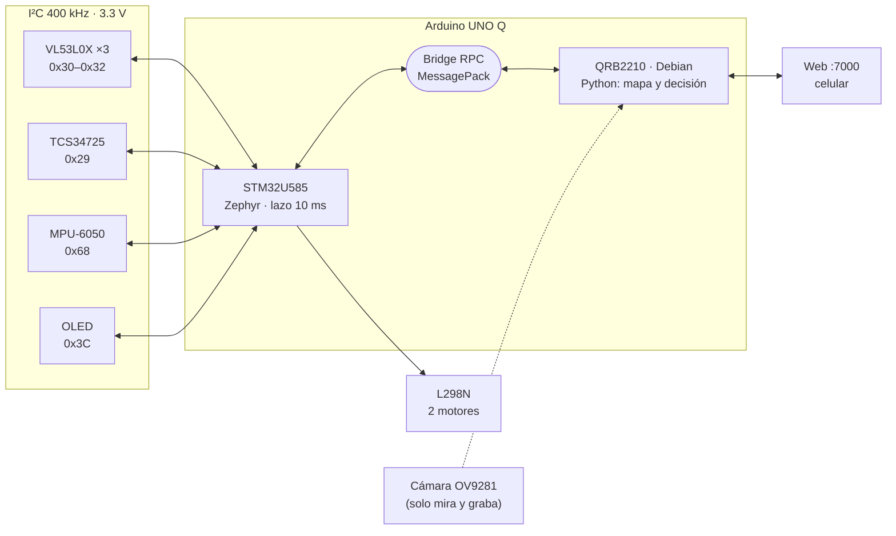
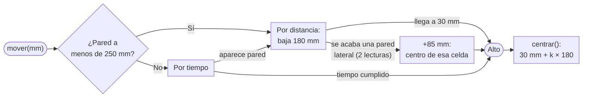
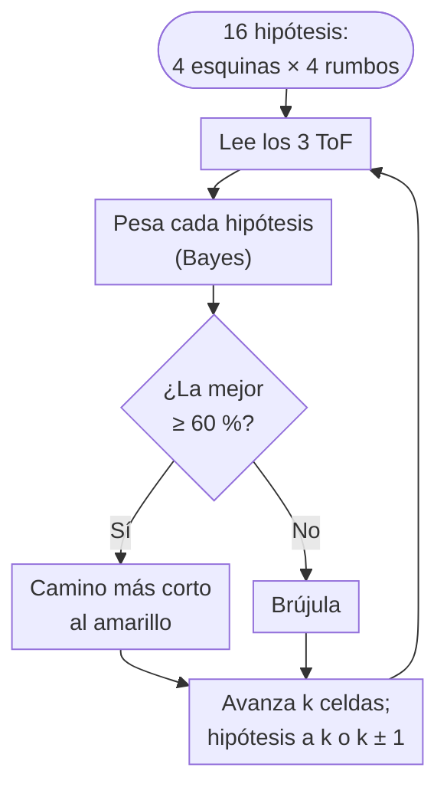

# El reto y nuestra respuesta

::: corto
El robot sale de **cualquier esquina** de un laberinto de 11 × 11 celdas y llega a la **marca amarilla** del centro, donde se detiene solo. En el camino cuenta las marcas de color del piso. No sabe de qué esquina sale ni hacia dónde mira: **se ubica solo** comparando lo que ven sus sensores con el mapa de la pista. Lo construimos en 52 etapas más una segunda versión (v2) hecha tras las primeras pruebas en pista, del 19 de octubre al 14 de noviembre. **En la competencia quedó en 2.º lugar: llegó al amarillo en 6:23 y luego en 2:06.4.**
:::

:::: cifras
::: cifra
**16** ubicaciones posibles al arrancar; el robot descubre cuál es la suya
:::
::: cifra
**98–100 %** llegadas al amarillo en la pista simulada (300 corridas por salida)
:::
::: cifra
**2:06.4** mejor tiempo real al amarillo, sin encoders
:::
::: cifra
**0** encoders: el avance se mide con láser
:::
::: cifra
**10 ms** ciclo de control en el STM32
:::
::: cifra
**52** etapas documentadas en la bitácora
:::
::::

Este manual explica **qué hace distinto a este robot**. No es una lista de piezas: son las decisiones que más trabajamos, por qué las tomamos y cómo las comprobamos.

| Lo que pide el reto | Nuestra respuesta | Página |
|---|---|---|
| Que nada se salga de control | Dos procesadores: el STM32 ejecuta y frena solo; Linux decide | 3 |
| Moverse celda por celda sin encoders | Las orillas de las paredes laterales hacen de regla; el láser frontal solo de cerca | 5 |
| Girar 90° de verdad y no chocar | MPU-6050: rumbo absoluto, giros verificados, choque confirmado | 6 |
| Saber dónde está sin odometría confiable | Autolocalización en el mapa de la pista; si se pierde, se cuadra con la pared y se re-ubica (hasta 10 veces) | 7 |
| Elegir reglas con datos, no a ojo | Simulador 2D con las funciones reales del robot | 8 |
| Ajustar en la pista, sin laptop | Calibración completa desde el celular | 9 |

::: tip
**Cómo leerlo.** Cada capítulo abre con un recuadro **En corto** de pocas líneas. Si solo tienes un minuto por página, léelo y mira la figura.
:::

# Arquitectura: dos cerebros, una placa

::: corto
El Arduino UNO Q tiene un microcontrolador STM32 y un procesador Qualcomm con Linux. Les dimos trabajos separados: el STM32 **ejecuta y protege**; Linux **piensa**. Así ningún retraso de Linux deja al robot fuera de control.
:::

::: figura

**Figura 1. Arquitectura.** Qué mirar: todo lo de tiempo real cuelga del STM32; Linux decide y sirve la página web.
:::

| | STM32U585 (Cortex-M33) | QRB2210 (Cortex-A53) |
|---|---|---|
| **Sistema** | Zephyr (sketch Arduino) | Debian Linux, Python |
| **Hace** | Motores, 3 ToF, color, MPU-6050, OLED, botón | Máquina de estados, autolocalización, mapa, web |
| **Garantiza** | Para solo a 30 mm de una pared y **al confirmar el amarillo**, sin esperar a Python | Decide con el robot quieto y lecturas frescas |

**Detalles que cuidamos**

- **Movimientos que no bloquean.** Python pide `mover(mm)`, `girar(k)` o `centrar()` por RPC y consulta `ocupado()` y `odo(i)`. El STM32 termina el movimiento por su cuenta.
- **La web no estorba al robot.** Durante una corrida la página **no llama al Bridge**: muestra la última lectura. Antes, cada consulta eran 5 a 9 llamadas RPC cada 150 a 300 ms compitiendo con el robot.
- **La OLED no se refresca en movimiento:** tarda unos 25 ms y estorbaría al lazo de 10 ms.
- **Máquina de estados explícita** en Python: `SENSA → DECIDE → GIRA → AVANZA` (`ESCANEA` tras un cambio brusco). La fase se ve en la OLED y en la web, así cada decisión se puede depurar.
- **Respaldo real:** el mismo chasis acepta un UNO R3 con firmware *bare-metal* propio (registros, sin Arduino core: 42 % de flash contra 58 % del sketch).

# Hardware y chasis a medida

::: corto
Diseñamos el chasis en OpenSCAD, con medidas reales de cada pieza, y comprobamos por computadora que nada choque antes de imprimir. Las posiciones de los sensores en el CAD son las mismas constantes que usan el código y el simulador.
:::

::: figura
{width=44%}

**Figura 2. Chasis de dos pisos.** Qué mirar: huella de 120 mm, pensada para girar dentro de un pasillo de 180 mm; insertos de latón M3 en lugar de tornillos al plástico.
:::

::: figura
{width=64%}

**Figura 3. Sensores vistos desde arriba.** Qué mirar: de estas coordenadas sale que, centrado en la celda, el frontal lee 30 mm (84 − 54) y cada lateral 41 mm (84 − 43).
:::

| Subsistema | Decisión |
|---|---|
| **Bus I²C a 3.3 V** | 3 ToF, color, OLED y MPU en un solo bus. Los 3 VL53L0X y el TCS34725 traen la misma dirección (0x29): los ToF se encienden uno por uno con XSHUT y se reasignan a 0x30–0x32, sin hardware extra |
| **Medidas reales** | Rueda 45 × 17 mm, motor 12 × 11 mm, módulo ToF de 11 mm. El hueco del motor pasó por 5 valores (11.85 a 12.05 mm) hasta el ajuste a presión |
| **Dos placas, un chasis** | Mismo mapa de pines en UNO Q y UNO R3 vía Proto Shield; solo cambia un puente de VCC (3V3 ↔ 5V) |

# Movimiento sin encoders

::: corto
Los motores no traen encoder y el tiempo deriva con la batería. En la pista real vimos que el láser frontal, con su cono de 25°, ve las paredes laterales desde 300–400 mm y engaña al avance. Por eso la versión final usa **las orillas de las paredes laterales como regla**: cada una está en una orilla de celda, y el robot para al centro de la celda donde se acaba una pared. El tiempo solo dice cuántas celdas; el frontal solo vale a menos de 250 mm.
:::

::: {.figura .alta}

**Figura 4. Un avance dentro del STM32.** Qué mirar: todos los caminos terminan en `Alto` sin esperar a Python; después, `centrar` deja el robot en el centro de su celda.
:::

| Técnica | Cómo funciona | Por qué |
|---|---|---|
| **Alto en el centro exacto** | Para a 30 mm reales de la pared; si queda a menos de 25 mm, retrocede. Desde 130 mm frena en proporción | 30 mm es la lectura con el eje justo al centro de la celda (del CAD) |
| **Centrar con la pared** | Tras cada avance, con pared enfrente a menos de 250 mm, se acerca o aleja hasta 30 mm + *k* × 180 | Cada avance empieza desde el centro: sin esto, 58 % de llegadas en simulación contra 90 % |
| **Cuenta solo lo que cabe** | Si la pared está más cerca que lo pedido, reporta lo que realmente avanzó | El simulador encontró que antes reportaba 180 mm sin moverse: el mapa se recorría una celda |
| **Orillas de pared** | Pared de su carril: lateral < 75 mm; se acaba: > 95 mm, confirmado en 2 lecturas; avanza 85 mm más y para al centro de esa celda. Si empieza una pared, se ajusta al centro de celda más cercano | Ninguna abertura se pasa de largo; una lectura mala no dispara nada |
| **Centrado en el carril** | Control proporcional sobre la diferencia de los laterales (con una pared, sobre 41 mm), saturado a ±40 PWM, **solo con paredes de su carril** | Al pasar una abertura, el lateral ve la pared del pasillo de al lado a 80–120 mm y jalaba al robot hacia ella hasta chocar |
| **Rumbo con una pared** | En ventanas de 300 ms, lo que cambia la lectura lateral frente a lo avanzado es el ángulo real; la diferencia con el giroscopio es deriva y se corrige 30 % | Sin detenerse y con una sola pared |
| **Motores desbalanceados** | Entre movimientos aprende cuánto jala hacia un lado y lo compensa | Un integral continuo empeoraba la simulación; entre movimientos, no |
| **Pasillos de un tirón** | Con pared a ambos lados avanza hasta 3 celdas seguidas; si se abre un lado, para ahí | Menos paradas y un movimiento más fluido |

# MPU-6050: giros reales, choques confirmados

::: corto
El giroscopio da giros de 90° reales y rumbo recto. El acelerómetro detecta choques, atorones y si alguien levanta el robot. Cada umbral salió de logs de la pista, no de la hoja de datos.
:::

| Función | Cómo funciona |
|---|---|
| **Rumbo absoluto** | Cada giro va a un ángulo deseado acumulado (`ref` ± 90°): el error de un giro se corrige en el siguiente, no se acumula. Corta 6° antes por la inercia |
| **Aprende su montaje** | El signo del sensor se descubre en el primer giro; el sesgo del giroscopio se mide al encender (200 muestras). Funciona como sea que se atornille, siempre que vaya plano |
| **Giros verificados** | Antes de avanzar se endereza si se desvió 3° a 45°. Si un giro quedó a más de 10°, Python lo termina (2 intentos) |
| **Corrige su propia deriva** | Con una pared lateral toma el ángulo medido como verdad y corrige 30 % por ventana; quieto, vuelve a medir el sesgo del giroscopio |
| **Cuadrarse al perderse** | Gira ±35° en pasos de 7° mirando la pared, ajusta una parábola a la distancia y queda paralelo en su vértice |
| **Giro atorado** | 400 ms girando sin moverse 2° significa una esquina trabada: retrocede 200 ms y sigue (hasta 2 veces) |
| **Robot levantado** | Aceleración vertical bajo 0.8 g durante 150 ms: apaga motores y termina la corrida |

::: figura
{width=82%}

**Figura 5. Choque confirmado en dos pasos.** Qué mirar: pasar 1.5 g solo abre una ventana de 250 ms; es choque si en ese tiempo el frontal no bajó 10 mm. Sin pared a la vista solo cuenta un golpe mayor a 2.5 g (curva ilustrativa).
:::

::: tip
**Por qué en dos pasos.** En el log de la pista, la vibración de los motores daba golpes de 0.75 a 1.52 g sin chocar. En el simulador, con vibración alta, contar solo el golpe dio casi 10 falsos choques por corrida y bajó las llegadas de 85 % a 63 %. Confirmar con el ToF lo separa. Sin el MPU (giros por tiempo) las llegadas caen a 52 %.
:::

# Se ubica solo en la pista

::: corto
Sin encoders, la posición se desfasa con cada avance y cada golpe. Por eso el robot **no confía en su odometría para saber dónde está**: trae el mapa de la pista y, en cada celda, compara cuántas celdas libres ven sus láser con lo que vería en cada lugar posible. Las paredes deciden dónde está; la odometría solo sugiere.
:::

:::: dos
::: figura
{width=100%}

**Figura 6. La pista, sacada de las fotos.** Qué mirar: el amarillo (6, 6) está dentro de un cuarto con 2 entradas; un seguidor de pared lo rodearía sin entrar.
:::

::: figura

**Figura 7. Localización de Markov.** Qué mirar: el ciclo nunca supone que el avance fue exacto; cada lectura vuelve a decidir qué hipótesis sobrevive.
:::
::::

| Situación | Qué hace el robot |
|---|---|
| **Cada lectura** | Una hipótesis que coincide en las 3 direcciones pesa 0.7³; una que falla por 1 celda pesa 0.12 en esa dirección; más, 0.02 |
| **Ubicación segura** (≥ 60 %) | Va por la ruta más segura del mapa al amarillo (cada celda 1, +0.5 por lado sin pared, +1 por giro; en esta pista casi igual a la más corta) |
| **Qué distingue cada láser** | Solo 0, 1 o "2 o más" celdas libres: más lejos la distancia no dice nada del pasillo |
| **Se pierde** | Se detiene, se cuadra con la pared y se re-ubica en toda la pista; puede perderse hasta 10 veces antes de rendirse a la brújula |
| **El mapa no coincide** | En la versión final **no corrige el mapa** (`CAMBIA_MAPA = False`): en pista "cambió" 2 paredes que estaban bien por lecturas falsas |
| **Otra pista** | Si nada cuadra con ninguna hipótesis, concluye que la pista cambió y sigue solo con la **brújula**: la salida libre que más apunta al centro, con castigo por repetir y algo de azar para romper ciclos |

| Caso (versión anterior, 200 corridas) | Pista (mapa + ubicación) | Solo brújula |
|---|---|---|
| Pista real | **98 %, 23 s** | 96 %, 39 s |
| Odometría mala | **82 %** | 71 % |
| Entrada del cuarto central cerrada | **92 %, 25 s** | 74 %, 56 s |
| Otro laberinto (el mapa no sirve) | 84 % | 86 % |

**Versión final (v2), pista real, 300 corridas por salida.** Con el simulador corregido para que el frontal vea las paredes laterales (`ROZA`) se reprodujo por fin la falla de pista:

| Salida | Versión anterior | v2 final |
|---|---|---|
| Abajo-derecha, viendo izquierda | 76 % | 100 %, 19 s |
| Abajo-derecha, viendo arriba | 81 % | 99 %, 23 s |
| Abajo-izquierda, viendo arriba | 59 % | 99 %, 23 s |
| Arriba-izquierda, viendo derecha | 60 % | 99 %, 26 s |
| Arriba-izquierda, viendo abajo | 67 % | 100 %, 24 s |
| Arriba-derecha, viendo izquierda | 34 % | 98 %, 28 s |

# Un simulador para elegir las reglas

::: corto
En vez de afinar a ojo en la pista, construimos un **simulador 2D** que usa las **funciones reales** de `main.py`. Probamos cada regla en 200 laberintos parecidos a la pista; la versión final se afinó contra la pista real, ya con los registros de las corridas. Lo que más pesa no son los umbrales de los láser: es **no perder la celda**.
:::

| El simulador modela | Cómo |
|---|---|
| **Robot** | 120 mm con esquinas R30 y física de los motores, calibrada con la pista: 600 ms de avance = 154 mm; 250 ms de giro ≈ 70° |
| **ToF** | En sus posiciones del CAD, con 3 % de ruido, 1 % de fallas y un cono estrecho |
| **MPU-6050** | Giroscopio con deriva y golpes de vibración sacados de los logs reales |
| **Choques** | Por contacto del cuerpo con las paredes y los postes |
| **Laberintos** | 11 × 11 con isla central de 3 × 3 y 2 entradas, algunos bucles, salida en una esquina al azar |
| **Cono del frontal** | Ve las paredes laterales desde lejos (`ROZA`), como en los logs de pista: sin eso el simulador no reproducía la falla real |
| **Cámara** | Rayos sobre el piso con ruido de píxel, columnas sin dato y error de inclinación |

| Variante (cambia una regla) | Llega | Celda perdida |
|---|---|---|
| **Reglas elegidas** | **90 %** | 40 % |
| Sin corregir el "avancé 180 mm" falso del sketch | 67 % | 98 % |
| Sin `centrar` tras avanzar | 58 % | 60 % |
| Ganancia derivativa `KD` = 0.3 (antes) | 59 % | 74 % |
| Sin MPU (giros por tiempo) | 52 % | 78 % |
| Sin preferir el centro | 76 % (tarda 2.2×) | 60 % |
| Código anterior completo | **26 %** | 100 % |

::: ajuste
**Lo que no importó (±5 puntos):** el umbral de pared lateral entre 90 y 150 mm, el de frente libre entre 90 y 160 mm, mínimo o mediana de 3 lecturas, el umbral de salto entre 80 y 180 mm, los votos por pared entre 3 y 8, y el umbral de choque entre 0.8 y 2.5 g con vibración normal. Saber qué **no** mover también ahorró horas de pista.
:::

::: tip
**La corrida de 2:06.4, reconstruida.** Con lo que graba el robot (lecturas a ~20 Hz, decisiones, giros y avances) se calculó el camino más probable sobre el mapa: `docs/video/corrida2.mp4` y `docs/corrida2.html`. Es una reconstrucción; sin encoders no hay trayectoria medida.
:::

::: tip
**Antes del simulador:** probamos exploración completa (Trémaux) con el mapa que el robot construye. Funciona si la posición es exacta (en simulación, 0 de 30 llegadas con mano izquierda contra 30 de 30), pero con la odometría desfasada da vueltas sobre celdas que cree nuevas. Por eso pasamos a la autolocalización.
:::

# Calibración desde el celular

::: corto
Todo lo que depende de la pista se calibra desde una página web que sirve el propio robot. Sin cables, sin reprogramar y sin copiar números a mano: lo calibrado se guarda en la placa y se carga solo en cada arranque. Fue de lo más útil del proyecto.
:::

| En la página | Qué hace |
|---|---|
| **Asistente de colores** | 5 pasos (piso, rojo, verde, azul, amarillo); cada uno promedia 5 lecturas y se manda al STM32 |
| **Distancia de los ToF** | Un punto a 100 mm con vernier por sensor: corrige el desfase en el STM32, antes de cualquier decisión |
| **Avance sin encoders** | Avanza 10 cm por tiempo, mides con regla y guardas: ajusta los milisegundos por celda |
| **Simulador "qué haría"** | Dibuja en vivo lo que mide cada ToF y qué decidiría el robot, sin moverlo |
| **Corrida** | Iniciar, detener, borrar el mapa, fase, celda, meta y cronómetro grande |
| **Cámara** | Imagen, puntos de las bases de las paredes en mm, "celdas libres al frente" y calibración de inclinación |

**Clasificación de color.** El TCS34725 va dentro de una capucha impresa, con su propio LED. Normalizamos la cromaticidad (*r / (r + g + b)*), que no cambia con la intensidad de la luz, y sumamos un término logarítmico de brillo con peso pequeño, que separa colores de tono parecido como blanco y amarillo:

> *dᵢ = (r̂ − rᵢ)² + (ĝ − gᵢ)² + (b̂ − bᵢ)² + 0.01 · ln²((C + 1) / (Cᵢ + 1))*

Un color cuenta solo si se ve 3 veces seguidas y en la transición piso → color: nunca se cuenta dos veces el mismo cuadro.

::: cuidado
**La cámara solo mira y graba.** Una OV9281 monocromática de obturador global ve la base de la pared más cercana en cada columna y, con su altura e inclinación, la convierte en mm sobre el piso: así ve lo que los láser no (celdas libres al frente, aberturas de las celdas de adelante). En simulación no mejoró de forma medible en condiciones normales, y en pista el piso negro brillante reflejó la luz y produjo paredes falsas (8 pérdidas en una corrida), así que su decisión quedó apagada (`CAM_LOC = False`) y se conserva el registro. Para encender la placa en modo host USB (detectar la cámara) se usa un servicio de systemd.
:::

# Lo que aprendimos

::: corto
Lo más valioso no fue una pieza, sino la forma de trabajar: medir antes de suponer, darle a cada sensor un papel claro, probar las reglas en un simulador y quitar lo que no sirve.
:::

| Lección | De dónde salió |
|---|---|
| **Sin encoders, no confíes en la posición: ubícate** | Con la odometría desfasada, explorar con un mapa propio daba vueltas. Comparar lo que ven los láser con el mapa de la pista llevó las llegadas simuladas a 98 % |
| **Simular antes de afinar** | El simulador encontró un bug real del sketch (reportaba 180 mm sin moverse) y mostró que los umbrales de los ToF casi no importaban. Pasamos de 26 % a 90 % de llegadas |
| **Un número geométrico no sirve si el sensor no lo alcanza** | Un primer `D_FRENTE` de 55 mm nunca se cumplía: el VL53L0X sin calibrar "nunca llegaba a 50". Hoy los umbrales están en milímetros reales, con el sensor calibrado |
| **Cada sensor necesita un papel y una jerarquía** | La cámara pasó de mandar a encarecer, a desempatar y a asistir. Todo se ordenó cuando los ToF quedaron como autoridad sobre las paredes |
| **Una lectura mala no debe cambiar nada sola** | La menor de 3 lecturas, saltos confirmados en 2 lecturas, choques confirmados con el ToF |
| **Una simulación que no reproduce la falla no sirve** | El simulador mostraba 98 % mientras la pista fallaba. Al agregar que el frontal ve las paredes laterales, reprodujo la falla (34–81 %) y guió la v2 (98–100 %) |
| **Calibra lo que puntúa** | Quedamos 2.º; los colores no estaban bien calibrados y se perdieron puntos. Calibrar colores en la pista de hoy va primero en la lista |
| **Los registros valen más que la intuición** | Los logs de las dos corridas mostraron un reloj que saltó 525 s, falsos cambios de mapa y medias vueltas encadenadas |
| **Quitar código también es ingeniería** | Alinear con giros de 5° volvía al robot muy lento y se quitó. Una reescritura quitó unos 500 renglones de `main.py` sin perder capacidad |

::: cuidado
**Lo que mejoraríamos:** encoders en cuadratura para los tramos sin pared, y un puente H MOSFET (TB6612FNG o DRV8833) en lugar del L298N, que pierde 2–3 V y deja 4.5–5 V a los motores. Los porcentajes de este manual son de simulación; la prueba real fue la competencia (2.º lugar, 2:06.4), y la v2 no se volvió a probar en pista después de los últimos ajustes.
:::

| Glosario | |
|---|---|
| **ToF** | *Time of Flight*: sensor láser de distancia (VL53L0X) |
| **RPC / Bridge** | Llamada a una función del otro procesador; el Bridge las transporta |
| **Hipótesis** | Una posible ubicación (celda y rumbo) del robot, con su probabilidad |
| **Localización de Markov** | Pesar cada hipótesis con Bayes tras cada lectura y moverla con cada avance |
| **Brújula** | Respaldo: la salida libre que más apunta al centro, sin mapa |
| **Trémaux / DFS** | Exploración que avanza al fondo y prefiere caminos no visitados |

::: final
Gracias por su tiempo. Todo el código, el CAD, el simulador, la bitácora completa y los manuales de uso y técnico están en el repositorio del proyecto.

**Manuel Harari López · Víctor Miguel Vázquez · Carlos Emiliano Escamilla Garibay**
Microcontroladores 2 · 2026
:::
