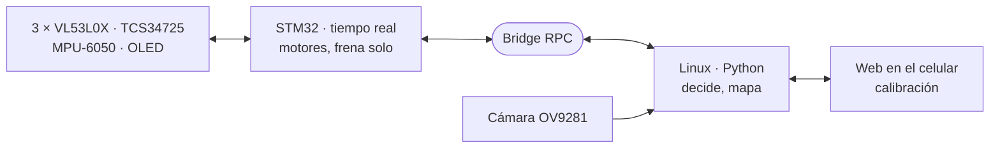

# El proyecto en 30 segundos

::: corto
El robot entra a un laberinto que no conoce, lo explora completo con 3 sensores láser y se detiene solo en la marca **amarilla**. En el camino cuenta las marcas de color y guarda un mapa. En la segunda corrida va directo a la meta por la ruta más corta conocida. Todo se calibra desde el celular, sin reprogramar.
:::

::: figura

**Figura 1. Dos cerebros en una placa.** Qué mirar: el STM32 ejecuta cada movimiento y frena por su cuenta; si Linux se retrasa, el robot nunca queda fuera de control.
:::

# Lo que hace distinto a este robot

| Qué | Cómo lo hicimos | Por qué importa |
|---|---|---|
| **Dos procesadores con tareas separadas** | El STM32 (lazo de 10 ms) mueve, mide y **para solo** al confirmar amarillo o a 30 mm de la pared. Linux decide y mira con la cámara. Durante la corrida la web no usa el Bridge | La latencia de Linux (visión, web) no afecta al control. La parada en la meta no espera a Python |
| **Máquina de estados explícita** | `SENSA → DECIDE → GIRA → AVANZA` (`ESCANEA` tras un cambio brusco). Decide siempre quieto, con lecturas frescas. La fase se ve en la OLED y en la web | Cada decisión se puede depurar viendo en qué fase estaba |
| **Una lectura mala nunca decide sola** | La menor de 3 lecturas por ToF; los saltos se confirman en 2 lecturas; el mapa acumula **votos** ±5 por pared | Un reflejo o un ruido no borra lo que vieron las demás lecturas |
| **Exploración completa (Trémaux / DFS)** | Prefiere celdas sin ver (izquierda, frente, derecha). Si no quedan, va por BFS a la celda más cercana con lados sin explorar (`frontera()`) | La meta al centro es una **isla**: en simulación, mano izquierda 0/30 laberintos; exploración completa **30/30** |
| **Avance sin encoders** | Mide la celda con el ToF frontal: para cuando la lectura bajó 180 mm. Sin pared a la vista usa tiempo | Los motores N20 no traen encoder; el tiempo deriva con la batería |
| **Geometría del CAD en el código** | `D_FRENTE` = 84 − 54 = 30 mm, `D_LADO` = 84 − 43 = 41 mm, `TRAS_SALTO` = 124 mm salen de las posiciones de los sensores en OpenSCAD | El robot para y se centra en el centro real de la celda, no "a ojo" |
| **Pasillos de un tirón** | Con pared a ambos lados avanza hasta 3 celdas; si se abre un lado, para en el centro de esa celda | ~9 % menos paradas en simulación y se mueve más fluido |

# MPU-6050: más que medir giros

::: corto
El giroscopio da giros de 90° reales y rumbo recto; el acelerómetro detecta choques y si alguien levanta el robot. Cada función se ajustó con logs de la pista.
:::

| Función | Detalle |
|---|---|
| **Rumbo absoluto** | Cada giro va a un ángulo deseado acumulado: el error de un giro se corrige en el siguiente. Corta 6° antes por la inercia |
| **Aprende su montaje** | El signo del sensor se descubre en el primer giro; el sesgo se mide al encender (200 muestras) |
| **Giros verificados** | Antes de avanzar se endereza si se desvió 3°–45°. Si un giro quedó a más de 10°, Python lo termina |
| **Choque confirmado** | Un golpe > 1.5 g solo hace **sospechar**; es choque si en 250 ms el frontal no bajó 10 mm. Sin pared a la vista solo cuenta > 2.5 g. El umbral salió del log: los falsos golpes iban de 0.75 a 1.52 g |
| **Giro atorado / levantado** | 400 ms girando sin moverse 2° → retrocede y sigue. Vertical < 0.8 g por 150 ms → se detiene |
| **Corrige su deriva** | Con 2 paredes, centrado y paralelo 300 ms, toma el rumbo del pasillo como verdad y corrige la mitad del error |

::: figura
{width=72%}

**Figura 2. Choque confirmado.** Qué mirar: pasar 1.5 g no basta; decide si el robot siguió avanzando en los 250 ms siguientes. Así la vibración de los motores no se confunde con un choque (curva ilustrativa).
:::

# Cámara monocromática: asiste, nunca manda

::: corto
Una cámara de obturador global (OV9281, 1 MP, sin filtro de color) mira el piso antes de cada avance, con una sola foto. Ve blanco (pared) contra negro (piso) mejor que una cámara a color.
:::

- **Umbral automático (Otsu)** en cada foto, con contraste estirado y límites [100, 220]: si ve blanco en el camino, el robot va lento y el ToF hace el doble check.
- **Rumbo por punto de fuga:** las bases de las 2 paredes se cortan en un punto cuya columna depende **solo del ángulo** del robot. Se calibra girándolo 15° a mano: no hace falta medir la inclinación ni la lente. En imágenes sintéticas el error fue de **±0.1°** entre −12° y 12°.
- **Fusión con el MPU:** con giroscopio, la cámara no gira el robot; mueve el rumbo deseado y el giroscopio lo sostiene (filtro complementario).
- **Experimental:** 5 "ToF virtuales" calibrados con el ToF frontal como regla, que ven las diagonales donde los láser no llegan.

# Color, calibración y lo que aprendimos

| Tema | Detalle |
|---|---|
| **Color** | Cromaticidad *r/(r+g+b)* más un término logarítmico de brillo, que separa blanco de amarillo. 3 lecturas iguales para aceptar; cuenta solo en la transición piso → color |
| **Calibración desde el celular** | Colores (5 pasos), los 3 ToF (un punto a 100 mm con vernier) y la cámara se calibran en la web y se cargan solos al arrancar. Incluye un simulador que dibuja lo que mide cada ToF y qué haría el robot |
| **Chasis propio** | OpenSCAD paramétrico, un solo chasis para UNO Q y UNO R3 (respaldo con firmware *bare-metal*), interferencias verificadas por CSG |

::: tip
**Lecciones clave:** los umbrales van a la mitad entre lecturas reales; cada sensor tiene un papel y una jerarquía (los ToF mandan sobre paredes); y quitar código también es ingeniería: una reescritura quitó ~500 líneas sin perder capacidad.
:::

::: cuidado
**Limitaciones que conocemos:** sin encoders, los tramos largos sin pared dependen de la batería; el L298N pierde 2–3 V (un puente MOSFET lo resolvería).
:::
