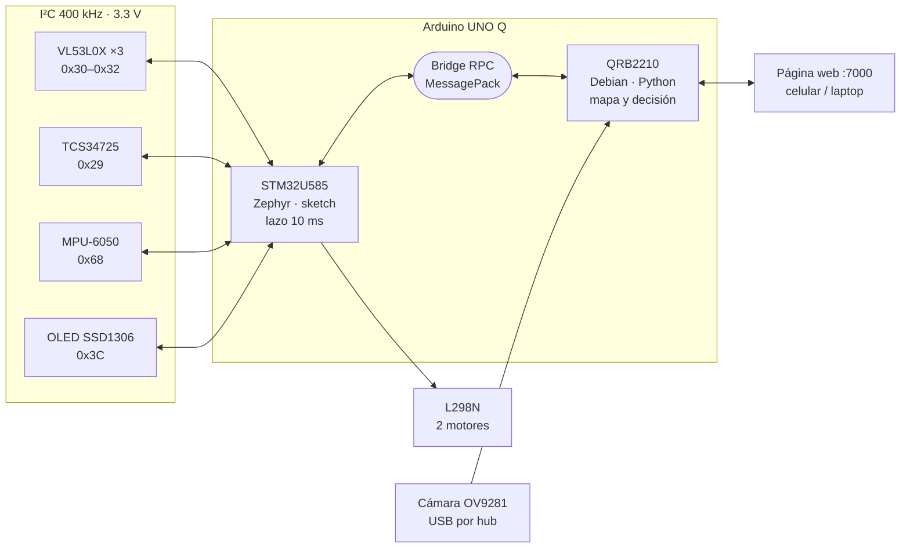
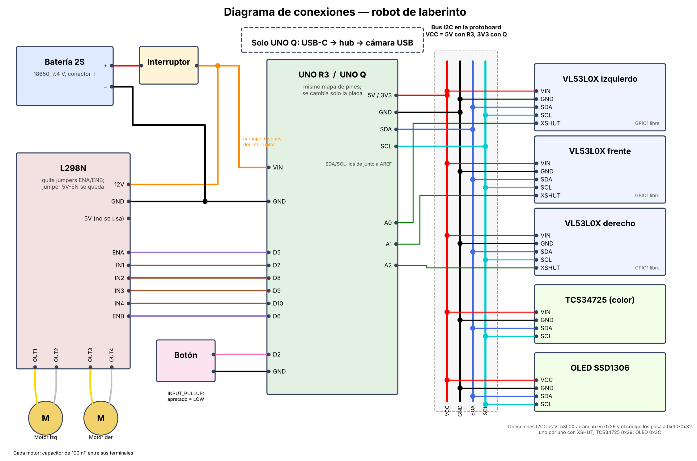
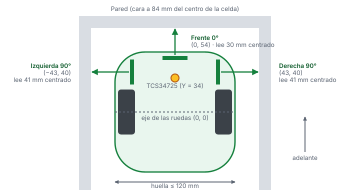
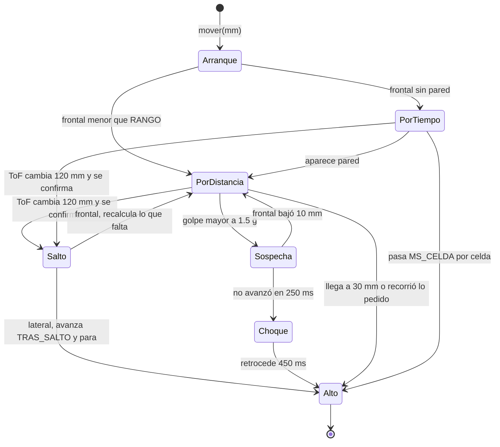
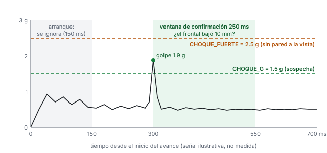
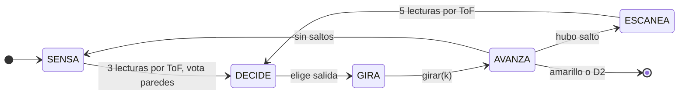
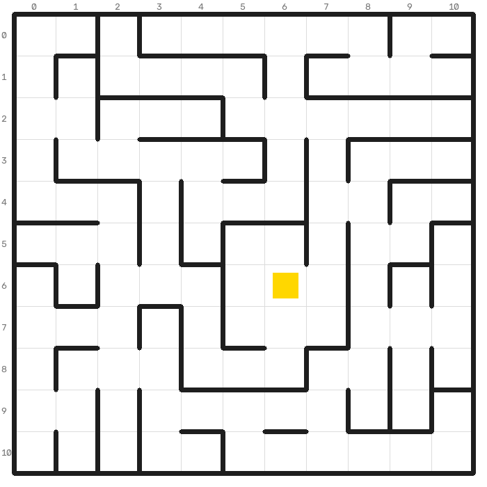
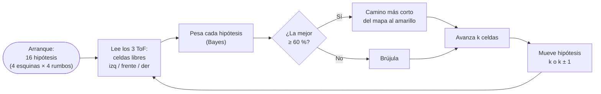
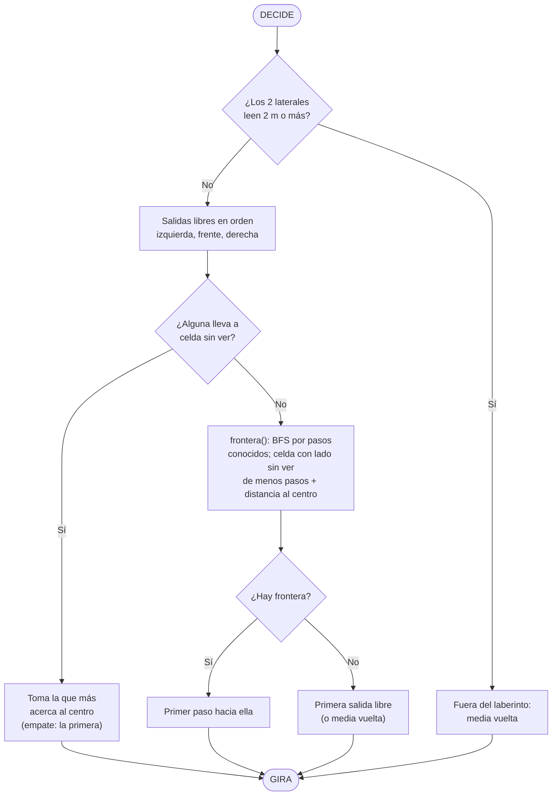

# 1. Qué hace el robot

::: corto
El robot sale de una esquina del laberinto y llega al cuadro **amarillo** del centro, donde se detiene solo. Avanza celda por celda mirando con tres sensores láser dónde hay pared. Trae el mapa de la pista y se ubica en él con lo que ven los láser, así que no depende de saber cuánto avanzó. En el camino cuenta los cuadros de colores.
:::

| Aspecto | Valor |
|---|---|
| Laberinto | Celdas de 180 mm. La meta es el cuadro amarillo; no se supone un tamaño de laberinto fijo |
| Robot | Diferencial con dos ruedas motrices y un patín, huella ≤ 120 mm |
| Laberinto de la pista | 11 × 11 celdas; el amarillo al centro, dentro de un cuarto con 2 entradas; salida en cualquier esquina |
| Estrategia (`ESTRATEGIA = "pista"`) | Trae el mapa de la pista y se ubica en él con lo que ven los ToF (autolocalización); va por el camino más corto al amarillo. Si duda o la pista cambió, decide con la brújula (capítulo 9) |
| Simulación | 200 laberintos con física de motores, ToF con ruido y giroscopio con deriva: 98 % de llegadas en la pista real (capítulo 9.4) |
| Cámara | Apagada por ahora (`USAR_CAM = False`); el capítulo 7 describe lo que hace al encenderla |

::: tip
Este manual es de referencia. Para operar el robot (encender, calibrar, resolver fallas) usa el **Manual de uso**. La bitácora completa de decisiones está en la **Bitácora de diseño**.
:::

# 2. Arquitectura: dos cerebros

::: corto
El Arduino UNO Q trae dos computadoras en una placa. Una **pequeña y puntual** (STM32) mueve los motores y lee los sensores cien veces por segundo. Una **grande con Linux** (QRB2210) decide el camino, guarda el mapa y mira con la cámara. Se hablan por el Bridge (RPC). El STM32 ejecuta cada movimiento por su cuenta y frena solo, así que el robot nunca queda fuera de control si Linux tarda.
:::

::: figura

**Figura 1. Arquitectura.** Qué mirar: todo lo de tiempo real (sensores, motores) cuelga del STM32; Linux solo decide, mira con la cámara y sirve la web.
:::

| Dominio | Procesador | Sistema | Tareas |
|---|---|---|---|
| Tiempo real | STM32U585 (Cortex-M33) | Zephyr (sketch Arduino) | Motores, 3 ToF, clasificación de color, MPU-6050 opcional, pantalla y botón |
| Decisión | Qualcomm QRB2210 (Cortex-A53) | Debian Linux | Máquina de estados, mapa, ruta corta, persistencia, cámara (OpenCV), página web |

Separar los dominios aísla la latencia no determinista de Linux (planificador, E/S, visión) del lazo de control.

::: tip
**Respaldo:** si el UNO Q falla, el mismo chasis acepta un UNO R3 (ATmega328P) con firmware *bare-metal* propio (carpeta `atmega328p/`) que hace todo en un solo chip, sin Arduino core. Este manual describe la versión del UNO Q.

**Un solo sketch, con MPU-6050:** `uno_q/sketch/`. La versión sin MPU (`sketch_sin_mpu/`) se retiró del repositorio para no confundir; queda en el historial de git (capítulo 13).
:::

# 3. Protocolo RPC (Bridge)

::: corto
Linux llama funciones que expone el STM32 por el Bridge (RPC MessagePack, enrutado por `arduino-router`). Los movimientos no bloquean: Python pide `mover` o `girar` y luego consulta `ocupado()` y `odo(i)`.
:::

| Procedimiento | Qué hace |
|---|---|
| `mover(mm, lento)` | Avanza hasta *mm* (una celda = 180 mm). Si `lento` es 1 usa `VEL_LENTO`. No bloquea; devuelve 0 si ya hay un movimiento en curso |
| `girar(k)` | Gira en sitio *k* × 90°; el signo indica el sentido (2 = media vuelta) |
| `ajustar(g)` | Corrige el rumbo *g* grados (derecha +) con lo que mide la cámara. Con MPU y sentido conocido no gira: mueve el rumbo deseado y la recta lo sostiene (devuelve 1). Si no, gira en su lugar (devuelve 2: hay que esperar) |
| `centrar(lim)` | Con pared enfrente a menos de *lim* mm: avanza o retrocede a `VEL_MIN` hasta que el frontal lea `D_FRENTE` + *k* × 180 (centro de la celda), máximo 1 s. Python lo pide tras cada avance con `CENTRA_F` = 600. Devuelve 2 si hay que esperar |
| `mover_t(mm)` | Avance de prueba por tiempo (sin medir con el frontal ni alargarse por saltos): calibra `msCelda` desde la web |
| `set_ms(ms)` | Fija `msCelda` (200-2000) |
| `alinear(lim)` | Con MPU: gira en su lugar hasta el rumbo deseado si se desvió 3° o más (`ALIN_MIN`) y no más de *lim* (45 antes de avanzar; 180 para terminar un giro fallido). Devuelve 2 si hay que esperar. Sin MPU devuelve 0 |
| `ocupado()` | 1 mientras hay un movimiento activo |
| `odo(i)` | Lecturas (tabla siguiente) |
| `color()` | Último color confirmado (3 lecturas seguidas), una sola vez |
| `alto()` | Detiene el movimiento (Python lo pide al confirmar la meta) |
| `arranque()` | Evento del botón: 1 = corto, 2 = largo |
| `set_cuenta`, `set_estado`, `set_fase` | Actualizan la pantalla (conteo, estado, fase de la máquina) |
| `raw(i)` | Lectura cruda del sensor de color (*i* = R, G, B, C) para el panel web |
| `set_ref(i, r, g, b, c)` | Carga el color de referencia *i* (r, g, b en milésimas) |
| `set_tof(i, a, b)` | Carga la calibración del ToF *i*: real = *a* × crudo + *b* (*a* en milésimas, *b* en décimas de mm) |

| `odo(i)` | Devuelve | Unidad |
|---|---|---|
| 0 | Recorrido del avance actual | mm |
| 1 | Lo que falta del avance | mm |
| 2 | Máscara de paredes y movimiento | bits |
| 3 | Saltos: 1 izquierda, 2 frente, 4 derecha | bits |
| 5 / 6 / 7 | Distancia frente / izquierda / derecha (calibrada) | mm |
| 8 | Desvío de rumbo | ° |
| 9 / 10 / 11 | Lectura de cada ToF sin calibrar | mm |
| 12 | El último avance chocó (solo MPU) | 0/1 |
| 13 | Veces que el último giro se atoró (solo MPU) | cuenta |
| 14 | Lo levantaron; se borra al leerlo (solo MPU) | 0/1 |
| 15 | Golpe máximo del último avance (solo MPU) | mg |

# 4. Conexiones y hardware

::: corto
Una batería 2S alimenta los motores (por el L298N) y la placa (por VIN). Todos los sensores comparten el bus I²C a 3.3 V. Los pines son los mismos en el UNO Q y en el UNO R3: para cambiar de placa se saca el Proto Shield.
:::

::: figura
{width=100%}

**Figura 2. Diagrama de conexiones.** Qué mirar: las líneas verdes (XSHUT a A0–A2) permiten encender los ToF uno por uno para darles dirección distinta; el resto de los sensores solo usa el bus de la protoboard.
:::

| Componente | Pin del módulo | UNO Q |
|---|---|---|
| L298N | ENA (quitar jumper) | D5 |
| L298N | IN1 / IN2 | D7 / D8 |
| L298N | ENB (quitar jumper) | D6 |
| L298N | IN3 / IN4 | D9 / D10 |
| L298N | 12V / GND | Batería + / GND |
| VL53L0X izq / frente / der | XSHUT | A0 / A1 / A2 |
| VL53L0X ×3, TCS34725, OLED, MPU-6050 | SDA / SCL | SDA / SCL |
| VL53L0X ×3, TCS34725, OLED, MPU-6050 | VCC / GND | 3.3V / GND |
| TCS34725 | LED / INT | Sin conectar (LED siempre encendido) |
| MPU-6050 (GY-521) | AD0 | GND (dirección 0x68); INT, XDA, XCL sin conectar |
| Botón de arranque | a GND | D2 |
| Batería 2S 18650 (conector T) | + | Interruptor → VIN |
| Cámara USB | | Hub USB‑C |

::: cuidado
GND común entre todo. No alimentes el UNO Q con el regulador de 5 V del L298N. Con la Q el puente de VCC del Proto Shield va a 3V3 (con el R3 va a 5V).
:::

| Subsistema | Implementación |
|---|---|
| Alimentación | Batería 2S (6.0–8.4 V) → interruptor → L298N (V_S) y VIN del UNO Q (7–24 V, reguladores conmutados) |
| Lógica de potencia | Regulador 78M05 del L298N (necesita ≳ 7 V). Entradas compatibles con 3.3 V (V_IH ≥ 2.3 V) |
| Bus I²C | 400 kHz, alimentado a 3.3 V para no exponer los pines del Q a *pull-ups* de 5 V. Lleva 3 × VL53L0X, TCS34725, una OLED SSD1306 y, opcional, un MPU-6050 (0x68) |
| Pantalla | OLED 128 × 64 con driver propio. Muestra estado, conteos y un contador de *heartbeat* de la comunicación entre los procesadores |
| Chasis | OpenSCAD paramétrico de dos pisos, FDM (Bambu X2D), insertos de latón M3 y pedestal impreso con inserto M4. Interferencias verificadas por intersección CSG |
| Cambio de placa | Mismo mapa de pines en Q y R3 vía Proto Shield; solo cambia el puente de VCC (3V3 ↔ 5V) |

::: cuidado
**Voltaje en los motores:** el L298N es bipolar (Darlington) y cae ≈ 2–3 V. Con 7.4 V llegan ≈ 4.5–5 V a los motores. Es la principal ineficiencia del diseño; un puente MOSFET (TB6612FNG, DRV8833) la eliminaría.
:::

# 5. Sensores de distancia

::: corto
Tres sensores láser (izquierda, frente y derecha) miden en milímetros qué tan lejos está la pared, unas 50 veces por segundo. Una lectura rara nunca decide sola: el robot toma varias y se queda con la menor.
:::

::: figura
{width=85%}

**Figura 3. Robot visto desde arriba.** Qué mirar: las coordenadas (X, Y) de cada ToF en mm desde el eje de las ruedas (del CAD) y su dirección de medida; de ahí salen `D_FRENTE` = 84 − 54 = 30 mm y `D_LADO` = 84 − 43 = 41 mm.
:::

| Aspecto | Detalle |
|---|---|
| Sensores | 3 × VL53L0X, tiempo de vuelo a 940 nm |
| Direcciones I²C | Los tres traen la misma (0x29), que además comparte el sensor de color. Al arrancar se mantienen apagados con XSHUT (A0–A2). Se encienden uno por uno y cada uno se reasigna a 0x30–0x32 antes de `init()` |
| Lectura | Modo continuo con *timing budget* de 20 ms (≈ 50 Hz por sensor), no bloqueante |
| Umbrales | Lateral con menos de 120 mm (`PARED`) = pared. Frontal con menos de 55 mm reales (`PARED_F`) = pared en su celda; con 120 mm o más (`FRENTE_LIBRE`) el frente cuenta como salida |
| Lecturas mínimas | Python toma 3 lecturas de cada ToF y usa la menor (5 tras un cambio brusco). Una lectura mala no deja pasar al robot |
| Calibración | Desde la web, un punto a 100 mm por sensor: solo desfase `real = crudo + b`. Con varios puntos el código ajusta `real = a × crudo + b` por mínimos cuadrados. Se aplica en el STM32 antes de cualquier decisión, para que el control de 10 ms, los saltos y el alto a 30 mm usen milímetros reales |

# 6. Sensor de color

::: corto
Debajo del robot hay un sensor con su propia luz, tapado con una capucha para que no le afecte la luz del lugar. Compara lo que ve con los colores calibrados. Exige ver el mismo color tres veces seguidas y no vuelve a contar hasta regresar al piso. El amarillo es la meta: el robot se detiene en cuanto lo confirma.
:::

**Adquisición.** TCS34725 con integración de 24 ms, ganancia 4× y LED propio, dentro de una capucha impresa. La capucha fija la distancia al piso y bloquea la luz ambiente.

**Clasificación** por vecino más cercano. Primero se normaliza la cromaticidad, que da invariancia de primer orden a la intensidad de luz:

> *r̂ = R / (R + G + B)*, igual para *ĝ* y *b̂*

La distancia a cada color de referencia *i* suma un término logarítmico de brillo. Ese término separa colores de tono parecido y distinta reflectancia, como blanco y amarillo:

> *dᵢ = (r̂ − rᵢ)² + (ĝ − gᵢ)² + (b̂ − bᵢ)² + 0.01 · ln²((C + 1) / (Cᵢ + 1))*

El resultado es "piso" si la menor distancia es mayor que 0.02 o si el brillo es menor que 1.3 veces el del piso negro (`BRILLO_MIN`, quita falsos positivos).

| Etapa | Cómo funciona |
|---|---|
| Calibración | Desde el panel web (puerto 7000). Cada referencia es el promedio de 5 lecturas sobre la pista. Se guarda en `/app/datos/colores.json`; si no existe, se usan los valores de fábrica. Linux la carga al STM32 con `set_ref` en cada arranque, sin recompilar |
| Antirrebote | 3 muestras iguales seguidas (3 × 30 ms). El evento solo se dispara en la transición piso → color |
| Meta | Al confirmar amarillo, el **STM32 detiene el movimiento por sí mismo**, sin esperar a Python. Python guarda la celda como meta |
| Celda del color | *k = ⌊(mm + 34 + 90) / 180⌋*, con *mm* los milímetros recorridos en el avance y 34 mm la distancia del eje al sensor (`Y_COLOR`). Cada celda cuenta su color una sola vez |

| Color | r̂ | ĝ | b̂ | C |
|---|---|---|---|---|
| PISO | 0.282 | 0.379 | 0.333 | 153 |
| ROJO | 0.602 | 0.208 | 0.188 | 581 |
| VERDE | 0.155 | 0.535 | 0.309 | 636 |
| AZUL | 0.16 | 0.329 | 0.508 | 354 |
| AMAR | 0.409 | 0.449 | 0.142 | 1836 |

Valores de fábrica (`REFS` en `main.py`, igual a `refs[]` del sketch). Los calibrados en la web tienen prioridad.

# 7. Cámara (opcional)

::: corto
**Hoy está apagada** (`USAR_CAM = False`): el robot decide solo con los ToF. Este capítulo describe lo que hace al encenderla. La cámara mira el piso por donde va a pasar. Es **monocromática**, y el piso negro con paredes blancas es justo lo que mejor distingue. Antes de cada avance toma **una foto**: revisa si hay blanco (pared) en el camino para ir más despacio y mide si el robot va chueco con el punto de fuga del pasillo. La cámara nunca manda sobre los láser: solo **asiste**. Sin cámara, el robot funciona igual.
:::

**Sensor.** innomaker U20CAM-9281M: OV9281 de 1 MP **monocromático** con **obturador global** (todos los píxeles se exponen al mismo tiempo), hasta 720p a 120 fps, lente M12 gran angular, UVC (Linux la ve sin driver). Se captura a 320 × 240 con OpenCV y V4L2. El obturador global evita la deformación por movimiento (*rolling shutter*), que tuerce las líneas rectas cuando el robot gira. Sin filtro de color (matriz de Bayer), cada píxel recibe toda la luz: más sensibilidad y menos ruido en la luminancia, que es lo único que se usa. Por la misma razón **no puede ver el amarillo**; la meta la confirma el TCS34725.

| `EXPERIMENTAL` en `python/main.py` | Cámara |
|---|---|
| `False` (estable, como está en git) | 1 a 3: exposición fija, umbral automático (Otsu), corrección de rumbo |
| `True` (experimental) | 1 a 5: además, distancia por cámara y aberturas adelante |

## 7.1 Técnicas 1 a 3 (versión estable)

**1. Exposición fija.** Con exposición automática, la cámara cambia su ganancia según lo que tenga enfrente (una pared blanca cerca la oscurece, la ropa de la gente la aclara), y un mismo piso cambia de gris entre fotos. Desde la web se fija la exposición (`CAP_PROP_AUTO_EXPOSURE` en manual, `CAP_PROP_EXPOSURE` en unidades UVC de 100 µs) y se guarda en `/app/datos/camara.json`.

**2. Umbral automático (Otsu) con contraste y sensibilidad.** Antes de Otsu, el gris se **estira**: el 2 % más oscuro de la mitad de abajo pasa a 0 y el 2 % más claro a 255 (si la imagen es casi uniforme no se estira, para no inventar contraste). La **sensibilidad** (web, de −80 a 80) baja el umbral de Otsu esos niveles de gris: más alta, ve blanco antes. El histograma de la escena es **bimodal** (piso negro y pared blanca); Otsu elige el umbral que maximiza la varianza entre las dos clases, en cada foto. Se calcula sobre la mitad de abajo de la imagen después de un filtro de mediana de 5 × 5. El umbral se acota a [`UMBRAL_MIN`, `UMBRAL_MAX`] = [100, 220]. Con él se mide la fracción de blanco en `ZONA_PASO`: si pasa de `BLANCO_MAX` (15 %), Python pide `mover(mm, 1)` (lento) y lee el frontal como doble check; el sketch para a 35 mm si la pared es real.

**3. Rumbo por punto de fuga.** En cada fila de `ZONA_BORDES` (45 % a 95 % de la altura) se busca, desde el centro hacia cada lado, el primer píxel blanco: la base de la pared izquierda y la derecha. Cada pared se ajusta a una recta *x = a·y + c* por mínimos cuadrados con rechazo de atípicos (empieza con la mitad más cercana y descarta los puntos a más de 5 px). Las dos rectas se cortan en el **punto de fuga** del pasillo. Su columna depende **solo del ángulo** entre el robot y el pasillo: *θ = atan(k · (x_f − x₀))*, donde *x₀* es la columna con el robot derecho y *k* los radianes por píxel. Las dos se miden en la web (robot derecho, y girado 15° a mano).

| Caso | Qué hace con θ |
|---|---|
| \|θ\| ≥ `ANG_MIN` (4°) | Python llama `ajustar(θ)` antes de avanzar |
| \|θ\| > `ANG_MAX` (20°) | La lectura se descarta como mala |
| Con MPU-6050 | No gira: `ajustar` mueve el rumbo deseado (`ref`) y `KG` lo corrige durante el avance. La cámara corrige la deriva del giroscopio, que da la respuesta rápida (filtro complementario) |
| Sin MPU (sin `G` en la OLED) | Gira en su lugar por tiempo (`MS_90` × θ / 90, mínimo 30 ms). Respaldo aproximado |

En pruebas con imágenes sintéticas de un pasillo (cámara a 150 mm de altura, 35° hacia abajo, ruido de ±6 niveles de gris), el ángulo medido coincidió con el real dentro de ±0.1° entre −12° y 12°, también con el robot descentrado 25 mm y con una pared abierta.

::: tip
Un intento anterior de alinear con giros de 5° tomando muestras de los ToF volvió al robot muy lento y se quitó. Aquí es una sola foto por celda y, con MPU, no se gira: solo se cambia la referencia.
:::

## 7.2 Técnicas 4 y 5 (versión experimental)

**4. Distancia por cámara ("ToF virtuales").** En el piso, una fila de la imagen corresponde a una distancia hacia adelante. En lugar de modelar altura, inclinación y distorsión, se **calibra con el ToF frontal como regla**: con el robot frente a una pared a varias distancias, la web guarda la fila de la base de la pared en la columna central y la lectura del frontal (`/app/datos/camara.json`). Después, en 5 columnas (`COLS` = 10, 30, 50, 70 y 90 % del ancho) se busca la base de la pared desde abajo y se interpola su distancia. Las columnas laterales ven en diagonal, justo donde los 3 ToF no ven. Fuera del rango calibrado no da valor. En pruebas sintéticas la columna central midió 209, 306, 400 y 517 mm con paredes a 200, 300, 400 y 500 mm.

**5. Aberturas en la celda siguiente.** Con la tabla anterior se sabe qué filas corresponden a las paredes laterales de la celda siguiente (`SIG` = 60 a 240 mm del frontal). Si en ese tramo menos del 30 % de las filas tiene la base de la pared sobre la recta de esa pared, ese lado está abierto. Entonces el robot avanza **lento**, para que la detección de saltos lo detenga centrado, y anota un **voto débil** (−1) de libre: si los ToF dicen lo contrario al llegar, ganan ellos. En pruebas sintéticas detectó la abertura izquierda, la derecha y la izquierda con el robot girado 6°, sin falsos positivos en el pasillo cerrado.

::: cuidado
Son experimentales porque dependen de que la calibración por filas sea estable y de cómo se ve la base de las paredes reales (sombras, uniones, madera). Pruébalas primero mirando la web con el robot quieto.
:::

## 7.3 Montaje y web

- **Montaje:** módulo (medida por confirmar; el CAD usa 32 × 32 mm) sobre un pedestal impreso, inclinado hacia abajo para ver el piso adelante del eje. La inclinación quedó la de la primera versión del soporte (la última del CAD no se imprimió); como todo se calibra con el robot real, no afecta. Se conecta por un hub USB-C con entrada de alimentación: con la Q alimentada por VIN, su USB-C no da 5 V al hub, así que el hub se alimenta por su puerto PD.
- **Web:** la imagen a 160 × 120 (JPEG calidad 40) muestra el camino en rojo (blanco) o verde (negro), las bases de las paredes y el punto de fuga en azul, la línea de "derecho" en blanco y, en la experimental, la base de la pared por columna en amarillo. Abajo: porcentaje de blanco, umbral de Otsu, rumbo, distancias y aberturas. Un candado comparte la cámara entre el robot y el panel. Al arrancar la busca una vez; un hilo revisa cada 2 s si sigue conectada (OLED `SIN CAM`).

# 8. Movimiento

::: corto
El robot no tiene encoders: mide cuánto avanza con el láser de enfrente y para cuando esa distancia bajó 180 mm. Sin pared a la vista avanza por tiempo. Desde 130 mm frena en proporción y se detiene a 30 mm de la pared. Gira con el giroscopio del MPU-6050 (o por tiempo, si no responde) y el acelerómetro detecta choques y si lo levantan.
:::

**Actuación.** Dos micromotorreductores DC (≈ 12 × 11 mm de sección), ruedas de 45 mm, puente H L298N. PWM en ENA/ENB y sentido en IN1–IN4. El sentido de cada motor se invierte por software (`INV_IZQ`, `INV_DER`). Freno activo: ambas entradas en alto con EN = 255 durante 60 ms.

::: figura

**Figura 4. Máquina de estados de un avance (sketch).** Qué mirar: todos los caminos terminan en `Alto` dentro del STM32, sin esperar a Python; en pasillo Python solo pide más milímetros (hasta 3 celdas).
:::

## 8.1 Avance (lazo a 100 Hz, *T* = 10 ms)

| Paso | Qué hace |
|---|---|
| **Por distancia** | Al iniciar toma el frontal; si lee menos de 600 mm (`RANGO`) avanza hasta que haya bajado 180 mm (`CELDA`); si la pared está más cerca que eso, cuenta solo lo que cabe (antes reportaba 180 mm sin moverse y el mapa se recorría una celda). Si no ve nada a ese alcance avanza por tiempo (`MS_CELDA`) y, si a medio camino aparece una pared, sigue por distancia |
| **Alto y retroceso** | Se detiene al leer 30 mm reales al frente (`D_FRENTE`): es la lectura con el eje justo al centro de la celda (84 − 54 mm, CAD). Si queda por debajo de 25 mm (`D_FRENTE − D_CERCA`) se hace para atrás hasta 30 mm. Si hay pared y la distancia ya no baja en 300 ms, también para. Desde 130 mm frena de forma proporcional (`FRENA_K`). Un avance nunca pasa de lo pedido + `TRAS_SALTO` (304 mm en una celda) |
| **Perfil de velocidad** | Rampa de +6 PWM por ciclo hasta `VEL_EXPLORA` (o `VEL_LENTO`), y desaceleración lineal en el último cuarto de celda, con piso en `VEL_MIN` |
| **Cambios bruscos** | Si una lectura de un ToF cambia `SALTO` = 120 mm o más y la siguiente lo confirma: si se abre un lateral avanza `TRAS_SALTO` = 110 mm más (124 del CAD menos lo que tarda en confirmarse) y para en el centro de esa celda para escanearla (fase `ESCANEA`); si salta el frontal, recalcula lo que falta. Python lo lee con `odo(3)` |
| **Pasillo** | Si va de frente con pared a ambos lados, Python pide hasta `PASILLO` = 3 celdas de un tirón. Abrirse un lateral lo detiene en el centro de esa celda, así que las celdas intermedias se anotan con pared a los 2 lados. Hace ~9 % menos paradas en la simulación (30/30 laberintos) |
| **Centrado en el carril** | Con pared a un lado (lateral < `PARED` = 120 mm) corrige *u = K꜀·e + K_d·ė*, saturado en ±40 PWM y aplicado en diferencial (*PWM_izq = v − u*, *PWM_der = v + u*). Con 2 paredes, *e = d_izq − d_der*; con una, *e = 2·(d − D_LADO)*, `D_LADO` = 41 mm (84 − 43, CAD). Sin paredes va derecho con el rumbo del MPU |
| **Centrar con la pared** | Tras cada avance, si el frontal ve pared a menos de 600 mm (`CENTRA_F`), Python pide `centrar`: el robot avanza o retrocede a `VEL_MIN` hasta leer `D_FRENTE` + *k* × 180 mm, el centro de su celda (máximo 1 s). En simulación, sin esto llega 58 % contra 90 % |
| **Deriva con paredes** | Con 2 paredes, centrado (\|e\| < 15 mm) y paralelo (*ė* < 15 mm/s) durante 300 ms, la mitad de lo que difiera el rumbo del MPU del deseado se toma como deriva y se corrige |

## 8.2 Giros y MPU-6050

**Conexión.** Módulo GY-521 en el bus I²C (dirección 0x68, AD0 a GND), VCC a 3.3 V. Va atornillado **plano**: el eje Z queda vertical y es el que mide los giros. La orientación en el plano no importa: el signo lo aprende en el primer giro.

**Configuración** (`mpuInit`): sale del modo de reposo (0x6B = 0), filtro digital de ~44 Hz (0x1A = 3), giroscopio a ±500 °/s (0x1B = 0x08, 65.5 LSB por °/s) y acelerómetro a ±2 g (0x1C = 0, 16384 LSB/g). Con el robot quieto promedia 200 lecturas del giroscopio Z para restar su **sesgo**; por eso hay que encenderlo sin moverlo.

**Rumbo.** Cada 2 ms integra la velocidad angular: *ψ ← ψ + (g_z − b) / 65.5 · Δt*. El sketch guarda un **rumbo deseado absoluto** (`ref`) que cada giro aumenta en ±90°. Así el error de un giro no se acumula. Si el MPU no responde al arrancar, gira por tiempo (`MS_90`) a PWM constante `VEL_GIRO`.

| Función | Cómo | Parámetro |
|---|---|---|
| **Giro por ángulo** | Gira hasta `ref`; baja la velocidad en los últimos 25° y corta `ADELANTO` antes por la inercia | `ADELANTO` = 6° |
| **Rumbo en recta** | Suma *K_G · (ψ − ref)* (saturado a ±20 PWM) a la corrección de centrado | `KG` = 2.0 PWM/° |
| **Alinear antes de avanzar** | `alinear(45)`: si el rumbo se desvió 3° a 45°, gira en su lugar hasta `ref` antes de arrancar | `ALIN_MIN` = 3° |
| **Verificar cada giro** | Python lee el desvío (`odo(8)`); si pasa de 10° termina el giro con `alinear(180)` (2 intentos). Si aun así quedó 45° o más fuera, acepta el rumbo real: corrige el mapa en cuartos de vuelta y mueve `ref` | — |
| **Giro atorado** | Si girando pasan 400 ms sin 2° de giro, una esquina está trabada: retrocede 200 ms y sigue (hasta 2 veces) | `ATORADO_MS` = 400 ms |
| **Choque** | Ver 8.3 | `CHOQUE_G`, `CHOQUE_FUERTE`, `CONFIRMA_MS`, `RETRO_MS` |
| **Levantado** | Si la aceleración vertical baja de 0.8 g durante 150 ms (inclinado o en el aire), apaga los motores y Python termina la corrida | `LEVANTA_G` = 0.8 g |
| **Fusión con la cámara** | La cámara mide el ángulo real respecto al pasillo y `ajustar` mueve `ref`: corrige la deriva lenta del giroscopio | `ANG_MIN` = 4° |

## 8.3 Choque confirmado

Cada 10 ms se mide la aceleración horizontal menos un promedio lento (quita la inclinación del montaje). Un golpe de más de 1.5 g en un avance (pasados los primeros 150 ms) solo hace **sospechar**. Es choque si en los 250 ms siguientes el frontal no bajó 10 mm (el robot dejó de avanzar). Sin pared enfrente a la vista solo cuenta un golpe de más de 2.5 g. Confirmado, retrocede 450 ms a PWM 110 y termina; si quedó a menos de 35 mm de una pared lateral, Python se aleja (gira 20°, avanza 50 mm, regresa al rumbo).

::: figura
{width=92%}

**Figura 5. Umbrales del choque.** Qué mirar: un golpe arriba de la línea verde solo abre la ventana de 250 ms; lo que decide es si el frontal siguió bajando. La línea ámbar aplica solo cuando no hay pared a la vista.
:::

::: ajuste
Calibra con el "golpe" que muestra el log (`odo(15)`, en mg). `CHOQUE_G`: si detecta choques sin chocar, súbelo; si no los detecta, bájalo. `ADELANTO`: si se pasa del giro, súbelo de 2 en 2; si le falta, bájalo. `KG`: si zigzaguea en recta, 1.5; si tarda en enderezarse, 3. `LEVANTA_G`: si se detiene solo, bájalo a 0.7.
:::

::: cuidado
**Limitación reconocida:** sin encoders, la distancia depende del frontal. En tramos largos sin pared a la vista el resultado depende del voltaje de la batería y de la fricción. Lo mitigamos con el avance por distancia, el MPU-6050 para el rumbo y la rampa de arranque. La mejora natural son encoders en cuadratura.
:::

# 9. Cómo decide

::: corto
El robot decide siempre quieto, en fases que se repiten: **mira**, **decide**, **gira** y **avanza**. Hoy trae el **mapa de la pista** y se ubica en él comparando lo que ven los ToF con cada lugar posible; con la ubicación segura va por el camino más corto al amarillo. Si no está seguro o la pista cambió, decide con la **brújula**: la salida libre que más apunta al centro. Hay una tercera estrategia (Trémaux con mapa) que se puede elegir con `ESTRATEGIA`.
:::

::: figura

**Figura 6. Máquina de estados de Python.** Qué mirar: la fase actual sale en la OLED y en la web; `ESCANEA` solo sustituye a `SENSA` tras un cambio brusco.
:::

| Fase | Qué hace |
|---|---|
| `SENSA` | Toma 3 lecturas de cada ToF (la menor) y vota las paredes de la celda |
| `ESCANEA` | Igual, con 5 lecturas, tras un salto |
| `DECIDE` | Elige la salida según `ESTRATEGIA` (9.1 a 9.3) |
| `GIRA` | Pide `girar(k)` y espera |
| `AVANZA` | Pide `mover(180, lento)` (o hasta `PASILLO` celdas) y espera; lee mm recorridos y saltos |


| `ESTRATEGIA` | Qué hace | Cuándo |
|---|---|---|
| `"pista"` (actual) | Mapa cargado + autolocalización; si duda, brújula | La pista de las fotos, aunque cambien algunas paredes |
| `"brujula"` | Solo la salida libre que más apunta al centro | Otra pista, o si el mapa cargado no sirve |
| `"mapa"` | Exploración completa (Trémaux) hacia el centro | Comparar; era la estrategia de las etapas 38 a 49 |

**Salidas libres** (con lecturas de ToF): izquierda si el lateral lee ≥ 120 mm; frente si el frontal (calibrado) lee ≥ 130 mm (`FRENTE_LIBRE`), a la mitad entre la pared de su celda (~35-45 mm reales) y la de la siguiente (~215-225); derecha con el mismo criterio que la izquierda; media vuelta si no hay ninguna.


## 9.1 Pista conocida con autolocalización

::: figura
{width=50%}

**Figura 7. La pista cargada en `main.py`.** Qué mirar: el amarillo (6, 6) está dentro de un cuarto con 2 entradas; el robot puede salir de cualquiera de las 4 esquinas.
:::

El robot trae el mapa de la pista (`PISTA_H`, `PISTA_V`, `PISTA_META` en `main.py`, sacado de las fotos; imagen en `docs/img/pista_mapa.png`). No sabe de qué esquina sale ni hacia dónde mira: empieza con 16 hipótesis (4 esquinas × 4 rumbos). En cada celda compara cuántas celdas libres ven los ToF a la izquierda, al frente y a la derecha (`(lectura − 41 o 30) / 180`) con las de cada hipótesis en el mapa, y las pesa (Bayes: igual 0.7; ver de menos 0.25, porque el cono de unos 25° del ToF ve puntas de pared antes; ver 1 de más 0.1; lo demás 0.02; una pared enfrente es estricta). Al avanzar mueve cada hipótesis *k* celdas, o *k* ± 1, porque la odometría no es exacta, sin atravesar paredes; si termina con pared enfrente, la lleva al final del pasillo. Así la odometría solo sugiere y las paredes deciden dónde está. Con la hipótesis principal en 60 % o más (`CONFIANZA`) va por el camino más corto del mapa al amarillo. Si los ToF dicen pared donde el mapa dice paso (2 veces), corrige el mapa y busca otro camino. Si lo que ve no cuadra con ninguna hipótesis 2 lecturas seguidas (`MALA`), se vuelve a ubicar en toda la pista; a la 5.ª vez (`PERDIDAS_MAX`) concluye que la pista no es la misma y sigue solo con la brújula. Sin certeza, también decide la brújula.


::: figura

**Figura 8. Autolocalización (localización de Markov).** Qué mirar: la odometría solo propone *k* ± 1 celdas; lo que ven los ToF decide cuál hipótesis sobrevive.
:::

| Caso (200 corridas) | Pista (mapa cargado) | Brújula |
|---|---|---|
| Pista real | **98 %, 23 s** | 96 %, 39 s |
| Odometría mala | **82 %** | 71 % |
| Entrada de arriba del cuarto cerrada | **92 %, 25 s** | 74 %, 56 s |
| 6 paredes cambiadas | **92 %** | 92 % |
| 15 paredes cambiadas | 83 % | 86 % |
| Otro laberinto (el mapa no sirve) | 84 % | 86 % |


## 9.2 Brújula (respaldo)

Sin encoders la posición se desfasa (tiempo, choques), y con el mapa desfasado la exploración da vueltas: cree nuevas celdas que ya vio y busca fronteras que no existen. La brújula no usa el mapa de paredes: entre las salidas libres que ven los ToF **ahora**, toma la que apunta más al centro (rumbo del giroscopio, que sí es confiable, y la posición aproximada), menos `CASTIGO` = 1.0 por cada vez que ya tomó esa salida desde esa celda aproximada, más azar (`RUIDO` = 0.6, rompe ciclos). Un desfase de 1-2 celdas casi no cambia hacia dónde queda el centro. Simulación, 200 laberintos: con la odometría actual 86 % contra 87 % del mapa; con odometría mala (sin `centrar` ni la corrección del sketch) 60 % contra 46 %. El seguidor de pared que cambia de mano cada 10-25 decisiones llegó 20-47 %. `ESTRATEGIA = "mapa"` vuelve a Trémaux con el mapa.


## 9.3 Mapa: exploración completa hacia el centro

::: figura

**Figura 9. Decisión con `ESTRATEGIA = "mapa"` (Trémaux / DFS).** Qué mirar: la rama "sin ver" es la que garantiza recorrer todo; `frontera()` evita que el robot rodee una isla para siempre.
:::

**Por qué exploración completa.** La meta está al centro y solo tiene 2 entradas: las paredes que la rodean forman una **isla**, separada del muro exterior. Un seguidor de pared solo recorre el muro al que está pegado, así que rodea la isla sin entrar. En simulación (laberintos de 9 × 9 con la meta en una isla central de 3 × 3 con 2 entradas, 30 laberintos), la mano izquierda pura llegó a la meta 0 de 30 veces y la exploración completa 30 de 30.

**Se va por lo que se abre** (solo con `"mapa"`). Si el avance paró porque se abrió un lateral (`ESCANEA`) y esa salida lleva a una celda sin ver, la toma, aunque otra acerque más al centro (en simulación 87 % contra 90 % sin esta regla: igual dentro del ruido; se ve más natural).

**Hacia el centro.** El laberinto es de 11 × 11 y el robot sale de una esquina cualquiera, así que el centro queda a `CENTRO` = 5 celdas en x y en y. El lado lo deduce `ubica()`: en la celda de salida cada lado libre apunta hacia adentro (los muros exteriores de la esquina están pegados), y en cuanto se mueve en un eje, ese lado es hacia adentro. Un eje sin lado conocido no cuenta. En simulación (40 laberintos de 11 × 11 con isla central, esquina al azar) llega 40/40 en 1173 pasos en total contra 5479 sin preferir el centro (peor caso 93 contra 163). En la etapa 47 se decidió no precargar el mapa de las fotos (una pared mal ubicada lo haría chocar); la etapa 52 lo retomó con autolocalización, que detecta y corrige esas paredes (9.1).

::: tip
Historia: antes se probó "frente primero, luego izquierda". En pista se atoraba en una zona: preferir el frente rompe la garantía del seguidor de pared, que solo recorre todo el muro conexo si **siempre** prefiere el lado de su mano.
:::

| Mapa | Detalle |
|---|---|
| Celdas | Cada celda guarda 4 votos (N, E, S, O) en un diccionario de coordenadas |
| Votos | Cada lectura vota pared (+1) o libre (−1), con tope ±5 (`VOTO_MAX`). Una lectura mala no borra lo que vieron las demás |
| Recorrido | Por donde el robot pasó queda libre con certeza |
| Posición | La celda actual sale de los mm que de verdad avanzó (no de lo que pidió) |
| Colores | Cada color leído se anota en su celda; el amarillo marca la meta |
| Persistencia | Al terminar la corrida se guarda `/app/datos/mapa.json` (paredes, colores y meta), con escritura atómica. Tolera un archivo roto o vacío. Un toque largo (más de 2 s) borra mapa y conteo |
| Ruta corta | Con la meta en el mapa, la siguiente corrida calcula por BFS el camino más corto sobre pasos conocidos como libres (OLED `RAPIDO`). Si al avanzar no queda en la celda esperada, abandona la ruta y sigue explorando |
| Corrida | El botón corto inicia una corrida nueva (siempre en la misma celda y mirando al mismo lado); otro toque la detiene |


::: cuidado
La ruta corta de la siguiente corrida (`RAPIDO`) usa la meta guardada en coordenadas relativas a la salida. Si cambias de esquina de salida, borra el mapa (D2 más de 2 s) antes de correr.
:::

## 9.4 Simulación 2D: qué reglas sirven

::: corto
200 laberintos de 11 × 11 parecidos a la pista (isla central de 3 × 3 con 2 entradas, algunos bucles, salida en una esquina al azar). Con las reglas elegidas el robot llega al amarillo en 90 % de los laberintos (antes 26 %). Lo que más pesa es no perder la celda, no los umbrales de los ToF.
:::

El simulador (`uno_q/sim/sim2d.py`) mueve un robot de 120 mm (esquinas R30) con la física de los motores, y simula los ToF en sus posiciones del CAD con ruido (3 %), fallas (1 %) y un cono estrecho. También simula el giroscopio con deriva, los golpes de vibración del acelerómetro sacados de los logs y los choques por contacto del cuerpo. Las decisiones son las funciones reales de `main.py`. La velocidad se calibró con lo medido en pista: 600 ms de avance = 154 mm, 250 ms de giro ≈ 70°. Las corridas tienen un límite de 8 min. Con 200 laberintos, diferencias menores a ±7 puntos son ruido.

| Variante (cambia una regla sobre las elegidas) | Llega | Celda perdida | Choques por corrida |
|---|---|---|---|
| **Reglas elegidas** | **90 %** | 40 % | 1.8 |
| Sin corregir el "avancé" del sketch con pared cerca | 67 % | 98 % | 5.1 |
| Sin `centrar` tras avanzar | 58 % | 60 % | 3.4 |
| `KD` = 0.3 (antes) | 59 % | 74 % | 6.0 |
| Sin MPU (giros por tiempo, `MS_90` = 320) | 52 % | 78 % | 3.8 |
| Sin preferir el centro | 76 % (tarda 2.2×) | 60 % | 4.8 |
| Sin esquivar postes tras un choque | 88 % | 40 % | 5.2 |
| `RANGO` = 1000 (antes) | 87 % | 51 % | 2.8 |
| `TRAS_SALTO` = 124 (antes) | 87 % | 42 % | 3.8 |
| Vibración alta (como el log "choca mucho") | 85 % | 41 % | 2.9 |
| Vibración alta y choque = solo el golpe, sin confirmar | 63 % (9.6 falsos choques) | 84 % | 6.5 |
| Código anterior completo | 26 % | 100 % | 5.3 |

**Sin efecto medible (±5):** `PARED` 90-150, `FRENTE_LIBRE` 90-160, mínimo o mediana de 3 lecturas, `SALTO` 80-180, 1-3 lecturas para confirmarlo, `VOTO_MAX` 3-8, `PASILLO` 1-3, `KG` 1-2, corrección de deriva, alinear antes de leer, `CHOQUE_G` 0.8-2.5, `CONFIRMA_MS` 150-400, `ATORADO_MS` y `MS_CELDA` 600 o 700 (con `centrar` casi no importa; queda 700 por lo medido en pista). Con vibración normal el detector de choques no cambia la tasa, pero con vibración alta la confirmación evita casi 10 falsos choques por corrida: se queda.

**Peor:** `RETRO_MS` = 250 (no se despega: 60 choques por corrida), `KC` = 0.4-0.6, 5 lecturas con mediana.

Para repetirla: `echo "KD=0.3" | NS=200 python3 uno_q/sim/corre.py`; cada línea es una variante (`-` = el código actual).

# 10. Página web

::: corto
Linux sirve una página en el puerto 7000 (brick `web_ui`) que se abre desde el celular por WiFi. Es la herramienta central de puesta a punto: toda la calibración se hace ahí y queda guardada en `/app/datos/` para cargarse sola en cada arranque.
:::

| Función | Cómo funciona | Archivo |
|---|---|---|
| Colores | Asistente de 5 pasos; cada color promedia 5 lecturas del TCS34725 y se manda al STM32 (`set_ref`) | `colores.json` |
| Distancia | Por sensor, puntos (mm reales con vernier, lectura cruda promedio de 10); en pista se usa 1 punto a 100 mm por sensor: solo desfase `real = crudo + b` (con varios puntos, `real = a × crudo + b` por mínimos cuadrados), que se manda al STM32 (`set_tof`) | `tof.json` |
| Simulador | Dibuja lo que mide cada ToF y lo que haría el robot (`que_haria()`) sin moverlo | — |
| Cámara | Imagen 160 × 120 en gris con la zona de paso en rojo (blanco) o verde (negro) | `camara.json` |
| Corrida | Fase, celda, mapa y meta; iniciar, detener y borrar (`/api/control`) | — |

::: cuidado
Durante una corrida la página **no llama al Bridge**: muestra la última lectura que tomó el robot y su última foto, para no quitarle tiempo ni la cámara. Fuera de corrida lee directamente los sensores.
:::

# 11. Parámetros calibrables

::: corto
Valores tal como están en `sketch.ino` y `main.py`. Cambia uno a la vez y prueba en pista con la batería cargada. Los que salen de la geometría del CAD solo cambian si cambia el chasis.
:::

## 11.1 Sketch (STM32)

| Nombre | Valor | Unidad | Qué hace | Cuándo cambiarlo |
|---|---|---|---|---|
| `CELDA` | 180 | mm | Avance de una celda | Si cambia el laberinto |
| `RANGO` | 600 | mm | Con el frontal por debajo avanza por distancia; más lejos, por tiempo (de lejos, un poco chueco, el frontal ve las paredes laterales) | — |
| `msCelda` | 700 | ms | Tiempo por celda cuando no hay pared a la vista. Variable: la manda Python al arrancar (`set_ms`), calibrada en la web | Web: Calibrar avance |
| `MS_90` | 250 | ms | Giro de 90° por tiempo (solo si el MPU no responde) | Solo sin MPU |
| `VEL_EXPLORA` | 140 | PWM | Velocidad normal de avance (0–255) | — |
| `VEL_LENTO` | 100 | PWM | Velocidad cuando la cámara ve blanco | — |
| `VEL_GIRO` | 130 | PWM | Velocidad de giro | — |
| `VEL_MIN` | 80 | PWM | Piso de la rampa de frenado | — |
| `PARED` | 120 | mm | Lateral por debajo = pared | Tras calibrar los ToF |
| `PARED_F` | 55 | mm reales | Frontal por debajo = pared en su celda (requiere frontal calibrado) | Tras calibrar los ToF |
| `D_FRENTE` | 30 | mm reales | Alto al frente con el eje al centro de la celda (84 − 54, CAD) | Si cambia el chasis |
| `D_CERCA` | 5 | mm | Retrocede si baja de `D_FRENTE − D_CERCA` = 25 mm | — |
| `FRENA_K` | 2 | PWM/mm | Frenado proporcional desde 130 mm | — |
| `SALTO` | 120 | mm | Cambio brusco entre 2 lecturas | — |
| `TRAS_SALTO` | 110 | mm | Avance tras abrirse un lateral, para centrarse en esa celda | Para antes o se pasa del centro (±5) |
| `D_LADO` | 41 | mm | Lectura lateral con el robot centrado (84 − 43, CAD) | Si cambia el chasis |
| `KC` | 0.8 | — | Centrado: ganancia de posición | Zigzaguea entre paredes (bajar, p. ej. 0.5) |
| `KD` | 0 | — | Centrado: velocidad de acercamiento (0.3 torcía el rumbo en la simulación) | — |
| `KG` | 2.0 | PWM/° | Sostener rumbo en recta (con MPU) | Zigzaguea: 1.5; tarda en enderezarse: 3 |
| `CHOQUE_G` | 1.5 | g | Golpe que hace sospechar un choque | Falsos choques: +0.1; choques sin detectar: −0.1 |
| `CHOQUE_FUERTE` | 2.5 | g | Golpe que cuenta sin pared enfrente | — |
| `CONFIRMA_MS` | 250 | ms | Ventana para ver si el frontal siguió bajando | — |
| `LEVANTA_G` | 0.8 | g | Vertical por debajo (150 ms) = lo levantaron | Se detiene solo: 0.7 |
| `RETRO_MS` | 450 | ms | Retroceso tras un choque | — |
| `ATORADO_MS` | 400 | ms | Giro sin moverse 2° que cuenta como atorado | — |
| `ALIN_MIN` | 3 | ° | Con MPU, desvío desde el que endereza antes de avanzar | — |
| `ADELANTO` | 6 | ° | Corta el giro antes por la inercia | Se pasa del giro: +2; le falta: −2 |
| `AJUSTE_DER` | −10 | PWM | Diferencia en recta; negativo = más fuerza al motor izquierdo | Se va a la derecha: +5; a la izquierda: −5 |
| `INV_IZQ` / `INV_DER` | true / true | — | Invierte el sentido del motor por software | Si un motor va al revés |
| `BRILLO_MIN` | 1.3 | × piso | Filtro del sensor de color | — |
| `DIST_MAX` | 0.02 | — | Distancia máxima a una referencia de color | — |

## 11.2 Python (Linux)

| Nombre | Valor | Unidad | Qué hace | Cuándo cambiarlo |
|---|---|---|---|---|
| `FRENTE_LIBRE` | 120 | mm reales | El frente cuenta como salida (a la mitad entre ~30 y ~210) | Tras calibrar los ToF |
| `VOTO_MAX` | 5 | votos | Tope de votos por pared | — |
| `PASILLO` | 3 | celdas | Máximo de un tirón en pasillo (1 = parar en cada celda) | Tieso: 4; pierde posición: 2 |
| `ESTRATEGIA` | "pista" | — | Mapa cargado + autolocalización (o `"brujula"`, o `"mapa"`: Trémaux) | Otra pista: `"brujula"` o corrige `PISTA_H`/`PISTA_V` |
| `CONFIANZA` | 0.6 | — | Certeza mínima de dónde está para seguir el mapa | — |
| `PERDIDAS_MAX` / `MALA` | 10 / 0.01 | — | Perdido estas veces = otra pista: solo brújula (antes se re-ubica) | — |
| `RUIDO` / `CASTIGO` | 0.6 / 1.0 | — | Brújula: azar y castigo por salida repetida | Da vueltas en una zona: `CASTIGO` 1.5 |
| `CENTRA_F` | 600 | mm | Tras avanzar, con pared enfrente a menos de esto se centra con ella (`centrar`) | 0 = apagado |
| `CENTRO` | 5 | celdas | De la esquina de salida al centro (11 × 11) | Otro tamaño: (lado − 1) / 2 |
| `USAR_CAM` | False | — | Cámara apagada: solo ToF | `True` para volver a usarla |
| `Y_COLOR` | 34 | mm | Del eje al sensor de color (CAD: `COLOR_Y`) | Si cambia el chasis |
| `UMBRAL_MIN` / `UMBRAL_MAX` | 100 / 220 | gris | Límites del umbral de Otsu | — |
| `ZONA_BORDES` | (0.45, 0.95) | fracción | Filas donde busca las bases de las paredes | — |
| `ANG_MIN` / `ANG_MAX` | 4 / 20 | ° | Corrige el rumbo desde / descarta arriba de | — |
| `camcal` (web) | expo 0, x₀ 160, k 0.008 | — | Exposición, columna "derecho", radianes por píxel; experimental: fila → mm. En `/app/datos/camara.json` | Desde la web (Manual de uso 4.3) |
| `EXPERIMENTAL` | False | — | `True` activa distancia y aberturas por cámara | Para probar técnicas 4 y 5 |
| `COLS` / `SIG` | 5 columnas / 60-240 | mm | Experimental: columnas de distancia / tramo de la celda siguiente | — |
| `ZONA_PASO` | (0.30, 0.55, 0.70, 1.00) | fracción | Piso por donde va a pasar | Camino rojo en pasillo libre |
| `BLANCO_MAX` | 0.15 | fracción | Blanco que activa el avance lento | Camino rojo en pasillo libre (subir) |
| Colores de referencia | `REFS` | — | Valores de fábrica | Desde la web; se guardan en `/app/datos/colores.json` |

# 12. Evolución del diseño

::: corto
De un robot por tiempo con *flood fill* en un mapa fijo de 16 × 16 se pasó a un robot que mide con los ToF, decide con una máquina de estados, trae el mapa de la pista y se ubica en él. Cada regla se eligió con un simulador 2D de 200 laberintos. La bitácora completa está en la **Bitácora de diseño**.
:::

| Tema | Cambio desde la V1 |
|---|---|
| V1 | Movimiento por tiempo, sin encoders, con *flood fill* sobre un mapa de 16 × 16 celdas y respaldo en UNO R3 (ATmega328P) |
| Sensores | 3 × VL53L0X reasignados de dirección I²C y sensor de color TCS34725 con calibración desde el panel web |
| Cámara | Primero detectaba paredes; después buscó también el amarillo; con la OV9281 monocromática detecta blanco con umbral automático y corrige el rumbo con el punto de fuga; la experimental además mide distancias y aberturas |
| Avance | El frontal mide la celda, para a 30 mm reales y retrocede si queda muy cerca; sin pared va por tiempo |
| Cambios bruscos | `SALTO` en los ToF: el robot se centra en la celda abierta y la escanea |
| Decisión | De *flood fill* con paredes de la cámara, a reglas de pared, a la máquina de estados `SENSA → DECIDE → GIRA → AVANZA` con prioridad frente; luego mano izquierda pura; exploración completa hacia el centro; hoy, mapa de la pista con autolocalización y brújula de respaldo |
| Simulación 2D | 200 laberintos con física, ruido y deriva: encontró un bug real del sketch (reportaba 180 mm sin moverse) y eligió `centrar`, `KD` = 0, `RANGO` = 600 y `TRAS_SALTO` = 110 |
| Mapa | Votos ±5 por pared y colores por celda; ruta corta por BFS en la siguiente corrida |
| Meta | El STM32 para solo al confirmar el amarillo, sin esperar a Python |
| Giros | MPU-6050: rumbo absoluto y rumbo sostenido en recta; sin él, por tiempo |
| Web | Durante la corrida no usa el Bridge para no quitarle tiempo al robot |

# 13. Control de versiones

::: corto
Hoy hay un solo sketch (con MPU-6050) y un solo Python. Las versiones retiradas siguen en el historial de git, en el commit `2e01996`.
:::

| Revisión | Fecha | Qué cambió en el código |
|---|---|---|
| A | 19-oct a 9-nov | Iteración A: UNO R3 / Nano con firmware *bare-metal* (`atmega328p/`, respaldo) |
| B1 | 9 a 11-nov | UNO Q: sketch + Python, mapa por votos, avance por distancia, máquina de estados |
| B2 | 11-nov | MPU-6050 opcional; se agregan 2 sketches: `sketch/` (con MPU) y `sketch_sin_mpu/` (sin MPU) |
| B3 | 11-nov | Cámara OV9281 monocromática: Otsu, rumbo por punto de fuga; `python_experimental/` |
| B4 | 11-nov | Exploración completa (meta al centro), calibración de ToF a 100 mm, control desde la web, cronómetro |
| B5 | 11-nov | MPU completo: alinear, giros verificados, choques, giro atorado, robot levantado |
| B6 | 11-nov | Se retira `sketch_sin_mpu/` del repositorio: el robot lleva MPU-6050. Queda un solo sketch, `sketch/` |
| B7 | 11-nov | Se retira `python_experimental/` (era el mismo `main.py` con `EXPERIMENTAL = True`). Queda un solo Python |
| **B8** | **12-nov** | **Hacia el centro desde cualquier esquina; cámara apagada; simulación 2D y sus reglas (`centrar`, `KD` = 0, `RANGO` = 600, `TRAS_SALTO` = 110); brújula; mapa de la pista con autolocalización (`ESTRATEGIA = "pista"`)** |

**Recuperar la versión sin MPU.** La última versión de `uno_q/sketch_sin_mpu/` está en el commit `2e01996`:

```
git show 2e01996:uno_q/sketch_sin_mpu/sketch.ino > sketch_sin_mpu.ino
```

::: tip
También puedes abrir el commit `2e01996` en GitHub; ahí está además `uno_q/python_experimental/`. Funciona con el mismo Python y la misma página web; gira y avanza por tiempo (`MS_90`, `MS_CELDA`). Además, `uno_q/sketch/` sigue funcionando sin MPU si no lo detecta al arrancar.
:::

# 14. Glosario

| Término | Significado |
|---|---|
| **BFS** | Búsqueda en anchura: encuentra el camino más corto entre dos celdas |
| **Bridge** | Servicio que pasa las llamadas (RPC) entre Linux y el STM32 |
| **Control P** | Corrige en proporción al error |
| **CSG** | Operaciones booleanas entre sólidos 3D (unión, resta, intersección) |
| **DFS** | Búsqueda en profundidad: avanza hasta el fondo de un camino antes de volver a probar otro |
| **Encoder** | Sensor que cuenta las vueltas de la rueda |
| **Frontera** | Celda ya vista que todavía tiene un lado libre hacia una celda sin ver |
| **HSV** | Forma de describir un color por tono, saturación y brillo |
| **I²C** | Bus de 2 cables (SDA datos, SCL reloj) que comparten varios sensores |
| **IMU / MPU-6050** | Sensor de giro y aceleración; aquí mide el ángulo de los giros, choques y si lo levantan |
| **Lazo abierto / cerrado** | Sin / con medición del resultado para corregir |
| **MCU** | Microcontrolador: computadora pequeña y puntual para controlar hardware |
| **MPU** | Microprocesador: computadora grande que corre un sistema operativo (Linux) |
| **Obturador global** | Todos los píxeles se exponen al mismo tiempo: la imagen no se tuerce con el movimiento |
| **Otsu** | Método que elige solo el umbral que mejor separa dos grupos de gris (aquí, piso y pared) |
| **Puente H** | Circuito que deja girar un motor en ambos sentidos |
| **Punto de fuga** | Donde se juntan en la imagen dos líneas que en la realidad son paralelas (las paredes del pasillo) |
| **PWM** | Prender y apagar muy rápido para regular la potencia; 0 = apagado, 255 = máximo |
| **RPC** | Llamada a procedimiento remoto: un procesador le pide a otro que ejecute una función |
| **Rumbo** | Hacia dónde apunta el robot, en grados |
| **ToF** | *Time of Flight*: mide distancia por el tiempo que tarda la luz en ir y volver |
| **Trémaux** | Método clásico para recorrer un laberinto marcando los caminos ya visitados; aquí, la exploración que prefiere celdas sin ver |
| **Voto** | Cada lectura suma +1 (pared) o −1 (libre) a un lado de la celda, con tope ±5 |
| **Autolocalización** | Saber en qué celda y hacia dónde está el robot comparando lo que ven sus sensores con un mapa conocido |
| **Brújula** | Estrategia de respaldo: toma la salida libre que más apunta al centro, sin usar el mapa de paredes |
| **Hipótesis** | Una posible ubicación (celda y rumbo) del robot, con su probabilidad |
| **Localización de Markov** | Autolocalización que pesa cada hipótesis con la regla de Bayes después de cada lectura y la mueve con cada avance |
