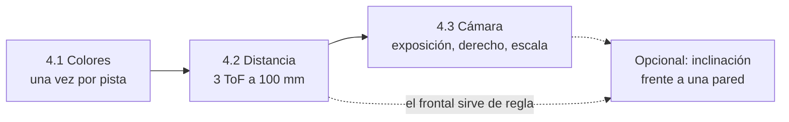
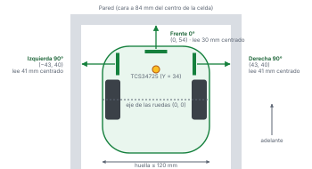
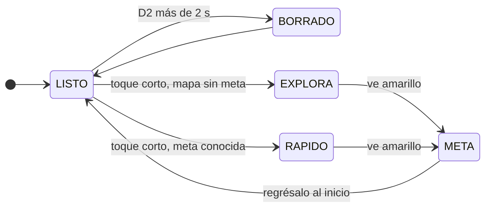
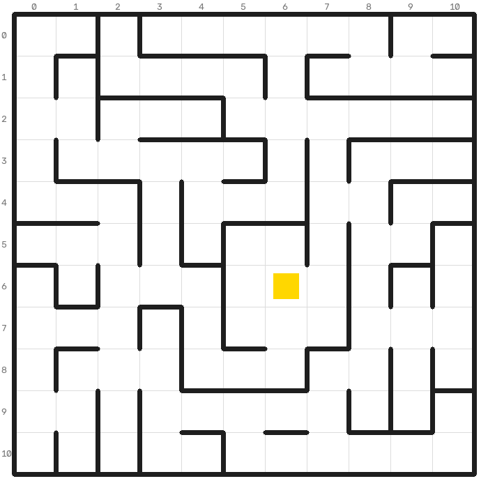

# 1. Antes de empezar

::: corto
El robot **no se mueve solo**. Lo prendes, esperas a que la pantalla diga `LISTO` y le das un **toque corto al botón D2**. Antes de eso, revisa la lista de abajo. Todo lo demás (colores, sensores, cámara) se calibra desde el celular.

Este manual describe la **v2** (carpeta `uno_q_v2/`), la versión que compitió: **2.º lugar**, con su mejor corrida en **2:06.4**. Todo el código está en el repositorio: <https://github.com/Happenedspice17/sumo-v-ia>
:::

::: checklist
- [ ] Batería cargada: **7.8 V o más**
- [ ] Ningún cable suelto
- [ ] Ruedas giran libres
- [ ] Sensores limpios
- [ ] MPU-6050 firme y plano (2 tornillos o cinta doble cara), cables amarrados
- [ ] Cámara y hub USB conectados, con el cargador del hub
- [ ] Robot quieto en una esquina del laberinto (cualquiera: se ubica solo)
- [ ] Laberinto nuevo: borra el mapa antes de empezar (capítulo 3)
:::

## Qué versión cargar

| Parte | Carpeta | Nota |
|---|---|---|
| App de App Lab | `uno_q_v2/` | Se llama **"Laberinto v2"** (`app.yaml`). Es otra app: la v1 (`uno_q/`) queda como estaba |
| Sketch (STM32) | `uno_q_v2/sketch/` | `sketch.ino` y `oled.h`, con MPU-6050 |
| Python (Linux) | `uno_q_v2/python/` | Un solo `main.py` (y `requirements.txt`) |
| Página web | `uno_q_v2/assets/` | `index.html` |
| Cámara | `python/main.py` | Encendida (`USAR_CAM = True`): se ve en la web y queda en el registro, pero **no decide** (`CAM_LOC = False`): en la pista del 13-nov vio paredes falsas por reflejos del piso |
| Salida | — | Cualquier esquina del laberinto de 11 × 11: el robot deduce solo dónde está |

## Cómo cargar la app (una vez)

1. En App Lab crea una app nueva y copia los archivos de `uno_q_v2/`: `sketch/sketch.ino` y `sketch/oled.h`, `python/main.py`, `python/requirements.txt` y `assets/index.html` (carpeta `assets/` en la raíz de la app).
2. Agrega el brick **WebUI - HTML** (panel Bricks). Sin él no hay página web.
3. En las librerías del sketch agrega `Adafruit SSD1306`, `Adafruit GFX Library`, `Adafruit TCS34725` y `VL53L0X` (de Pololu).
4. Conecta la cámara y el hub (con su cargador) **antes** de darle **Run**. App Lab carga el sketch al STM32 y arranca el Python.

::: tip
¿Necesitas la v1 o la versión vieja sin MPU? Están en `uno_q/` y en el historial de git. Mira el capítulo 9, "Control de versiones".
:::

# 2. Cómo encenderlo

::: corto
Prende el switch sin tocar el botón y espera unos 20 segundos sin mover el robot. Cuando la pantalla diga `LISTO` y el número de `PY` suba, ya puedes arrancar.
:::

1. Prende el switch **sin tocar el botón**.
2. Espera **20 segundos**. Si el MPU-6050 está conectado, el robot mide su giroscopio al arrancar.
3. Mira la pantalla: debe mostrar el estado y `PY` con un número que sube. **Está listo** cuando dice `LISTO`.

::: cuidado
No muevas el robot mientras arranca. El MPU-6050 mide su desfase con el robot quieto; si lo mueves, gira mal toda la corrida.
:::

::: figura

```mermaid
flowchart LR
  A([Switch ON]) --> B[Espera 20 s<br/>sin moverlo]
  B --> C{¿PY sube?}
  C -- No --> D[App Lab → Run]
  D --> C
  C -- Sí --> E([LISTO])
```

**Figura 1. Encendido.** Qué mirar: el único paso que puede fallar es que Python no arranque; lo notas porque `PY` no sube.
:::

## Qué dice la pantalla

| Pantalla | Qué significa |
|---|---|
| Arriba: `LISTO` | Esperando. Listo para correr |
| `EXPLORA` | Corriendo y mapeando (primera vez) |
| `RAPIDO` | Corriendo por la ruta corta conocida |
| `META` | Encontró el amarillo y se detuvo |
| `BORRADO` | Mapa y conteo borrados |
| `SIN CAM` | No hay cámara. El robot sigue funcionando igual (la cámara no decide) |
| Arriba, después del estado: `SENSA`, `DECIDE`, `GIRA`, `AVANZA`, `ESCANEA` | Fase actual de la corrida |
| Abajo: `PY n` | Si no sube, Python no corre. Si aparece `G`, el MPU-6050 está detectado |

::: tip
La pantalla se actualiza solo con el robot quieto; durante el movimiento no cambia. Si `PY` no sube, conecta la laptop, abre App Lab y dale **Run**.
:::

# 3. Cómo usar el botón D2

::: corto
Un toque corto arranca o detiene. Mantenerlo más de 2 s borra el mapa. Presionado al prender entra a la prueba de sensores. Lo mismo se hace desde la página web.
:::

| Haz esto | Pasa esto |
|---|---|
| **Toque corto** | Arranca una corrida. Empieza siempre en la misma celda y viendo al mismo lado |
| **Otro toque corto** (mientras corre) | La detiene |
| **Mantener más de 2 s** y soltar | Borra el mapa y el conteo (laberinto nuevo) |
| **En la web: ▶ Iniciar / ■ Detener / Borrar mapa** | Lo mismo que el toque corto, otro toque y mantener 2 s, desde el celular |
| **Presionado al prender** | Modo prueba de sensores: la pantalla muestra `CALIBRACION` con r, g, b, color y distancias |

::: tip
El robot trae el mapa de la pista: se ubica solo y va al amarillo por el camino más corto. Si duda, decide con la brújula. Borra con D2 antes de cada laberinto nuevo y cada vez que cambies de esquina de salida.
:::

# 4. Cómo calibrar desde la página web

::: corto
Todo se calibra desde el celular: colores, sensores de distancia, avance y cámara. No necesitas cables ni reprogramar. Lo que calibras se guarda en el robot (`/app/datos/`) y se carga solo en cada arranque. Sigue el orden: primero distancia, luego cámara (la inclinación usa el frontal como regla). Lo único que se ajusta en el código es la parada en aberturas (`TRAS_SALTO`, capítulo 6).
:::

1. Prende el robot normal y espera a que suba `PY`.
2. En la laptop o el celular (en el mismo WiFi que la placa), abre **`http://<IP>:7000`**. La IP cambia según la red: App Lab la muestra al darle Run.

| En la página | Para qué |
|---|---|
| Corrida (arriba) | Iniciar, detener y borrar el mapa sin tocar el robot |
| Asistente de colores | Calibrar los 5 colores del piso (4.1) |
| Ver sensores ToF → Calibrar distancia | Calibrar los 3 sensores de distancia con el vernier (4.2) |
| Cámara → Calibrar cámara | Exposición, sensibilidad al blanco, rumbo derecho, escala e inclinación (4.3) |
| Ver sensores ToF (dibujo) | Ver en vivo lo que mide cada sensor y qué haría el robot, sin moverlo |
| Cámara | Ver lo que ve: camino, bases de las paredes y "Celdas libres al frente" (capítulo 5) |
| Dónde está | Fase, celda, celdas mapeadas, meta y último avance durante la corrida |

::: figura

**Figura 2. Orden de calibración.** Qué mirar: la inclinación de la cámara depende del ToF frontal, así que el paso 4.2 va antes.
:::

## 4.1 Colores (una vez por pista)

1. Sigue el asistente. Pon el robot **en el piso de la pista**, quieto, encima del color que te pide, y aprieta **Guardar**. Son 5: piso, rojo, verde, azul y amarillo. Cada botón promedia 5 lecturas.
2. Al final sale **¡Listo!**. Pasa el sensor por cada color y revisa que arriba diga el nombre correcto.
3. Si uno falla, dale **◀ Atrás** y repítelo.

::: tip
Se guarda solo y se queda aunque apagues. Recalibra solo si cambias de pista o de lugar (otra luz).
:::

## 4.2 Sensores de distancia (una vez, o si mueves un sensor)

1. Abre **Ver sensores ToF** y baja a **Calibrar distancia**. Deja el robot quieto.
2. Pon algo plano y blanco (un trozo de pared) frente al sensor, a **100 mm** medidos con el vernier desde la cara del sensor.
3. Aprieta **Izq a 100 mm**, **Frente a 100 mm** o **Der a 100 mm**. Promedia 10 lecturas y corrige el desfase de ese sensor.
4. Abajo sale cada sensor: "a 100 mm leía X mm → corrige ±Y mm". El dibujo de arriba ya muestra la distancia corregida y, debajo, la lectura sin calibrar.

::: figura
{width=88%}

**Figura 3. Dónde está cada sensor.** Qué mirar: con el robot centrado en la celda, los laterales deben leer unos 41 mm y el frontal unos 30 mm, ya calibrados.
:::

::: checklist
- [ ] Izquierdo a 100 mm
- [ ] Frontal a 100 mm
- [ ] Derecho a 100 mm
:::

::: cuidado
Los umbrales (`PARED`, `D_FRENTE`, `FRENTE_LIBRE`) se ajustaron con lecturas sin calibrar. Después de calibrar, revisa en el dibujo qué lee el robot centrado en una celda. Si salió mal, solo repítelo: reemplaza la calibración anterior de ese sensor. **Borrar** la quita.
:::

## 4.2b Avance sin encoders (una vez, o si cambia la batería o el piso)

1. En **Ver sensores ToF**, baja a **Calibrar avance**. Pon el robot en el piso con espacio libre adelante y marca dónde está el eje (las ruedas).
2. Aprieta **Avanzar 10 cm**: avanza por tiempo, sin medir con el frontal.
3. Mide con regla cuánto avanzó de verdad, escríbelo en **mm reales** y aprieta **Guardar**. Ajusta los ms por celda en proporción y se guarda en el robot.
4. Repite hasta que avance 100 mm (±5).

::: tip
Solo se usa cuando el frontal no ve pared a menos de 250 mm (en la v2 el frontal solo mide de cerca). Con pared enfrente, el robot mide con el ToF y se centra con ella (`centrar`).
:::

## 4.3 Cámara (una vez, o si mueves la cámara)

1. Abre **Calibrar cámara**, abajo de la imagen.
2. **Exposición:** escribe un número en **Exp** y aprieta **Aplicar** hasta que el piso salga negro y las paredes blancas, sin manchas (unidades de 100 µs: 100 = 10 ms; 0 la deja automática). **Gan** en −1 no toca la ganancia.
3. **Sensibilidad al blanco:** déjala en 0. Súbela de 10 en 10 si no ve la pared como blanco; ponla negativa si ve blanco donde hay piso negro. Aprieta **Aplicar**.
4. **Derecho:** pon el robot derecho y centrado en un pasillo largo y aprieta **Está derecho**.
5. **Escala:** gíralo a mano **15° a la derecha** (con transportador) y aprieta **Fijar escala**. Al regresarlo derecho, abajo de la imagen debe decir "Rumbo: derecho" o 1-2°.
6. **Inclinación (opcional, solo para la vista web):** pon el robot **derecho frente a una pared, a 15–40 cm**, y aprieta **Calibrar inclinación**. Usa el ToF frontal como regla, así que calíbralo antes (4.2). Si el frontal no lee entre 100 y 450 mm, no guarda nada y pide acomodar el robot.
7. Revisa la imagen: los **puntos amarillos** deben caer en la base de las paredes y el texto **"Celdas libres al frente"** debe decir cuántas celdas libres hay de verdad delante del robot.

::: checklist
- [ ] Exposición
- [ ] Sensibilidad al blanco
- [ ] Derecho
- [ ] Escala (15°)
- [ ] Opcional: inclinación (frente a una pared a 15–40 cm) y puntos amarillos en la base de las paredes
:::

::: tip
Si mueves la cámara, repite estos pasos. En la v2 la cámara no decide, así que una cámara mal calibrada no hace fallar la corrida; pero lo que ve queda en el registro (capítulo 8) para compararlo con el mapa.
:::

# 5. Cómo revisar la cámara

::: corto
La página muestra lo que ve la cámara. En un pasillo libre, el camino debe salir **verde**. Si sale rojo, ajusta la exposición. Durante una corrida verás la última foto que tomó el robot, no video en vivo. En la v2 la cámara **solo mira**: el robot no va lento ni se ubica con ella.
:::

| Marca en la imagen | Qué significa |
|---|---|
| Camino **rojo** | Ve blanco (pared) en el piso por donde va a pasar |
| Camino **verde** | Ve negro (piso libre) |
| Líneas **azules** | Las bases de las 2 paredes y su punto de fuga. Si el punto queda a un lado de la línea blanca, el robot va chueco |
| Puntos **amarillos** | Dónde empieza la pared en cada columna de la imagen. Deben caer en la base de las paredes |
| Texto abajo | "Celdas libres al frente", pared o abierto a cada lado de las 2 celdas de adelante, qué tan chueco va y la inclinación calibrada |

::: ajuste
Camino rojo sobre piso libre o puntos amarillos fuera de la base de las paredes: revisa primero la exposición y la sensibilidad al blanco (4.3), y luego repite **Calibrar inclinación**. El piso negro brillante refleja la luz y puede verse como pared.
:::

# 6. Cómo ajustar el movimiento

::: corto
Calibra con la batería cargada. Cambia **un número a la vez** en `uno_q_v2/sketch/sketch.ino` (o en `uno_q_v2/python/main.py` si es de pasillos o estrategia), dale **Run** y prueba. Después de cada prueba, mantén D2 por 2 s para borrar.
:::

| Si el robot... | Cambia | Valor hoy | Así |
|---|---|---|---|
| No llega a la siguiente celda (sin pared enfrente) | Web: Calibrar avance | 700 ms | Repite la prueba de 10 cm |
| Se pasa de la celda (sin pared enfrente) | Web: Calibrar avance | 700 ms | Repite la prueba de 10 cm |
| Se queda dando vueltas en una zona | `RUIDO` / `CASTIGO` (main.py) | 0.6 / 1.0 | Sube `CASTIGO` a 1.5 |
| Se pasa del giro | `ADELANTO` | 6° | Súbelo 2 |
| Le falta giro | `ADELANTO` | 6° | Bájalo 2 |
| Zigzaguea en recta | `KG` | 2.0 | Bájalo a 1.5 |
| Tarda en enderezarse en recta | `KG` | 2.0 | Súbelo a 3 |
| Dice "choque" en el log sin haber chocado | `CHOQUE_G` | 1.5 g | Súbelo 0.1 |
| Choca y el log no dice "choque" | `CHOQUE_G` | 1.5 g | Bájalo 0.1 (mira el "golpe" del log) |
| Se detiene solo: "me levantaron" | `LEVANTA_G` | 0.8 g | Bájalo a 0.7 |
| Se ve tieso en pasillos largos | `PASILLO` (main.py) | 3 | Súbelo a 4 |
| Pierde la posición en pasillos largos | `PASILLO` (main.py) | 3 | Bájalo a 2 (1 = parar en cada celda) |
| Laberinto de otro tamaño | `CENTRO` (main.py) | 5 | (lado − 1) / 2 |
| Al acabarse una pared lateral, para atrás del centro de la celda | `TRAS_SALTO` | 85 mm | Súbelo 5 |
| Al acabarse una pared lateral, para adelantado del centro de la celda | `TRAS_SALTO` | 85 mm | Bájalo 5 |
| Tras avanzar va y viene frente a la pared | `CENTRA_F` (main.py) | 250 mm | Bájalo |
| Se va a la derecha | `AJUSTE_DER` | −10 | Súbelo 5 |
| Se va a la izquierda | `AJUSTE_DER` | −10 | Bájalo 5 |
| Zigzaguea entre paredes | `KC` | 0.8 | Bájalo, por ejemplo a 0.5 |

::: ajuste
**`TRAS_SALTO` se calibra en pista.** Deja que el robot pare en una abertura lateral y mide dónde quedó el eje: si quedó **adelantado** del centro de la celda, bájalo; si quedó **atrás**, súbelo. En simulación funciona de 75 a 95 mm; con 105 ya falla.
:::

::: ajuste
Con MPU-6050 el robot sostiene el rumbo solo en recta, y la v2 aprende sola la diferencia entre motores mientras avanza, así que `AJUSTE_DER` casi no hace falta. Si se desvía o gira de más o de menos, revisa primero `ADELANTO`.
:::

::: tip
Para ver por qué gira o avanza, usa **Ver sensores ToF** en la página: dibuja en vivo lo que mide cada sensor y qué haría el robot.
:::

# 7. Cómo correr el laberinto

::: corto
Pon el robot en cualquier esquina y dale un toque corto. Con la pista cargada se ubica solo comparando lo que ven sus sensores con el mapa, y va al amarillo por el camino más corto. Si repites desde la misma esquina, la segunda corrida usa la meta guardada (`RAPIDO`).
:::

1. **Mantén D2 por 2 s** y suelta (borra las pruebas).
2. Pon el robot quieto en **una esquina**, en cualquier orientación.
3. Dale un **toque corto**. Busca el amarillo y se detiene solo en `META`.
4. Para repetir, regrésalo **a la misma esquina y posición** y dale **toque corto**: va directo por la ruta guardada (`RAPIDO`).

::: figura

**Figura 4. Estados de una corrida.** Qué mirar: el robot elige `EXPLORA` o `RAPIDO` solo, según si el mapa guardado ya tiene la meta.
:::

::: figura
{width=46%}

**Figura 5. La pista que trae el robot.** Qué mirar: si las paredes de tu pista no coinciden con este mapa, el robot lo nota y sigue con la brújula; si cambió mucho, avisa al equipo para actualizar `PISTA_H` y `PISTA_V`.
:::

::: cuidado
Entre intentos del mismo laberinto **no borres**: así recuerda el camino. Borra solo cuando cambies de laberinto.
:::

# 8. Qué hacer si…

::: corto
Busca el síntoma en la tabla. La mayoría de los problemas se arreglan con una recalibración desde la web o revisando un cable.
:::

| Síntoma | Causa probable | Solución |
|---|---|---|
| No se mueve | No recibió el toque corto, o no está en `LISTO` | Dale un toque corto a D2 con la pantalla en `LISTO` |
| Se pasa de la meta | Amarillo mal calibrado, o va por tiempo | Recalibra el amarillo (4.1). Si va por tiempo, recalibra el avance (4.2b) |
| Al abrirse un lado, se detiene antes o después del centro de la celda | `TRAS_SALTO` desajustado | Ajústalo de 5 en 5 (capítulo 6) |
| Gira de más o de menos | `ADELANTO` desajustado | Ajusta `ADELANTO` (capítulo 6) |
| No sale la `G` abajo en la pantalla | El MPU-6050 no responde | Revisa VCC, GND, SDA, SCL y que AD0 vaya a GND. Sin él gira por tiempo y gira mal |
| Se detiene a media corrida y el log dice "me levantaron" | Lo moviste o se inclinó | Si no fue eso, baja `LEVANTA_G` |
| Gira al revés | Motores cruzados en el puente H | Cambia OUT1-2 por OUT3-4 en el puente H |
| Un motor va al revés | Cables del motor invertidos | Voltea sus 2 cables en el puente H |
| La cámara ve paredes donde no hay (camino rojo o puntos amarillos sobre piso libre) | Reflejos del piso brillante o cámara mal calibrada | Ajusta exposición y sensibilidad y repite **Calibrar inclinación** (4.3). La corrida no se afecta: la cámara no decide |
| **Calibrar inclinación** no guarda | El frontal no lee entre 100 y 450 mm, o no ve la pared | Pon el robot derecho frente a una pared a 15–40 cm y repite |
| No para en el amarillo | Amarillo mal calibrado (lo detecta el sensor de color, no la cámara) | Recalibra el amarillo en la página (4.1) |
| Un color sale mal | Calibración de ese color | Repítelo en la página con **◀ Atrás** |
| `PY` no sube | Python no corre | App Lab → **Run** |
| `SIN VL53L0X` | Sensores de distancia sin conexión | Revisa sus cables |
| `SIN SENSOR COLOR` | Sensor de color sin conexión | Revisa sus cables |
| `SIN CAM` en la pantalla | Hub sin cargador o cámara fuera del hub | Conecta el cargador del hub y la cámara al hub. El robot funciona sin cámara, pero no revisa el piso |
| La cámara sale negra | Cámara conectada después de Run | Conecta cámara y hub **antes** de darle Run; el hub con su cargador |
| La página no abre | Otra red o IP equivocada | Usa el mismo WiFi que la placa y la IP que muestra App Lab con `:7000` |
| Se pierde o el mapa está mal | Mapa viejo o con errores | Mantén D2 por 2 s para borrar y empieza de nuevo |
| Pantalla negra | Arranque en curso o batería baja | Espera; si sigue, revisa la batería |
| Las primeras celdas va hacia un lado raro | Todavía no sabe en qué esquina está: decide con la brújula | Es normal; en pocas celdas se ubica y toma el camino corto |
| Nunca se ubica y da vueltas | La pista no es la del mapa cargado | Usa `ESTRATEGIA = "brujula"` en `main.py`, o actualiza `PISTA_H` / `PISTA_V` |
| La segunda corrida va a un lugar equivocado | Cambiaste de esquina y usó la meta guardada | Borra el mapa (D2 más de 2 s) al cambiar de esquina |
| No sabes por qué falló una corrida | — | Revisa su registro (abajo) |

## Revisar el registro de una corrida

Cada corrida deja dos archivos en `/app/datos/logs/` (la carpeta `datos/logs/` de la app en la placa): un texto con todo lo que imprimió el robot y un `..._crudo.csv` con unas 20 lecturas por segundo (3 ToF, desvío del giroscopio, mm avanzados) y cada decisión, giro y avance. Cada arranque deja también su propio texto.

1. Copia los archivos a la laptop (por ejemplo con `adb pull` desde la carpeta de la app).
2. En la laptop, desde `uno_q_v2/`, corre `python3 sim/repite.py archivo_crudo.csv`.
3. Lee en cada decisión qué vio el robot, dónde creía estar (sus 3 mejores hipótesis) y qué decidió. Donde lo que vio no cuadra con la pista está la falla.

# 9. Control de versiones

::: corto
La versión que se usa es la v2 (`uno_q_v2/`, app "Laberinto v2"); la v1 (`uno_q/`) queda como estaba. Cada una tiene un solo sketch (con MPU-6050) y un solo Python. La estrategia (`ESTRATEGIA`) y la cámara (`USAR_CAM`, `CAM_LOC`, `EXPERIMENTAL`) son banderas dentro de `main.py`. Historial completo: <https://github.com/Happenedspice17/sumo-v-ia>
:::

| Revisión | Qué cambió para quien lo usa |
|---|---|
| B2 | Llegan 2 sketches: `sketch/` (con MPU-6050) y `sketch_sin_mpu/` |
| B4 | La web inicia, detiene y borra el mapa; cronómetro y colores vistos |
| B5 | El MPU se usa completo: se endereza antes de avanzar, verifica giros, se recupera de choques y se detiene si lo levantan |
| B6 | Queda un solo sketch, `sketch/` (con MPU-6050). `sketch_sin_mpu/` se quitó del repositorio |
| B7 | Queda un solo Python. La versión experimental de la cámara es `EXPERIMENTAL = True` en `main.py` |
| B8 | Sale de cualquier esquina y se ubica solo con el mapa de la pista; cámara apagada; avance calibrable en la web |
| **B9** | **Llega la v2 (`uno_q_v2/`, app "Laberinto v2"), la que compitió: 2.º lugar, 2:06.4. Para al centro de la celda en cada orilla de pared (`TRAS_SALTO` = 85 mm), frontal solo de cerca (250 mm), cámara visible en la web con "Calibrar inclinación" pero sin decidir, y registro de cada corrida en `/app/datos/logs/`** |

::: tip
Si algún día hace falta la versión sin MPU, está en el commit `2e01996` del repositorio (carpeta `uno_q/sketch_sin_mpu/`). El detalle está en el manual técnico, capítulo "Control de versiones".
:::

# 10. Glosario

| Término | Significado |
|---|---|
| **App Lab** | Programa de Arduino que carga el sketch al STM32 y arranca el Python |
| **Registro (log)** | Archivos que deja cada corrida en `/app/datos/logs/`: texto y `_crudo.csv` |
| **D2** | El botón del robot (pin digital 2) |
| **MPU-6050** | Sensor de giro y aceleración: mide cuánto gira el robot y si chocó |
| **OLED** | La pantallita del robot |
| **PY** | Contador en la pantalla que sube mientras Python responde |
| **Sketch** | El programa del STM32 (la parte que mueve motores y lee sensores) |
| **ToF** | *Time of Flight*: sensor láser de distancia (VL53L0X) |
| **Vernier** | Calibrador para medir los 100 mm de la calibración |
