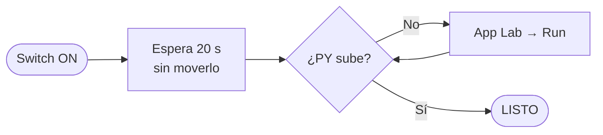
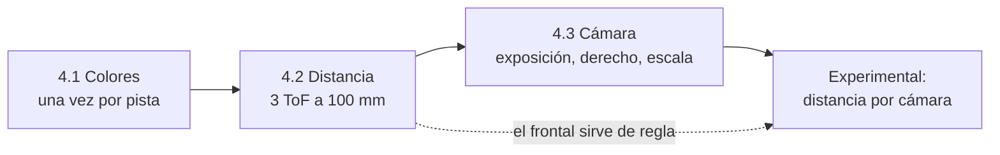
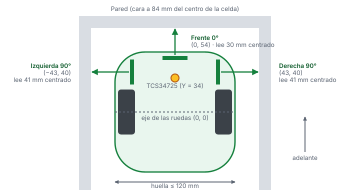
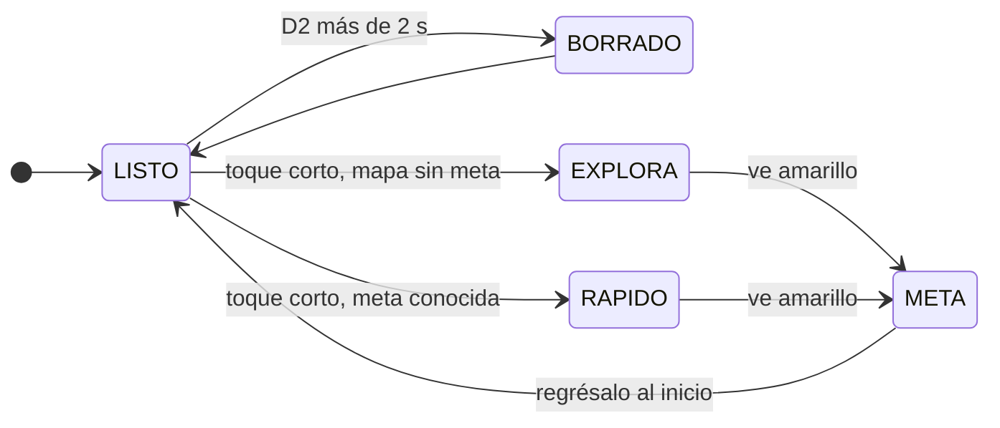

# 1. Antes de empezar

::: corto
El robot **no se mueve solo**. Lo prendes, esperas a que la pantalla diga `LISTO` y le das un **toque corto al botón D2**. Antes de eso, revisa la lista de abajo. Todo lo demás (colores, sensores, cámara) se calibra desde el celular.
:::

::: checklist
- [ ] Batería cargada: **7.8 V o más**
- [ ] Ningún cable suelto
- [ ] Ruedas giran libres
- [ ] Sensores limpios
- [ ] MPU-6050 firme y plano (2 tornillos o cinta doble cara), cables amarrados
- [ ] Cámara y hub USB conectados, con el cargador del hub
- [ ] Robot en la esquina de inicio, mirando hacia adelante, y quieto
- [ ] Laberinto nuevo: borra el mapa antes de empezar (capítulo 3)
:::

## Qué versión cargar

| Parte | Carpeta | Nota |
|---|---|---|
| Sketch (STM32) | `sketch/` | Siempre este, con MPU-6050 |
| Python (Linux) | `python/` | Un solo `main.py` |
| Cámara experimental | `python/main.py` | Cambia `EXPERIMENTAL = False` a `True`: además mide distancias y ve aberturas |

::: tip
¿Necesitas la versión vieja sin MPU? Está en el historial de git. Mira el capítulo 9, "Control de versiones".
:::

# 2. Cómo encenderlo

::: corto
Prende el switch sin tocar el botón y espera unos 20 segundos sin mover el robot. Cuando la pantalla diga `LISTO` y el número de `PY` suba, ya puedes arrancar.
:::

1. Prende el switch **sin tocar el botón**.
2. Espera **20 segundos**. Si el MPU-6050 está conectado, el robot mide su giroscopio al arrancar.
3. Mira la pantalla: debe mostrar el estado y `PY` con un número que sube. **Está listo** cuando dice `LISTO`.

::: cuidado
No muevas el robot mientras arranca. El MPU-6050 mide su desfase con el robot quieto; si lo mueves, gira mal toda la corrida.
:::

::: figura

**Figura 1. Encendido.** Qué mirar: el único paso que puede fallar es que Python no arranque; lo notas porque `PY` no sube.
:::

## Qué dice la pantalla

| Pantalla | Qué significa |
|---|---|
| Arriba: `LISTO` | Esperando. Listo para correr |
| `EXPLORA` | Corriendo y mapeando (primera vez) |
| `RAPIDO` | Corriendo por la ruta corta conocida |
| `META` | Encontró el amarillo y se detuvo |
| `BORRADO` | Mapa y conteo borrados |
| `SIN CAM` | No hay cámara. El robot sigue funcionando |
| Arriba, después del estado: `SENSA`, `DECIDE`, `GIRA`, `AVANZA`, `ESCANEA` | Fase actual de la corrida |
| Abajo: `PY n` | Si no sube, Python no corre. Si aparece `G`, el MPU-6050 está detectado |

::: tip
La pantalla se actualiza solo con el robot quieto; durante el movimiento no cambia. Si `PY` no sube, conecta la laptop, abre App Lab y dale **Run**.
:::

# 3. Cómo usar el botón D2

::: corto
Un toque corto arranca o detiene. Mantenerlo más de 2 s borra el mapa. Presionado al prender entra a la prueba de sensores. Lo mismo se hace desde la página web.
:::

| Haz esto | Pasa esto |
|---|---|
| **Toque corto** | Arranca una corrida. Empieza siempre en la misma celda y viendo al mismo lado |
| **Otro toque corto** (mientras corre) | La detiene |
| **Mantener más de 2 s** y soltar | Borra el mapa y el conteo (laberinto nuevo) |
| **En la web: ▶ Iniciar / ■ Detener / Borrar mapa** | Lo mismo que el toque corto, otro toque y mantener 2 s, desde el celular |
| **Presionado al prender** | Modo prueba de sensores: la pantalla muestra `CALIBRACION` con r, g, b, color y distancias |

::: tip
La primera corrida explora y mapea hasta encontrar el amarillo. Las siguientes van directo por la ruta corta si ya conocen la meta. Borra con D2 antes de cada laberinto nuevo.
:::

# 4. Cómo calibrar desde la página web

::: corto
Todo se calibra desde el celular: colores, sensores de distancia y cámara. No necesitas cables ni reprogramar. Lo que calibras se guarda en el robot y se carga solo en cada arranque. Sigue el orden: primero distancia, luego cámara (usa el frontal como regla).
:::

1. Prende el robot normal y espera a que suba `PY`.
2. En la laptop o el celular (en el mismo WiFi que la placa), abre **`http://<IP>:7000`**. La IP cambia según la red: App Lab la muestra al darle Run.

| En la página | Para qué |
|---|---|
| Corrida (arriba) | Iniciar, detener y borrar el mapa sin tocar el robot |
| Asistente de colores | Calibrar los 5 colores del piso (4.1) |
| Ver sensores ToF → Calibrar distancia | Calibrar los 3 sensores de distancia con el vernier (4.2) |
| Cámara → Calibrar cámara | Exposición, rumbo derecho, escala y (experimental) distancia (4.3) |
| Ver sensores ToF (dibujo) | Ver en vivo lo que mide cada sensor y qué haría el robot, sin moverlo |
| Cámara | Ver si el camino sale blanco (pared) o negro (capítulo 5) |
| Dónde está | Fase, celda, celdas mapeadas, meta y último avance durante la corrida |

::: figura

**Figura 2. Orden de calibración.** Qué mirar: la distancia por cámara depende del ToF frontal, así que el paso 4.2 va antes.
:::

## 4.1 Colores (una vez por pista)

1. Sigue el asistente. Pon el robot **en el piso de la pista**, quieto, encima del color que te pide, y aprieta **Guardar**. Son 5: piso, rojo, verde, azul y amarillo. Cada botón promedia 5 lecturas.
2. Al final sale **¡Listo!**. Pasa el sensor por cada color y revisa que arriba diga el nombre correcto.
3. Si uno falla, dale **◀ Atrás** y repítelo.

::: tip
Se guarda solo y se queda aunque apagues. Recalibra solo si cambias de pista o de lugar (otra luz).
:::

## 4.2 Sensores de distancia (una vez, o si mueves un sensor)

1. Abre **Ver sensores ToF** y baja a **Calibrar distancia**. Deja el robot quieto.
2. Pon algo plano y blanco (un trozo de pared) frente al sensor, a **100 mm** medidos con el vernier desde la cara del sensor.
3. Aprieta **Izq a 100 mm**, **Frente a 100 mm** o **Der a 100 mm**. Promedia 10 lecturas y corrige el desfase de ese sensor.
4. Abajo sale cada sensor: "a 100 mm leía X mm → corrige ±Y mm". El dibujo de arriba ya muestra la distancia corregida y, debajo, la lectura sin calibrar.

::: figura
{width=88%}

**Figura 3. Dónde está cada sensor.** Qué mirar: con el robot centrado en la celda, los laterales deben leer unos 41 mm y el frontal unos 30 mm, ya calibrados.
:::

::: checklist
- [ ] Izquierdo a 100 mm
- [ ] Frontal a 100 mm
- [ ] Derecho a 100 mm
:::

::: cuidado
Los umbrales (`PARED`, `D_FRENTE`, `FRENTE_LIBRE`) se ajustaron con lecturas sin calibrar. Después de calibrar, revisa en el dibujo qué lee el robot centrado en una celda. Si salió mal, solo repítelo: reemplaza la calibración anterior de ese sensor. **Borrar** la quita.
:::

## 4.3 Cámara (una vez, o si mueves la cámara)

1. Abre **Calibrar cámara**, abajo de la imagen.
2. **Exposición:** escribe un número y aprieta **Aplicar** hasta que el piso salga negro y las paredes blancas, sin manchas. Empieza en 100 (10 ms). 0 la deja automática.
3. **Derecho:** pon el robot derecho y centrado en un pasillo largo y aprieta **Está derecho**.
4. **Escala:** gíralo a mano **15° a la derecha** (con transportador) y aprieta **Fijar escala**. Al regresarlo derecho, abajo de la imagen debe decir "Rumbo: derecho" o 1-2°.
5. **Solo experimental:** pon el robot frente a una pared a 100, 200, 300, 400 y 600 mm y aprieta **Agregar punto** en cada una. El ToF frontal hace de regla, así que calíbralo antes (4.2).

::: checklist
- [ ] Exposición
- [ ] Derecho
- [ ] Escala (15°)
- [ ] Distancia (solo experimental)
:::

::: tip
No tienes que medir la inclinación de la cámara: estos pasos miden todo con el robot armado. Si mueves la cámara, repítelos.
:::

# 5. Cómo revisar la cámara

::: corto
La página muestra lo que ve la cámara. En un pasillo libre, el camino debe salir **verde**. Si sale rojo, ajusta la exposición. Durante una corrida verás la última foto que tomó el robot, no video en vivo.
:::

| Marca en la imagen | Qué significa |
|---|---|
| Camino **rojo** | Ve blanco (pared) en el piso por donde va a pasar. El robot va lento |
| Camino **verde** | Ve negro (piso libre). El robot va normal |
| Líneas **azules** | Las bases de las 2 paredes y su punto de fuga. Si el punto queda a un lado de la línea blanca, el robot va chueco y lo corrige antes de avanzar |
| Puntos **amarillos** (solo experimental) | Dónde empieza la pared en 5 columnas; abajo dice a cuántos mm y si ve una abertura en la celda siguiente |

::: ajuste
Camino rojo sobre piso libre: revisa primero la exposición (4.3). Si sigue, ajusta `ZONA_PASO` (la parte del piso que mira) o sube `BLANCO_MAX` (cuánto blanco tolera antes de ir lento), en `python/main.py`.
:::

# 6. Cómo ajustar el movimiento

::: corto
Calibra con la batería cargada. Cambia **un número a la vez** en `sketch/sketch.ino` (o en `python/main.py` si es de cámara o pasillos), dale **Run** y prueba. Después de cada prueba, mantén D2 por 2 s para borrar.
:::

| Si el robot... | Cambia | Valor hoy | Así |
|---|---|---|---|
| No llega a la siguiente celda (sin pared enfrente) | `MS_CELDA` | 600 ms | Súbelo 25 |
| Se pasa de la celda (sin pared enfrente) | `MS_CELDA` | 600 ms | Bájalo 25 |
| Se pasa del giro | `ADELANTO` | 6° | Súbelo 2 |
| Le falta giro | `ADELANTO` | 6° | Bájalo 2 |
| Zigzaguea en recta | `KG` | 2.0 | Bájalo a 1.5 |
| Tarda en enderezarse en recta | `KG` | 2.0 | Súbelo a 3 |
| Dice "choque" en el log sin haber chocado | `CHOQUE_G` | 1.5 g | Súbelo 0.1 |
| Choca y el log no dice "choque" | `CHOQUE_G` | 1.5 g | Bájalo 0.1 (mira el "golpe" del log) |
| Se detiene solo: "me levantaron" | `LEVANTA_G` | 0.8 g | Bájalo a 0.7 |
| Se ve tieso en pasillos largos | `PASILLO` (main.py) | 3 | Súbelo a 4 |
| Pierde la posición en pasillos largos | `PASILLO` (main.py) | 3 | Bájalo a 2 (1 = parar en cada celda) |
| Se queda antes del centro de la celda al abrirse un lado | `TRAS_SALTO` | 124 mm | Súbelo 5 |
| Se pasa del centro de la celda al abrirse un lado | `TRAS_SALTO` | 124 mm | Bájalo 5 |
| Se va a la derecha | `AJUSTE_DER` | −10 | Súbelo 5 |
| Se va a la izquierda | `AJUSTE_DER` | −10 | Bájalo 5 |
| Zigzaguea entre paredes | `KC` | 0.8 | Bájalo, por ejemplo a 0.5 |

::: ajuste
Con MPU-6050 el robot sostiene el rumbo solo en recta, así que `AJUSTE_DER` casi no hace falta. Si se desvía o gira de más o de menos, revisa primero `ADELANTO`.
:::

::: tip
Para ver por qué gira o avanza, usa **Ver sensores ToF** en la página: dibuja en vivo lo que mide cada sensor y qué haría el robot.
:::

# 7. Cómo correr el laberinto

::: corto
La primera corrida explora hasta el amarillo. La segunda, desde la misma posición, va directo por la ruta corta. No borres el mapa entre intentos del mismo laberinto.
:::

1. **Mantén D2 por 2 s** y suelta (borra las pruebas).
2. Pon el robot en la **esquina de inicio**, mirando hacia adelante.
3. Dale un **toque corto**. Explora hasta el amarillo y se detiene solo en `META`.
4. Regrésalo al inicio, en la misma posición, y dale **toque corto** otra vez: ahora va directo por la ruta corta (`RAPIDO`).

::: figura

**Figura 4. Estados de una corrida.** Qué mirar: el robot elige `EXPLORA` o `RAPIDO` solo, según si el mapa guardado ya tiene la meta.
:::

::: cuidado
Entre intentos del mismo laberinto **no borres**: así recuerda el camino. Borra solo cuando cambies de laberinto.
:::

# 8. Qué hacer si…

::: corto
Busca el síntoma en la tabla. La mayoría de los problemas se arreglan con una recalibración desde la web o revisando un cable.
:::

| Síntoma | Causa probable | Solución |
|---|---|---|
| No se mueve | No recibió el toque corto, o no está en `LISTO` | Dale un toque corto a D2 con la pantalla en `LISTO` |
| Se pasa de la meta | Amarillo mal calibrado, o va por tiempo | Recalibra el amarillo (4.1). Si va por tiempo, baja `MS_CELDA` |
| Gira de más o de menos | `ADELANTO` desajustado | Ajusta `ADELANTO` (capítulo 6) |
| No sale la `G` abajo en la pantalla | El MPU-6050 no responde | Revisa VCC, GND, SDA, SCL y que AD0 vaya a GND. Sin él gira por tiempo y gira mal |
| Se detiene a media corrida y el log dice "me levantaron" | Lo moviste o se inclinó | Si no fue eso, baja `LEVANTA_G` |
| Gira al revés | Motores cruzados en el puente H | Cambia OUT1-2 por OUT3-4 en el puente H |
| Un motor va al revés | Cables del motor invertidos | Voltea sus 2 cables en el puente H |
| Siempre va lento | La cámara ve blanco en el camino | Revisa en la página si el camino sale rojo sobre piso negro; ajusta la exposición (4.3), `ZONA_PASO` o `BLANCO_MAX` |
| Antes de avanzar gira un poquito al lado equivocado | Calibración de rumbo de la cámara | Repite "Está derecho" y "Fijar escala" (4.3) girándolo a la **derecha** |
| No para en el amarillo | Amarillo mal calibrado (lo detecta el sensor de color, no la cámara) | Recalibra el amarillo en la página (4.1) |
| Un color sale mal | Calibración de ese color | Repítelo en la página con **◀ Atrás** |
| `PY` no sube | Python no corre | App Lab → **Run** |
| `SIN VL53L0X` | Sensores de distancia sin conexión | Revisa sus cables |
| `SIN SENSOR COLOR` | Sensor de color sin conexión | Revisa sus cables |
| `SIN CAM` en la pantalla | Hub sin cargador o cámara fuera del hub | Conecta el cargador del hub y la cámara al hub. El robot funciona sin cámara, pero no revisa el piso |
| La cámara sale negra | Cámara conectada después de Run | Conecta cámara y hub **antes** de darle Run; el hub con su cargador |
| La página no abre | Otra red o IP equivocada | Usa el mismo WiFi que la placa y la IP que muestra App Lab con `:7000` |
| Se pierde o el mapa está mal | Mapa viejo o con errores | Mantén D2 por 2 s para borrar y empieza de nuevo |
| Pantalla negra | Arranque en curso o batería baja | Espera; si sigue, revisa la batería |

# 9. Control de versiones

::: corto
Hoy hay un solo sketch (con MPU-6050) y un solo Python. La cámara experimental es una bandera dentro de `main.py`.
:::

| Revisión | Qué cambió para quien lo usa |
|---|---|
| B2 | Llegan 2 sketches: `sketch/` (con MPU-6050) y `sketch_sin_mpu/` |
| B4 | La web inicia, detiene y borra el mapa; cronómetro y colores vistos |
| B5 | El MPU se usa completo: se endereza antes de avanzar, verifica giros, se recupera de choques y se detiene si lo levantan |
| B6 | Queda un solo sketch, `sketch/` (con MPU-6050). `sketch_sin_mpu/` se quitó del repositorio |
| **B7** | **Queda un solo Python. La versión experimental de la cámara es `EXPERIMENTAL = True` en `main.py`** |

::: tip
Si algún día hace falta la versión sin MPU, está en el commit `2e01996` del repositorio (carpeta `uno_q/sketch_sin_mpu/`). El detalle está en el manual técnico, capítulo "Control de versiones".
:::

# 10. Glosario

| Término | Significado |
|---|---|
| **App Lab** | Programa de Arduino que carga el sketch al STM32 y arranca el Python |
| **D2** | El botón del robot (pin digital 2) |
| **MPU-6050** | Sensor de giro y aceleración: mide cuánto gira el robot y si chocó |
| **OLED** | La pantallita del robot |
| **PY** | Contador en la pantalla que sube mientras Python responde |
| **Sketch** | El programa del STM32 (la parte que mueve motores y lee sensores) |
| **ToF** | *Time of Flight*: sensor láser de distancia (VL53L0X) |
| **Vernier** | Calibrador para medir los 100 mm de la calibración |
