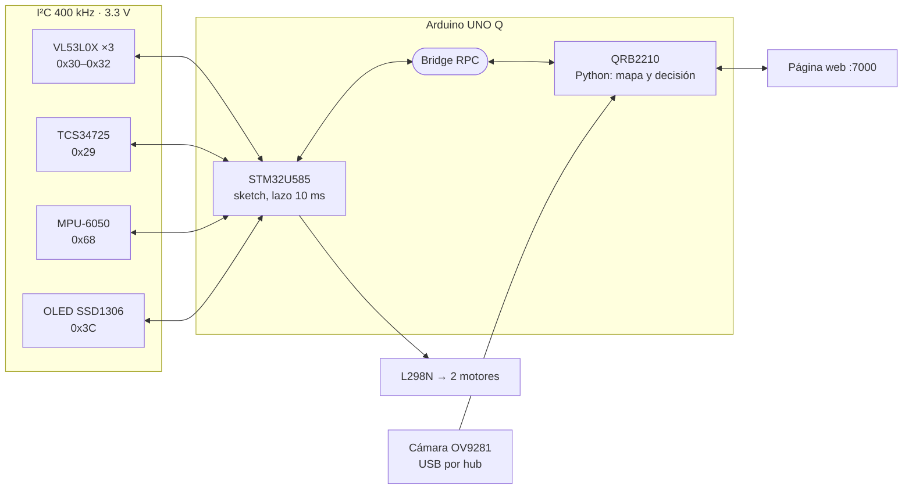
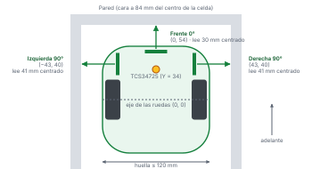
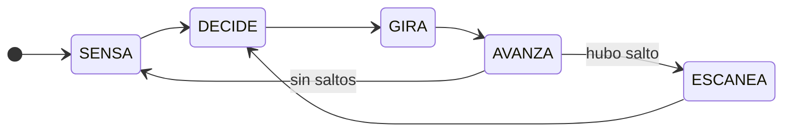
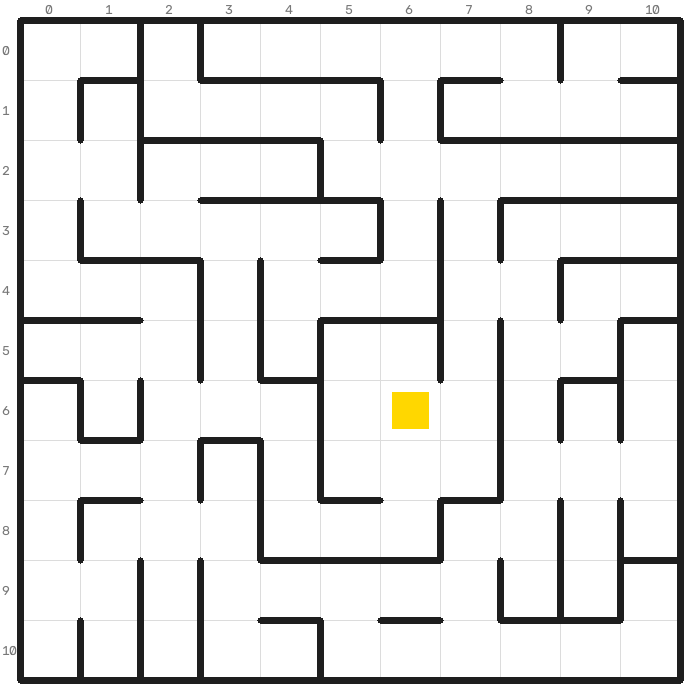

# Arduino UNO Q v2 (laberinto sin encoders)

Copia de `uno_q/` con otra idea de fondo: **sin encoders, los milímetros avanzados son una suposición; las paredes no**. Se carga completa (sketch, `python/main.py`, `assets/index.html`) como otra app de App Lab ("Laberinto v2"). `uno_q/` queda como estaba. **Sin probar en pista.**

| # | Cambio | Dónde |
|---|---|---|
| 1 | **Orillas de pared = regla.** Cada orilla de pared lateral (se acaba o empieza) está en una orilla de celda. Se acaba: para al centro de esa celda (`TRAS_SALTO`). Empieza: lo que falta se ajusta al centro de celda más cercano (`TRAS_CIERRA`). El tiempo solo dice cuántas celdas | sketch `borde()` |
| 1b | Las orillas se detectan por **umbral** (pared de carril < 75 mm, se acaba > 95 mm, 2 lecturas), no por salto brusco de 120 mm. El **centrado solo usa paredes de su carril** (< 95 mm): al pasar una abertura el cono del lateral ve la pared del pasillo perpendicular a 80–120 mm, y centrarse con eso jalaba el robot a la abertura hasta chocar | sketch `tofLee()`, `centrado()` |
| 2 | **Frontal solo de cerca.** `RANGO` 600 → 250 mm y `CENTRA_F` 600 → 250: su cono de 25° ve las paredes laterales desde ~300–400 mm (en pista leyó 407 con la pared a 4 celdas) | sketch, `main.py` |
| 3 | **Rumbo con una sola pared lateral, sin detenerse.** En 300 ms junto a una pared, lo que cambia su lectura entre lo que avanzó es el ángulo real; la diferencia con el giroscopio es deriva y se corrige 30 % por ventana. Además, quieto, vuelve a medir la deriva del giroscopio | sketch `control()`, `leeGyro()` |
| 4 | **Ubicarse con el patrón pared/abertura.** Cada ToF solo distingue 0, 1 o "2 o más" celdas libres (`VE`); más lejos la distancia no dice nada del pasillo | `leidas()`, `loc_observa()` |
| 5 | **Ruta más segura.** Dijkstra: cada celda 1, + 0.5 por lado sin pared, + 1 por giro (`COSTO_LADO`, `COSTO_GIRO`). En esta pista sale casi igual a la más corta | `ruta_segura()` |
| 6 | **Grabación.** Cada corrida deja en `/app/datos/logs/` su texto y un `..._crudo.csv`: ~20 lecturas por segundo (3 ToF, desvío del giroscopio, mm) y cada decisión, giro y avance. `python3 sim/repite.py archivo_crudo.csv` la reproduce contra el mapa: qué vio, dónde creía estar y qué decidió | `graba()`, `sim/repite.py` |

**Calibrar en pista (nuevo):** `TRAS_SALTO` (85 mm). Deja que pare en una abertura lateral y mide: si queda adelantado del centro de la celda, bájalo; si queda atrás, súbelo. En simulación sirve de 75 a 95; con 105 ya falla.

**Simulación** (`sim/`, pista real, 300 corridas por salida). El simulador v2 hace que el frontal vea las paredes laterales (`ROZA`), como en el log de pista; con eso por fin reproduce la falla real del código v1:

| Salida (foto) | v1 | v2 | v2 prueba de tontos |
|---|---|---|---|
| Abajo-derecha (10,10) viendo izquierda | 76 % | 100 %, 19 s | 98 % |
| Abajo-derecha (10,10) viendo arriba | 81 % | 99 %, 23 s | 97 % |
| Abajo-izquierda (0,10) viendo arriba | 59 % | 99 %, 23 s | 97 % |
| Arriba-izquierda (0,0) viendo derecha | 60 % | 99 %, 26 s | 98 % |
| Arriba-izquierda (0,0) viendo abajo | 67 % | 100 %, 24 s | 95 % |
| Arriba-derecha (10,0) viendo izquierda | 34 % | 98 %, 28 s | 92 % |

Repetir: `cd sim && python3 partida.py 300 normal` (o `tontos`); v1 en las mismas condiciones: `MAIN=../../uno_q/python/main.py python3 partida.py 150 normal RANGO=600 CENTRA_F=600 BORDES=0 LAT_RUMBO=0 TRAS_SALTO=110`. Pruebas: `python3 repite.py --prueba`, `python3 barrido.py`.

No simulado: la recalibración de deriva en reposo y el costo en tiempo de las llamadas de grabación.

---

# 🤖 Iteración B – Arduino UNO Q (con cámara)

**Robot de laberinto · Microcontroladores 2**
Manuel Harari López · Víctor Miguel Vázquez · Carlos Emiliano Escamilla Garibay
12 de noviembre de 2026 · Revisión B8

> Versión actual del robot. Documentación completa: [manual técnico](../docs/pdf/manual_tecnico.pdf) · [manual de uso](../docs/pdf/manual_uso.pdf) · [bitácora](../docs/pdf/historial_cambios.pdf)

**Contenido:** [Arquitectura](#-arquitectura) · [Conexiones](#-conexiones) · [Programación](#-programación-arduino-app-lab) · [Calibración](#️-calibración) · [Funcionamiento](#️-funcionamiento) · [Glosario](#-glosario)

## 🧭 Arquitectura

> **En corto:** el STM32 mueve los motores, lee los sensores y maneja la OLED (`sketch/`). Linux corre Python con la cámara y resuelve el laberinto (`python/`). Se comunican por Bridge.

*Figura 1. Arquitectura. Qué mirar: lo de tiempo real cuelga del STM32; Linux decide, mira con la cámara y sirve la web.*

## 🔌 Conexiones

> **En corto:** motores en D5–D10, botón en D2, XSHUT de los ToF en A0–A2 y todos los sensores en el bus I²C a 3.3 V. El diagrama completo está en [`../docs/diagrama_conexiones.png`](../docs/diagrama_conexiones.png).

| Componente | Pin del módulo | UNO Q |
|---|---|---|
| L298N | ENA (quitar jumper) | D5 |
| L298N | IN1 / IN2 | D7 / D8 |
| L298N | ENB (quitar jumper) | D6 |
| L298N | IN3 / IN4 | D9 / D10 |
| L298N | 12V / GND | Batería + / GND |
| VL53L0X izq / frente / der | XSHUT | A0 / A1 / A2 |
| VL53L0X ×3, TCS34725, OLED | SDA / SCL | SDA / SCL |
| VL53L0X ×3 (VCC), TCS34725 (VIN), OLED | VCC / GND | 3.3V / GND |
| TCS34725 (morado) | LED / INT | sin conectar (LED siempre encendido) |
| Botón de arranque | a GND | D2 |
| MPU-6050 (GY-521) | SDA / SCL, VCC 3.3V, GND, AD0 a GND (0x68); INT, XDA, XCL sin conectar. Plano y atornillado al chasis | SDA / SCL |
| Batería 2S 18650 (conector T) | + | interruptor → VIN |
| Cámara USB | | hub USB‑C |

VCC (3.3V), GND, SDA y SCL se reparten en la mini protoboard del Proto Shield: columnas VCC, GND, SDA, SCL. Con la Q el puente de VCC va a 3V3 (con el R3 va a 5V). Los pines son los mismos que en el R3 (`../atmega328p/`): para cambiar de placa se saca el shield con sus dupont. Ver `../docs/uno_q.md`. La posición física de cada pieza está en `../chasis/chasis.pdf`.

*Figura 2. Robot visto desde arriba. Qué mirar: posición (X, Y) de cada ToF en mm desde el eje y lo que lee cada uno con el robot centrado.*

> [!CAUTION]
> GND común entre todo. No alimentes el UNO Q con el regulador de 5 V del L298N.

## 💻 Programación (Arduino App Lab)

> **En corto:** crea la app, copia 4 archivos, agrega el brick WebUI y las librerías, y dale Run. Conecta cámara y hub antes de Run.

1. Crea una app nueva llamada `Laberinto`.
2. Copia `sketch/sketch.ino`, `python/main.py`, `python/requirements.txt` y `assets/index.html` (carpeta `assets/` en la raíz de la app).
   Un solo sketch (`sketch/`, con MPU-6050 y su `oled.h`) y un solo Python. La versión experimental de la cámara es una línea:

   | `EXPERIMENTAL` en `python/main.py` | Cámara |
   |---|---|
   | `False` (estable, como está en git) | 1 a 3: exposición fija, umbral automático (Otsu), corrección de rumbo |
   | `True` (experimental) | 1 a 5: además, distancia por cámara y aberturas adelante |

   La versión sin MPU (`sketch_sin_mpu/`) y la carpeta `python_experimental/` se quitaron del repositorio; están en el commit `2e01996`.
3. Agrega el brick **WebUI - HTML** (panel Bricks). Sin él no hay página web.
4. En las librerías del sketch agrega `Adafruit SSD1306`, `Adafruit GFX Library`, `Adafruit TCS34725` y `VL53L0X` (de Pololu).
5. Pulsa **Run**. App Lab carga el sketch al STM32 y arranca el Python.
6. Marca la app para que arranque sola: `arduino-app-cli properties set default user:laberinto2`.

> [!TIP]
> La página web se ve por WiFi en `http://<IP>:7000`. La IP cambia según la red: App Lab la muestra al darle Run, o con `adb shell hostname -I`. La laptop o el celular y la placa deben estar en la misma red.

Con el hub conectado al USB-C, App Lab se conecta por WiFi (el puerto no puede ir a la laptop y al hub a la vez). Conecta cámara y hub antes de Run.

> [!WARNING]
> **Alimentación del hub:** con la Q alimentada por VIN, su USB-C no da 5 V al hub. El hub debe recibir energía por su puerto PD: cargador PD, o 5 V ≥ 3 A del regulador del robot a un cable USB-C cortado conectado al puerto PD del hub, o módulo DC-DC con salida USB-C PD desde la batería. Alimentar solo la cámara con 5 V externos no basta.

## 🎛️ Calibración

> **En corto:** colores, distancia y cámara se calibran desde la web y se guardan en `/app/datos/`. Solo el avance por tiempo (`MS_CELDA`, `MS_90`) y `AJUSTE_DER` se ajustan en el código.

1. **Colores**: con la app corriendo abre `http://<ip de la Q>:7000` (App Lab muestra el link). El asistente pide los 5 colores uno por uno; cada botón promedia 5 lecturas. Se guarda en `/app/datos/colores.json` y se carga al MCU en cada arranque (`set_ref`). Los guardados tienen prioridad. Sin archivo guardado se usan los valores de fábrica (`REFS` en `main.py`, igual a `refs[]` del sketch):

   | Color | r | g | b | c |
   |---|---|---|---|---|
   | PISO | 0.282 | 0.379 | 0.333 | 153 |
   | ROJO | 0.602 | 0.208 | 0.188 | 581 |
   | VERDE | 0.155 | 0.535 | 0.309 | 636 |
   | AZUL | 0.16 | 0.329 | 0.508 | 354 |
   | AMAR | 0.409 | 0.449 | 0.142 | 1836 |

   **Sensores**: enciende con el botón presionado. La OLED muestra `r g b c`, el color detectado y las 3 distancias. Con el robot centrado en una celda los laterales deben leer ~41 mm (`D_LADO`) y el frontal ~30 mm (`D_FRENTE`), si los ToF están calibrados.
2. **Distancia (VL53L0X)**: en la web, "Ver sensores ToF" → "Calibrar distancia". Pon una pared a **100 mm** de la cara del sensor (vernier) y aprieta "Izq/Frente/Der a 100 mm" (promedia 10 lecturas). Corrige solo el desfase: `real = crudo + b`, con un punto por sensor; repetirlo reemplaza el anterior. (El ajuste de recta `real = a·crudo + b` con varios puntos sigue en el código si algún día hace falta.) Se guarda en `/app/datos/tof.json`, se manda al STM32 (`set_tof`) en cada arranque y el panel muestra la lectura sin calibrar (`odo(9..11)`).
3. **Avance**: con pared enfrente a menos de 600 mm (`RANGO`) avanza por distancia y no hay que calibrar. Sin pared a la vista avanza por tiempo: calíbralo en la web (**Calibrar avance**: avanza 10 cm por tiempo, mides con regla y guardas; ajusta `msCelda`), y `MS_90` para giros de 90°. Calibra con la batería cargada. Si se desvía, ajusta `AJUSTE_DER`.
4. **Cámara** (innomaker U20CAM-9281M, monocromática; no ve colores, el amarillo lo detecta el TCS34725). En la web, "Calibrar cámara": (1) exposición fija hasta que el piso salga negro y las paredes blancas; (2) robot derecho y centrado en un pasillo largo → "Está derecho"; (3) girado a mano unos 15° a la derecha → "Fijar escala"; (4, solo experimental) frente a una pared a varias distancias (100 a 600 mm) → "Agregar punto", usa el ToF frontal como regla. Se guarda en `/app/datos/camara.json`. La inclinación de la cámara no importa: todo se mide con el robot real. La página web muestra la imagen (160 × 120) con el camino en rojo si ve blanco o verde si ve negro. Ajusta `ZONA_PASO` para que en un pasillo libre salga verde.

> [!IMPORTANT]
> **Después de calibrar los ToF revisa los umbrales** (`D_FRENTE`, `PARED_F`, `PARED`, `D_LADO_MIN`, `FRENTE_LIBRE`): se ajustaron con lecturas sin calibrar.

> [!CAUTION]
> No se guardan imágenes en `/app`: con ellas App Lab marca "failed to start".

## ⚙️ Funcionamiento

> **En corto:** el sketch ejecuta cada movimiento y frena solo; Python decide quieto con una máquina de estados `SENSA → DECIDE → GIRA → AVANZA`. Trae el mapa de la pista, se ubica en él con los ToF y va por el camino más corto al amarillo; si duda, decide con la brújula. La cámara está apagada (`USAR_CAM = False`).

### Sketch (STM32): solo mueve el robot

- Avanza por distancia: al arrancar toma la lectura del frontal y para cuando bajó 180 mm (`CELDA`). Si el frontal no ve nada a menos de 600 mm (`RANGO`) va por tiempo (`MS_CELDA` = 700), y si a medio avance aparece una pared sigue por distancia. Siempre para a 30 mm reales de la pared de enfrente (`D_FRENTE`: el eje queda al centro de la celda) y se hace para atrás si queda a menos de 25.
- **Cambio brusco** (una lectura cambia `SALTO` = 120 mm o más y se repite en la siguiente): si se abre un lateral, para al centro de esa celda (`TRAS_SALTO` = 110 mm después) para escanearla; si salta el frontal, vuelve a medir lo que falta. Python lo lee con `odo(3)`.
- `centrar(lim)`: tras cada avance, con pared enfrente a menos de 600 mm, Python lo pide y el robot queda a 30 mm + k celdas de ella (centro de celda).
- Con `mover(mm, lento)` baja a `VEL_LENTO` (la pide Python cuando la cámara ve blanco).
- En recta se centra en el carril: con 2 paredes, que los laterales lean igual; con una, que lea 41 mm (`D_LADO`). Con las 2 paredes, centrado y paralelo, corrige la deriva del MPU. Las distancias salen de la geometría del chasis (CAD).
- Lee los ToF y el sensor de color y se los da al Python. RPC `odo(i)`: 0 mm recorridos, 1 mm que faltan, 3 saltos (1 izq, 2 frente, 4 der), 5/6/7 frente/izq/der.
- La OLED no se refresca en movimiento (tarda ~25 ms y estorba al control).

### Giros y MPU-6050

| Función | Cómo funciona |
|---|---|
| Arranque | Busca el MPU en 0x68 (OLED `G` abajo si lo encontró; si no, gira por tiempo con `MS_90`). Enciende el robot quieto: mide el bias del giroscopio |
| Rumbo absoluto | Cada giro va al ángulo deseado acumulado, así corrige lo que se pasó o le faltó el anterior. En recta sostiene ese rumbo (`KG`), además del centrado con paredes. El sentido del montaje lo aprende en el primer giro |
| Alinear | Antes de avanzar se endereza si se desvió 3° a 45° (`alinear`). Después de cada giro Python verifica el ángulo y lo termina si quedó a más de 10° |
| Choque | Un golpe de más de 1.5 g al avanzar es choque solo si el frontal dejó de bajar en los 250 ms siguientes (sin pared enfrente, solo un golpe de más de 2.5 g); entonces retrocede y vuelve a leer |
| Atorón | Girando, 400 ms sin moverse es un atorón (retrocede y sigue) |
| Levantado | Vertical bajo 0.8 g por 150 ms: detiene la corrida. `odo` 12 a 15 lo reportan |
| Calibrar `ADELANTO` | Si se pasa del giro, súbelo; si le falta, bájalo. `odo(8)` da el desvío en grados |

### Python: decide en cada paso

*Figura 3. Máquina de estados de Python. Qué mirar: todo se decide con el robot quieto; el color se revisa todo el tiempo. La fase sale en la OLED junto al estado y en la web.*

1. Lee los 3 ToF, la menor de 3 lecturas de cada uno (5 si en el avance hubo un cambio brusco). Cada lectura vota pared (+1) o libre (−1) en el mapa, con tope ±`VOTO_MAX`: una lectura mala no borra lo que vieron las demás. Por donde pasó queda libre seguro.
2. **Pista conocida** (`ESTRATEGIA = "pista"`, la de ahora): trae el mapa de las fotos y se ubica comparando lo que ven los ToF con él (16 hipótesis de salida; la odometría solo sugiere). Va por el camino más corto al amarillo; si algo cambió corrige el mapa; si nada cuadra, sigue con la brújula. Respaldo: exploración con **brújula** (`ESTRATEGIA = "brujula"`): no usa el mapa de paredes porque sin encoders la posición se desfasa; entre las salidas libres que ven los ToF toma la que apunta más al centro (giroscopio + posición aproximada), con castigo por salida repetida y algo de azar. Con `"mapa"`, exploración completa hacia el centro: de las salidas libres (lateral ≥ 120 mm; frente ≥ 120 mm reales, `FRENTE_LIBRE`, con el frontal calibrado) que llevan a una celda sin ver, toma la que más acerca al centro (empate: izquierda, frente, derecha). Sale de cualquier esquina de un 11 × 11: el centro está a `CENTRO` = 5 celdas y el lado lo deduce de las salidas libres en la esquina o de su primer movimiento (`ubica()`). Si no hay celdas nuevas, regresa por el camino conocido a la celda con lados sin explorar de menos pasos + distancia al centro (`frontera()`). Cámara apagada (`USAR_CAM = False`). Simulación 2D de las reglas: `sim/` (ver manual técnico 9.4). Así entra a una meta al centro con pocas entradas, que la mano izquierda sola rodearía sin entrar.
   

   *Figura 4. La pista cargada en `main.py` (`PISTA_H`, `PISTA_V`, `PISTA_META`). Qué mirar: el amarillo está en un cuarto con 2 entradas.*

3. Tras un cambio brusco escanea con 5 lecturas y decide igual (izquierda primero si es nueva).
4. La celda sale de los mm que de verdad avanzó. En pasillo (pared a ambos lados, de frente) avanza hasta `PASILLO` = 3 celdas de un tirón; si se abre un lateral para en el centro de esa celda.
5. Con la cámara encendida (`USAR_CAM = True`; hoy está apagada), antes de cada avance, con una sola foto:
   - Revisa el piso del camino con un umbral de gris automático (Otsu): negro → normal; blanco (pared) → va lento y el frontal hace el doble check (el sketch para a 30 mm si de verdad hay pared).
   - Mide el rumbo con el punto de fuga de las bases de las 2 paredes; si va chueco 4° o más, lo corrige (`ajustar`). Con MPU no gira: corrige el rumbo que sostiene el giroscopio. Sin MPU gira en su lugar.
   - Experimental: distancia a la pared en 5 columnas (como 5 ToF virtuales) y aberturas laterales en la celda siguiente (va lento y anota un voto débil de libre).
6. Cada color que lee el TCS34725 (3 lecturas seguidas) va al mapa en la celda donde está el sensor y se cuenta una vez. Amarillo = meta: el STM32 para solo en cuanto lo confirma, sin esperar al Python (OLED `META`).
7. El mapa (paredes, colores y meta) se guarda en `/app/datos/mapa.json`. En la siguiente corrida, si conoce la meta, va por el camino más corto conocido (BFS, OLED `RAPIDO`); si algo no cuadra, sigue explorando desde ahí.

### Botón, web y cámara

| Qué | Cómo funciona |
|---|---|
| Botón corto | Corrida nueva (pon el robot en el inicio). Otro toque la detiene. Cada corrida empieza en la misma celda y viendo al mismo lado |
| Botón sostenido más de 2 s | Borra el mapa y el conteo (laberinto nuevo) |
| Web, arriba | **▶ Iniciar**, **■ Detener** y **Borrar mapa** (`/api/control`) |
| Web durante una corrida | No llama al Bridge; muestra la última lectura que tomó el robot y su última foto, para no quitarle tiempo ni la cámara |
| Web → Ver sensores ToF | Dibujo en vivo de lo que mide cada VL53L0X y qué haría el robot |
| Cámara al arrancar | La busca una vez (OLED `LISTO` si la encuentra, `SIN CAM` si no). Un hilo revisa cada 2 s: si no hay cámara la busca y si se desconecta pone `SIN CAM` |

## 📖 Glosario

| Término | Significado |
|---|---|
| **BFS** | Búsqueda en anchura: el camino más corto entre dos celdas |
| **Bridge** | Servicio que pasa las llamadas (RPC) entre Linux y el STM32 |
| **DFS / Trémaux** | Exploración que avanza hasta el fondo y prefiere celdas sin ver; garantiza recorrer todo el laberinto |
| **Otsu** | Método que elige solo el umbral que mejor separa piso negro y pared blanca |
| **RPC** | Llamada a procedimiento remoto: un procesador le pide a otro que ejecute una función |
| **ToF** | *Time of Flight*: sensor láser de distancia (VL53L0X) |
| **Voto** | Cada lectura suma +1 (pared) o −1 (libre) a un lado de la celda, con tope ±5 |
